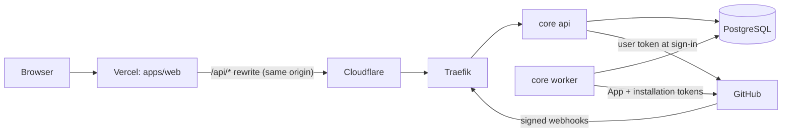

# Gitorgasm

Gitorgasm is a multi-tenant platform to manage GitHub organizations. It replaces GH Org Tool.
It mirrors GitHub App installations and repositories into PostgreSQL, serves them through a typed REST API, and runs GitHub work as durable background jobs.

**Status:** Stage 1 (foundation). The first vertical slice works end to end in local development and in tests. Nothing is deployed yet. See [the roadmap](docs/architecture/implementation-roadmap.md).

## Architecture in one picture



| Part | Path | Technology |
|---|---|---|
| Core backend (api, worker, migrate roles) | `core` | Go, net/http, pgx, River (Postgres job queue), goose |
| Public API contract | `contracts/openapi/v1.yaml` | OpenAPI 3.0, checked against live responses in tests |
| Frontend | `apps/web` | Next.js, TypeScript, TanStack Query, shadcn/ui (Vercel) |
| Kubernetes manifests | `deploy/kustomize` | Kustomize, deployed by the cluster's Argo CD |
| Go vs Rust measurements | `tests/performance/lang-bench` | Go and Rust benchmark harness with recorded results |
| Architecture docs and ADRs | `docs/architecture`, `docs/adr` | |

Go runs the core because the work is bound by network and GitHub rate limits. Rust is reserved for the CPU-bound scoring engine (Stage 5). [rust-vs-go.md](docs/architecture/rust-vs-go.md) gives the measurements and the reasons.

## What the slice does

- Sign-in with a GitHub App (web flow with `state` and PKCE). Opaque server sessions. GitHub tokens are encrypted at rest.
- Tenant access comes only from GitHub's `GET /user/installations` for the signed-in user.
- `GET /v1/organizations` and `GET /v1/organizations/{login}/repositories` (keyset pagination) read the mirror.
- `POST /v1/organizations/{login}/sync` queues a deduplicated sync job.
- `POST /webhooks/github` verifies the HMAC signature, stores the delivery once, and queues processing.
- The worker mirrors repositories. It waits out rate limits, marks removed repositories deleted only after a complete pass, and reconciles every 6 hours.

## Quick start

Requirements: Go 1.27, Docker with Compose, Node.js 22 with pnpm, Rust stable (benchmark code only), `kustomize`.

```bash
make tools      # golangci-lint, kubeconform, govulncheck
make up         # postgres + migrations + API on http://localhost:8080
make smoke      # health, readiness, and an authenticated route (expects 401)
make test       # all tests; Go tests use a fresh database per test
make verify     # everything CI runs
```

GitHub sign-in needs a development GitHub App. Copy `.env.example` to `.env`, fill it in, and run `make up-github`.

## Documentation

- [Contributing](CONTRIBUTING.md) and [agent guide](AGENTS.md)
- [System architecture](docs/architecture/system-architecture.md) and [ADRs](docs/adr/README.md)
- [Security policy](SECURITY.md) and [threat model](docs/architecture/security-threat-model.md)
- [Deployment topology](docs/architecture/deployment-topology.md)

## License

[MIT](LICENSE)
