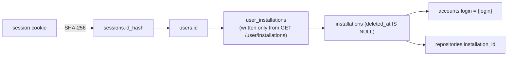

# Authentication and authorization

Status: Stage 1 (Foundation). Code: `core/internal/httpapi/auth.go`, `internal/secure/secure.go`, `internal/store/store.go`.

Labels: **Verified** (file path, command, or official URL), **Assumption**, **Decision**, **Alternative considered**, **Planned**.

## 1. Authentication flow

**Decision** (decisions item 8): GitHub App user-to-server web application flow with `state` and PKCE S256. GitHub supports PKCE and accepts only `S256`. **Verified**: "Must be `S256` - the `plain` code challenge method is not supported." <https://docs.github.com/en/apps/creating-github-apps/authenticating-with-a-github-app/generating-a-user-access-token-for-a-github-app>

```mermaid
sequenceDiagram
  autonumber
  actor B as Browser
  participant V as Vercel (apps/web)<br/>/api/* rewrite
  participant API as core api
  participant GH as github.com / api.github.com
  participant PG as PostgreSQL
  B->>V: GET /api/v1/auth/login
  V->>API: GET /v1/auth/login
  API->>API: state, verifier = 256-bit random<br/>challenge = b64url(SHA-256(verifier))
  API-->>B: 302 to /login/oauth/authorize?client_id&redirect_uri&state&code_challenge&S256&allow_signup=false<br/>Set-Cookie __Host-gitorgasm_oauth=state.verifier (10 min, HttpOnly, Secure, Lax)
  B->>GH: authorize App
  GH-->>B: 302 to callback?code&state
  B->>V: GET /api/v1/auth/callback?code&state (cookie)
  V->>API: forward
  API->>API: clear oauth cookie; constant-time compare state
  API->>GH: POST /login/oauth/access_token (client_id, client_secret, code, redirect_uri, code_verifier)
  GH-->>API: access_token [, refresh_token, expires_in]
  API->>GH: GET /user (user token)
  API->>GH: GET /user/installations (user token, all pages)
  API->>PG: BEGIN
  API->>PG: upsert users; upsert accounts + installations
  API->>PG: replace user_installations with GitHub's list
  API->>PG: insert sessions (SHA-256(id), sealed tokens, expires_at)
  API->>PG: InsertManyTx sync_installation per installation
  API->>PG: audit session.created; COMMIT
  API-->>B: 302 to APP_ORIGIN<br/>Set-Cookie __Host-gitorgasm_session=id (168h, HttpOnly, Secure, Lax, Path=/)
```

**Verified** step by step in `auth.go`: `login`, `callback`, `createSession`. Notes:

- All GitHub calls finish before the transaction opens. A GitHub failure creates no rows.
- The redirect target is the fixed `APP_ORIGIN`. No `returnTo` parameter exists. This removes the legacy open redirect (SEC-5). **Planned** (Stage 2): an allow-listed relative `returnTo` stored in the oauth cookie.
- `allow_signup=false` is sent (`client.AuthorizeURL`).
- Cookie names use the `__Host-` prefix only when `COOKIE_SECURE` is true (default true, `config.go`). Local HTTP development drops the prefix and `Secure`.

## 2. Session model

| Property | Value | Evidence |
|---|---|---|
| Session id | 256-bit random, base64url | `secure.RandomToken` |
| Stored form | `SHA-256(id)` as `sessions.id_hash` | `secure.Hash`, `00001_core.sql` |
| Cookie | `__Host-gitorgasm_session`, HttpOnly, Secure, SameSite=Lax, Path=/ | `setCookie` |
| TTL | `SESSION_TTL`, default 168 h, absolute | `config.go`, `createSession` |
| Activity | `last_seen_at` updated at most once per minute | `store.LookupSession` |
| Transport | cookie only. No bearer header. Never returned in a body. | `authed` |

- A database leak does not reveal usable session ids. Only hashes are stored.
- **Decision**: absolute expiry, no sliding renewal. The user logs in again after 7 days.
- **Planned** (Stage 2): idle timeout (for example 24 h without activity) using `last_seen_at`.
- **Alternative considered**: signed stateless JWT session. Rejected: no server-side revocation, and the webhook revocation path needs to delete sessions.

## 3. Token sealing

**Verified** (`secure.Sealer`, `createSession`):

- AES-256-GCM. Output = `nonce || ciphertext || tag`. Random 96-bit nonce per seal.
- Key = `TOKEN_ENCRYPTION_KEY`, base64, exactly 32 bytes. Startup fails on a wrong length (`NewSealer`). No fallback key exists. This fixes legacy SEC-10.
- Additional data = internal user id as decimal string. A sealed token copied to another user's row fails to open.
- `sessions.key_version` stores `secure.KeyVersion` (1).

Key rotation (**Planned**, Stage 2):

1. Add `TOKEN_ENCRYPTION_KEY_PREVIOUS`. The sealer opens with the key that matches `key_version`.
2. Increment `KeyVersion`. New sessions use the new key.
3. After `SESSION_TTL` (168 h) no row uses the old version. Remove the old key.

Emergency rotation: delete all sessions (`DELETE FROM sessions`). Users log in again. No GitHub token stays usable by Gitorgasm.

## 4. Tenant authorization

**Decision** (decisions item 9): tenant = GitHub installation. A user may access an installation only if GitHub said so.

- `user_installations` is written only by `store.ReplaceUserInstallations` with the list from `GET /user/installations` (user token), at login. The call replaces the full set. Grants that GitHub no longer reports are deleted. **Verified**.
- GitHub lists only installations of this App that the user can access. **Verified**: comment on `client.ListUserInstallations`, operation `apps/list-installations-for-authenticated-user`.
- Installation deletion (webhook or 404 in sync) deletes all grants (`store.MarkInstallationDeleted`). **Verified**.
- Every org-scoped handler calls `resolveOrg` → `store.AccessibleInstallation`, which joins `user_installations` for the session user. Missing grant → 404. **Verified**.
- `GET /v1/auth/install` only redirects to GitHub. No endpoint accepts an installation id from the client. This removes the legacy installation-linking IDOR (SEC-2). **Verified**: no route takes `installation_id` (`server.go`).



### Gaps (Planned, Stage 2)

| Gap | Risk | Plan |
|---|---|---|
| Grants are refreshed only at login. | A user removed from an org keeps read access to the mirror until the session expires (≤ 168 h). | Periodic job: for each active session with a usable token, call `GET /user/installations` and replace grants. Also run on `organization` `member_removed` and `membership` webhooks (Stage 3). |
| No org role check. | Any member with access to the installation can call `POST …/sync`. Impact now: an extra deduplicated sync. | Before any mutation: `GET /user/memberships/orgs/{org}` with the user token (`orgs/get-membership-for-authenticated-user`, "Members" read, UAT). Require `role = admin` and `state = active`. Do not cache the result for mutations. |
| Refresh tokens are stored but never used. | User token expires after 8 h (if expiring tokens are on). Stage 2 re-verification would fail after 8 h. | Refresh with `grant_type=refresh_token` under a row lock (`SELECT … FOR UPDATE` on the session) because refresh tokens are single-use. On `bad_refresh_token`, delete the session. |

## 5. Frontend proxy and cookies

**Decision** (decisions item 7): the Vercel app rewrites `/api/:path*` to `https://api-gitorgasm.upayan.dev/:path*`. **Planned** (Stage 1.5): the rewrite config in `apps/web`. **Verified**: `apps/web` has no rewrite and no API integration yet.

- The browser sees one origin. The session cookie is first-party and host-only for the Vercel host. No CORS headers are needed. **Verified**: the server sends no `Access-Control-*` headers (`server.go`).
- `GITHUB_OAUTH_CALLBACK_URL` must be the Vercel URL. **Verified** production value: `https://gitorgasm.vercel.app/api/v1/auth/callback` (`deploy/kustomize/overlays/production/config.yaml`). Then GitHub redirects the browser to the same origin that holds the oauth cookie. The Ingress routes `/v1` to the API, so the rewritten path `/v1/auth/callback` reaches the handler.
- `APP_ORIGIN` must be the Vercel origin. **Verified** production value: `https://gitorgasm.vercel.app`. The Origin check and the post-login redirect use it.
- **Assumption**: Vercel rewrites forward `Cookie` and `Set-Cookie` headers unchanged and keep the `Origin` header. Verify in Stage 1.5 with a preview deployment.
- No privileged token reaches the browser. The browser holds only the opaque session id in an HttpOnly cookie.

## 6. CSRF

**Verified** (`checkOrigin`, decisions item 10):

- Session cookie `SameSite=Lax`. Browsers do not send it on cross-site `POST` subrequests.
- Every unsafe method (not GET, HEAD, OPTIONS) must send `Origin` equal to `APP_ORIGIN` scheme + host. Else 403 `origin_rejected`.
- `POST /webhooks/github` is exempt. HMAC authenticates it.
- GET handlers do not change state, except `login` (sets an oauth cookie) and `callback` (protected by `state` + PKCE).
- `state` is compared with `crypto/subtle.ConstantTimeCompare`. This fixes legacy SEC-11.

## 7. Logout and revocation

| Trigger | Effect | Evidence |
|---|---|---|
| `POST /v1/auth/logout` | delete the session row, clear the cookie, 204 | `auth.go` `logout` |
| Session expiry | `LookupSession` ignores rows with `expires_at <= now()`. The handler clears the cookie. | `authed` |
| User revokes the App on GitHub | `github_app_authorization` `revoked` webhook calls `store.RevokeGitHubUser`: deletes all sessions and all `user_installations` grants of that GitHub user in one transaction, and audits `session.revoked_by_github` | `jobs.WebhookWorker.apply`, `store.RevokeGitHubUser` |
| Installation deleted | grants deleted, so org routes return 404 | `store.MarkInstallationDeleted` |

- **Verified**: GitHub delivers `github_app_authorization` to every App and the App cannot unsubscribe. <https://docs.github.com/en/webhooks/webhook-events-and-payloads#github_app_authorization>
- **Planned**: logout does not revoke the GitHub user token. Add `DELETE /applications/{client_id}/token` (`apps/delete-token`, verified in the pinned description) at logout, so a stolen sealed token is useless after logout.
- **Planned**: a "sign out everywhere" endpoint that deletes all sessions of the user.
- **Planned**: audit `session.deleted` on logout. Today only `session.created` and `session.revoked_by_github` are audited.
