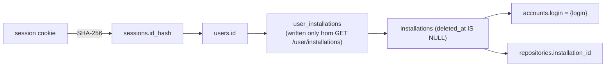

# Authentication and authorization

Status: Stage 1 (Foundation). Code: `core/internal/httpapi/auth/oauth.go`, `internal/secure/secure.go`, `internal/store/identity`, `internal/store/tenancy`.

Labels: **Verified** (file path, command, or official URL), **Assumption**, **Decision**, **Alternative considered**, **Planned**.

## 1. Authentication flow

**Decision** (decisions item 8): GitHub App user-to-server web application flow with `state` and PKCE S256. GitHub supports PKCE and accepts only `S256`. **Verified**: "Must be `S256` - the `plain` code challenge method is not supported." <https://docs.github.com/en/apps/creating-github-apps/authenticating-with-a-github-app/generating-a-user-access-token-for-a-github-app>

```mermaid
sequenceDiagram
  autonumber
  actor B as Browser
  participant V as Vercel (web)<br/>/api/* rewrite
  participant API as core api
  participant GH as github.com / api.github.com
  participant PG as PostgreSQL
  B->>V: GET /api/v1/auth/login
  V->>API: GET /v1/auth/login
  API->>API: state, verifier = 256-bit random<br/>challenge = b64url(SHA-256(verifier))
  API-->>B: 302 to /login/oauth/authorize?client_id&redirect_uri&state&code_challenge&S256&allow_signup=false<br/>Set-Cookie __Host-gitorgasm_oauth=state.verifier (10 min, HttpOnly, Secure, Lax)
  B->>GH: authorize App
  GH-->>B: 302 to callback?code&state
  B->>V: GET /api/v1/auth/callback?code&state (cookie)
  V->>API: forward
  API->>API: clear oauth cookie; constant-time compare state
  API->>GH: POST /login/oauth/access_token (client_id, client_secret, code, redirect_uri, code_verifier)
  GH-->>API: access_token [, refresh_token, expires_in]
  API->>GH: GET /user (user token)
  API->>GH: GET /user/installations (user token, all pages)
  API->>GH: GET /user/memberships/orgs/{org} per organization installation (user token)
  API->>PG: BEGIN
  API->>PG: upsert users; upsert accounts + installations (verified members and owners only)
  API->>PG: replace user_installations with the verified set
  API->>PG: insert sessions (SHA-256(id), sealed tokens, expires_at)
  API->>PG: InsertTx sync_installation per installation
  API->>PG: audit session.created; COMMIT
  API-->>B: 302 to APP_ORIGIN/organizations<br/>Set-Cookie __Host-gitorgasm_session=id (168h, HttpOnly, Secure, Lax, Path=/)
```

**Verified** step by step in `auth.go` (`login`, `callback`) and `sessions.go` (`createSession`). Notes:

- All GitHub calls finish before the transaction opens. A GitHub failure creates no rows.
- The redirect target is the fixed `APP_ORIGIN/organizations`. Incoming `returnTo`, `redirect_uri`, and installation ids never select the destination or grant access. This removes the legacy open redirect (SEC-5).
- `allow_signup=false` is sent (`client.AuthorizeURL`).
- Cookie names use the `__Host-` prefix only when `COOKIE_SECURE` is true (default true, `config.go`). Local HTTP development drops the prefix and `Secure`.

### Installation return and local browser contract

**Decision**: reuse `/api/v1/auth/login` as the GitHub App **Setup URL**. It starts a new OAuth flow whether the browser is signed in, signed out, returning after an installation, or explicitly refreshing grants. No new callback route or installation-linking API is needed.

The browser flow is:

1. Navigate to `GET /api/v1/auth/install` to choose an account and install on GitHub. This redirect writes no grants.
2. GitHub sends the browser to the Setup URL, potentially with `installation_id` and `setup_action`. The login handler ignores these values, creates fresh state and a PKCE verifier, and redirects to GitHub OAuth.
3. GitHub returns to `GET /api/v1/auth/callback?code=…&state=…`. The handler consumes the OAuth cookie, checks state and the nonempty verifier, and rejects authorization denial before any upstream call or database write.
4. A fresh user token supplies `/user` and every page of `/user/installations`. Only after all calls succeed does one transaction replace grants, create the session, enqueue each sync with `InsertTx`, and audit. A failure rolls back the entire transaction; no partial grants or orphan jobs remain.
5. The browser lands on `/organizations`. Use `GET /api/v1/me` for identity and `GET /api/v1/organizations` for the accessible list. Zero organizations is a valid signed-in state; organization approval requests may need approval before a subsequent refresh returns a grant.
6. “Refresh access” navigates to `/api/v1/auth/login` again. `POST /api/v1/auth/logout` with the frontend `Origin` deletes the current session and clears session and pending OAuth cookies; it returns 204, including when already signed out.

**Required configuration for local development** (configuration prerequisites only; these settings are not changed by this implementation):

| Setting | Value |
| --- | --- |
| Frontend address / backend `APP_ORIGIN` | `http://localhost:3000` |
| Frontend `API_ORIGIN` | `http://localhost:8080` |
| Backend `COOKIE_SECURE` | `false` for local HTTP only |
| Backend `GITHUB_OAUTH_CALLBACK_URL` and GitHub App Callback URL | `http://localhost:3000/api/v1/auth/callback` |
| GitHub App Setup URL | `http://localhost:3000/api/v1/auth/login` |
| GitHub App Redirect on update | Enabled, so repository-access updates also refresh grants |
| GitHub App Request user authorization (OAuth) during installation | Disabled, so the Setup URL initiates our state- and PKCE-protected flow |

Configure the existing App id, client id/secret, private key, webhook secret, and slug with the existing `GITHUB_*` settings. A partially configured App is a startup error; with no App configuration the login/install routes return 503 `github_not_configured`. Production uses the same frontend-origin paths with HTTPS and `COOKIE_SECURE=true`. Callback and Setup URL must use the browser's frontend origin, not the direct API origin, because the browser cookie is host-only.

**Verified GitHub facts**: the [Setup URL documentation](https://docs.github.com/en/apps/creating-github-apps/registering-a-github-app/about-the-setup-url) distinguishes Setup URL from Callback URL, describes **Redirect on update**, and warns that `installation_id` is spoofable. The [user access-token flow](https://docs.github.com/en/apps/creating-github-apps/authenticating-with-a-github-app/generating-a-user-access-token-for-a-github-app) documents PKCE S256 and explains that automatic authorization during installation starts a separate OAuth flow; disabling it lets Gitorgasm provide its own `state`, `redirect_uri`, and PKCE. [`GET /user/installations`](https://docs.github.com/en/rest/apps/installations?apiVersion=2022-11-28#list-app-installations-accessible-to-the-user-access-token) is the authorization source (operation `apps/list-installations-for-authenticated-user`).

Callback failures remain non-cacheable JSON `Error` responses with a request id: missing/expired OAuth cookie → 400 `oauth_state_missing`; absent/mismatched state or malformed cookie/verifier → 400 `oauth_state_mismatch`; denial/missing code → 400 `oauth_denied`. GitHub authentication failure → 400 `github_auth_failed`; upstream outage → 502 `github_unavailable`; rate limit → 503 `github_rate_limited`. The browser can restart at `/api/v1/auth/login`; no failure echoes GitHub's description, code, token, or untrusted redirect target.

Regression coverage: `core/internal/httpapi/integration/auth_test.go` covers the PKCE redirect, spoofed installation returns, callback rejection before upstream calls, full paginated grant replacement, upstream failure preservation, late-transaction rollback of grants/sessions/jobs, existing-session grant revocation, and origin-protected idempotent logout. Run `make test-go` for the repository's isolated-database Go suite, or `go test ./internal/httpapi/... ./internal/github/...` from `core/` with `TEST_DATABASE_URL` and `SCORING_BIN` set; the implementation task does not claim these checks were executed.

## 2. Session model

| Property    | Value                                                              | Evidence                        |
| ----------- | ------------------------------------------------------------------ | ------------------------------- |
| Session id  | 256-bit random, base64url                                          | `secure.RandomToken`            |
| Stored form | `SHA-256(id)` as `sessions.id_hash`                                | `secure.Hash`, `00001_core.sql` |
| Cookie      | `__Host-gitorgasm_session`, HttpOnly, Secure, SameSite=Lax, Path=/ | `setCookie`                     |
| TTL         | `SESSION_TTL`, default 168 h, absolute                             | `config.go`, `createSession`    |
| Activity    | `last_seen_at` updated at most once per minute                     | `identity.LookupSession`        |
| Transport   | cookie only. No bearer header. Never returned in a body.           | `auth.Handler.RequireSession`                        |

- A database leak does not reveal usable session ids. Only hashes are stored.
- **Decision**: absolute expiry, no sliding renewal. The user logs in again after 7 days.
- **Planned** (Stage 2): idle timeout (for example 24 h without activity) using `last_seen_at`.
- **Alternative considered**: signed stateless JWT session. Rejected: no server-side revocation, and the webhook revocation path needs to delete sessions.

## 3. Token sealing

**Verified** (`secure.Sealer`, `createSession`):

- AES-256-GCM. Output = `nonce || ciphertext || tag`. Random 96-bit nonce per seal.
- Key = `TOKEN_ENCRYPTION_KEY`, base64, exactly 32 bytes. Startup fails on a wrong length (`NewSealer`). No fallback key exists. This fixes legacy SEC-10.
- Additional data = internal user id as decimal string. A sealed token copied to another user's row fails to open.
- `sessions.key_version` stores `secure.KeyVersion` (1).

Key rotation (**Planned**, Stage 2):

1. Add `TOKEN_ENCRYPTION_KEY_PREVIOUS`. The sealer opens with the key that matches `key_version`.
2. Increment `KeyVersion`. New sessions use the new key.
3. After `SESSION_TTL` (168 h) no row uses the old version. Remove the old key.

Emergency rotation: delete all sessions (`DELETE FROM sessions`). Users log in again. No GitHub token stays usable by Gitorgasm.

## 4. Tenant authorization

**Decision** (decisions item 9): tenant = GitHub installation. A user may access an installation only if GitHub said so.

- `user_installations` is written only by `tenancy.ReplaceUserInstallations`, at login and OAuth refresh, and when a session re-verifies its grants (below). The call replaces the full set. Grants that GitHub no longer confirms are deleted, including when the new set is empty. **Verified**.
- `GET /user/installations` is the candidate list, not the grant. GitHub also lists an installation when the user only collaborates on one of its repositories: "repositories where they are a collaborator" (operation `apps/list-installations-for-authenticated-user`). Gitorgasm mirrors and scores whole installations, so `httpapi/auth/grants.go` `verifiedInstallations` keeps an entry only if the user is entitled to the whole account. **Verified**: <https://docs.github.com/en/rest/apps/installations#list-app-installations-accessible-to-the-user-access-token>.
  - Account type `Organization`: `GET /user/memberships/orgs/{org}` (`orgs/get-membership-for-authenticated-user`, UAT, organization permission "Members" read) must return `state: active` with role `admin` or `member`, for the same organization id and the same user id. GitHub documents 404 when the user is not affiliated, `state` `active` or `pending` otherwise, and 403 when the App is blocked by the organization. Pending and 403 are not grants, and neither is role `billing_manager`. **Verified**: <https://docs.github.com/en/rest/orgs/members#get-an-organization-membership-for-the-authenticated-user> and <https://docs.github.com/en/rest/authentication/permissions-required-for-github-apps>.
  - Account type `User`: granted only when the account id equals the signed-in user's id. A collaborator on someone else's personal repository gets nothing. No membership exists to check.
  - Account type `Enterprise`, or no account: not granted.
  - Any other failure (5xx, rate limit, network) fails the whole login or re-verification; no partial set is stored.
- Re-verification bound. `sessions.grants_verified_at` records when GitHub last confirmed the grants through that session's own sealed user token. `RequireSession` compares it with `GrantMaxAge` (15 minutes, `httpapi/auth/grants.go`) against the database clock. A stale session first repeats the login procedure with its token and replaces the user's grants in one transaction, then serves the request. A user removed from an organization therefore loses access on the first request made more than 15 minutes after the last confirmation. Requests inside that window use the stored grants. The check needs no webhook, so a missed or unsubscribed event cannot extend the bound. **Verified**: `integration/grants_test.go`.
  - Fail closed. If GitHub cannot confirm the grants (5xx, rate limit), the request gets 503 `github_unavailable` or `github_rate_limited` and existing grants are untouched. A user cannot keep access by exhausting their own token's rate limit.
  - A token GitHub rejects (401) deletes the session and returns 401 `github_reauthentication_required`. An expired token, or a token that cannot be unsealed, returns the same 401 without deleting the session.
  - The cost is one `GET /user/installations` call per page, plus one membership call per organization, per session every 15 minutes of activity. It counts against the user's 5,000 requests per hour.
- Installation deletion (webhook or 404 in sync) deletes all grants (`tenancy.MarkInstallationDeleted`). **Verified**.
- Every org-scoped handler calls `access.ResolveOrganization` → `tenancy.AccessibleInstallation`, which joins `user_installations` for the session user. Missing grant → 404. **Verified**.
- `GET /v1/auth/install` only redirects to GitHub. The Setup URL is `/api/v1/auth/login`, not the OAuth callback; any `installation_id` query value is ignored. No endpoint accepts an installation id as authorization. This removes the legacy installation-linking IDOR (SEC-2). **Verified**: `httpapi/auth/oauth.go`, `httpapi/routes.go`.



### Gaps (Planned, Stage 2)

| Gap                                       | Risk                                                                                                       | Plan                                                                                                                                                                                                                                 |
| ----------------------------------------- | ---------------------------------------------------------------------------------------------------------- | ------------------------------------------------------------------------------------------------------------------------------------------------------------------------------------------------------------------------------------ |
| Grants are refreshed only through OAuth. | Fixed. Sessions re-verify every 15 minutes (see above). | `organization` `member_removed` is subscribable (needs "Members" read) and could revoke sooner. It is not used: webhooks are unordered hints and GitHub does not redeliver automatically. The `membership` event is about team membership, not organization membership. |
| Sync remains available to installation members. | Any member with installation access can request a deduplicated sync. | Privileged administration now requires a live active-owner check for submission and every target. It uses the exact session's UAT and verifies installation identity and Members write permission. See [organization administration](organization-administration.md). |
| Refresh tokens are stored but never used. | When expiring user tokens are on, the token expires after 8 h. Re-verification then returns 401 `github_reauthentication_required` and the user signs in again, so a session cannot outlive its token. | Refresh with `grant_type=refresh_token` under a row lock (`SELECT … FOR UPDATE` on the session) because refresh tokens are single-use. On `bad_refresh_token`, delete the session. |
| Installation members can change shared scoring presets. | Any user with a grant, including a non-owner member, can save or delete the organization's presets. | Decision for the owner: gate preset writes on `role = admin` from the membership response. |

## 5. Frontend proxy and cookies

**Decision** (decisions item 7): the frontend rewrites `/api/v1/:path*` to the configured `API_ORIGIN` (`web/next.config.ts`). Browser auth navigation and API fetches use the same frontend origin.

- The browser sees one origin. The session cookie is first-party and host-only for the Vercel host. No CORS headers are needed. **Verified**: the server sends no `Access-Control-*` headers (`server.go`).
- `GITHUB_OAUTH_CALLBACK_URL` must be the Vercel URL. **Verified** production value: `https://gitorgasm.upayan.dev/api/v1/auth/callback` (`deploy/kustomize/overlays/production/config.env`). Then GitHub redirects the browser to the same origin that holds the OAuth cookie. The Ingress routes `/v1` to the API, so the rewritten path `/v1/auth/callback` reaches the handler.
- `APP_ORIGIN` must be the Vercel origin. **Verified** production value: `https://gitorgasm.upayan.dev`. The Origin check and the post-login redirect use it.
- **Assumption**: Vercel rewrites forward `Cookie` and `Set-Cookie` headers unchanged and keep the `Origin` header. Verify in Stage 1.5 with a preview deployment.
- No privileged token reaches the browser. The browser holds only the opaque session id in an HttpOnly cookie.

## 6. CSRF

**Verified** (`security.CheckOrigin`, decisions item 10):

- Session cookie `SameSite=Lax`. Browsers do not send it on cross-site `POST` subrequests.
- Every unsafe method (not GET, HEAD, OPTIONS) must send `Origin` equal to `APP_ORIGIN` scheme + host. Else 403 `origin_rejected`.
- `POST /webhooks/github` is exempt. HMAC authenticates it.
- GET handlers do not change state, except `login` (sets an oauth cookie) and `callback` (protected by `state` + PKCE).
- `state` is compared with `crypto/subtle.ConstantTimeCompare`. This fixes legacy SEC-11.

## 7. Logout and revocation

| Trigger                        | Effect                                                                                                                                                                                                               | Evidence                                             |
| ------------------------------ | -------------------------------------------------------------------------------------------------------------------------------------------------------------------------------------------------------------------- | ---------------------------------------------------- |
| `POST /v1/auth/logout`         | delete the current session row, clear the session and pending OAuth cookies, 204; idempotent and guarded by the frontend Origin | `httpapi/auth/sessions.go` `Logout` |
| Session expiry                 | `LookupSession` ignores rows with `expires_at <= now()`. The handler clears the cookie.                                                                                                                              | `auth.Handler.RequireSession`                                             |
| User revokes the App on GitHub | The `github_app_authorization` `revoked` webhook deletes the user's sessions and installation grants in one transaction. It audits `session.revoked_by_github`. | `internal/jobs/webhook`, `store/identity.RevokeGitHubUser` |
| Installation deleted           | Grants are deleted, so organization routes return 404. | `store/tenancy.MarkInstallationDeleted` |

- **Verified**: GitHub delivers `github_app_authorization` to every App and the App cannot unsubscribe. <https://docs.github.com/en/webhooks/webhook-events-and-payloads#github_app_authorization>
- **Planned**: logout does not revoke the GitHub user token. Add `DELETE /applications/{client_id}/token` (`apps/delete-token`, verified in the pinned description) at logout, so a stolen sealed token is useless after logout.
- **Planned**: a "sign out everywhere" endpoint that deletes all sessions of the user.
- **Planned**: audit `session.deleted` on logout. Today only `session.created` and `session.revoked_by_github` are audited.
