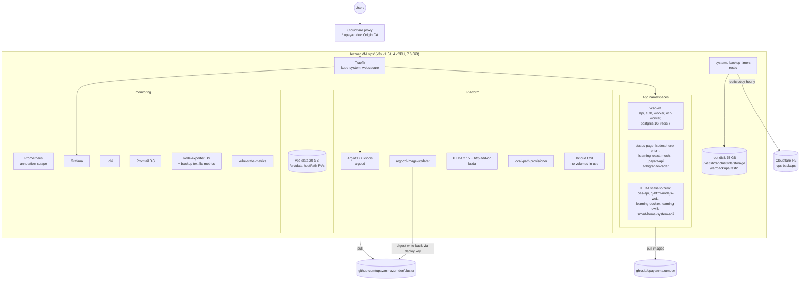

# Cluster audit for Gitorgasm

Audit date: 2026-10-26. Sources: the cluster repository `~/dev/upayanmazumder/cluster` (read-only) and the live cluster through `kubectl --context personal` (read-only commands only).

Labels:

- **Verified**: a file path or a command proves the statement.
- **Assumption**: not proven. Check before you rely on it.
- **Decision**: a choice that this document makes for Gitorgasm.
- **Proposal**: a recommendation for the owner to accept or reject.

## 1. Topology

**Verified** (`kubectl get nodes -o wide`):

- One node, `vps`. Roles `control-plane,etcd`. k3s `v1.34.4+k3s1`. Ubuntu 24.04.5. containerd 2.1.5.
- Public IP `138.201.157.147`. Tailscale IP `100.96.250.81`.
- Age 239 days.

**Verified** (`AGENTS.md`, `k8s/bootstrap/root-app.yaml`): GitOps flow.

1. The `root` Application watches `k8s/argocd/` recursively.
2. `k8s/argocd/projects/*.yaml` define AppProjects (`apps`, `vcap`, platform, tenant projects).
3. `k8s/argocd/applications/{apps,platform,vcap-v1}/*.yaml` hold explicit Applications.
4. `k8s/argocd/applicationsets/apps.yaml` is a **list** generator. It creates one Application per element. The path is `k8s/apps/<name>` and the namespace is `<name>`.

Apps are not auto-discovered. A new folder does nothing until you register it (section 4).

## 2. Capacity headroom

**Verified** (`kubectl describe node vps`, section "Allocated resources"):

| Resource | Allocatable        | Requests     | Free requests | Limits         |
| -------- | ------------------ | ------------ | ------------- | -------------- |
| CPU      | 4000m              | 2880m (72%)  | **1120m**     | 14560m (364%)  |
| Memory   | 7932600Ki = 7746Mi | 6238Mi (80%) | **1508Mi**    | 16558Mi (213%) |
| Pods     | 110                | 47 running   | 63            | n/a            |

**Verified** (`kubectl top node`): actual use is 1564m CPU (39%) and 5335Mi memory (68%). Real free memory is about 2411Mi.

**Verified** (`kubectl top pods -A --sort-by=memory`): the largest consumers are `vcap-v1/vcap-backend-v1-ocr-worker` (415Mi), `monitoring/prometheus` (405Mi), `prism-streaming-rag` (366Mi), `argocd-application-controller` (256Mi), and two `vcap-backend-v1-api` pods (about 195Mi each).

**Verified** (`kubectl get scaledobject -A`): five apps are at 0 replicas (`cas-api`, `dj-html-nodejs-web`, `learning-docker`, `learning-qwik`, `smart-home-system-api`). Their requests are not in the 2880m / 6238Mi totals. When they wake, they consume part of the free headroom. Also `vcap-backend-v1-worker` can scale to 4 and `ocr-worker` to 2 (`redis` triggers).

**Assumption**: the scale-to-zero apps use about 128Mi each when awake (the onboarding template default). If all five wake together, free memory requests fall to about 870Mi.

**Verified** (`docs/storage.md`, measured 2026-10-23): root disk 75 GB, 27 GB free. `/srv/data` 20 GB, 19 GB free.

Memory requests are the binding constraint. CPU is not.

## 3. Reusable infrastructure

| Component     | State                                                                                                                                                                                                       | Evidence                                                                                           |
| ------------- | ----------------------------------------------------------------------------------------------------------------------------------------------------------------------------------------------------------- | -------------------------------------------------------------------------------------------------- |
| Ingress       | Traefik in `kube-system`, `ingressClassName: traefik`, entrypoint `websecure`. TLS is the Cloudflare Origin CA default certificate for `*.upayan.dev`.                                                      | **Verified** `k8s/platform/traefik/`, `k8s/apps/upayan-api/ingress.yaml`, `kubectl get ingress -A` |
| Gateway API   | CRDs installed. No Gateway or HTTPRoute objects.                                                                                                                                                            | **Verified** `kubectl get gateway,httproute -A` returns "No resources found"                       |
| IngressRoute  | One: `kube-system/meghmitra-to-radar-redirect`.                                                                                                                                                             | **Verified** `kubectl get ingressroute -A`                                                         |
| Registry      | `ghcr.io/upayanmazumder/<repo>[/<component>]`.                                                                                                                                                              | **Verified** `k8s/argocd/applicationsets/apps.yaml`                                                |
| Image updates | argocd-image-updater, strategy `digest`, git write-back to `main` with secret `argocd/git-creds-updater` (SSH deploy key).                                                                                  | **Verified** `k8s/argocd/applications/apps/status-page.yaml`                                       |
| Secrets       | SOPS + age, `ksops` generator. Two recipients in `.sops.yaml` (`age-ops` workstation key, `age-cluster` in `argocd/sops-age`). Rule `k8s/.*secrets\.sops\.ya?ml$`, `encrypted_regex: ^(data\|stringData)$`. | **Verified** `.sops.yaml`, `.claude/skills/secrets-tls/SKILL.md`                                   |
| Autoscaling   | KEDA 2.15.1 plus HTTP add-on. ScaledObjects with `redis` and `external-push` triggers.                                                                                                                      | **Verified** `kubectl get scaledobject,httpscaledobject -A`                                        |
| Priority      | `low-priority` (value -1). Only system classes beside it.                                                                                                                                                   | **Verified** `kubectl get priorityclass`                                                           |
| PSA           | `namespace-baseline` component: enforce `baseline`, warn `restricted`.                                                                                                                                      | **Verified** `k8s/components/namespace-baseline/namespace.yaml`                                    |
| NetworkPolicy | 49 policies live. Pattern: default-deny ingress plus allow from Traefik pods in `kube-system`.                                                                                                              | **Verified** `k8s/apps/upayan-api/networkpolicy.yaml`, `kubectl get networkpolicy -A`              |
| Metrics       | Plain Prometheus. Pod discovery by annotation `prometheus.io/scrape: "true"`, `prometheus.io/path`, `prometheus.io/port`. No Prometheus Operator, no ServiceMonitor CRD.                                    | **Verified** `k8s/monitoring/prometheus-configmap.yaml` lines 56-80                                |
| Logs          | Promtail DaemonSet to Loki. Grafana at `grafana.upayan.dev`.                                                                                                                                                | **Verified** `k8s/monitoring/`                                                                     |
| PostgreSQL    | No shared instance. No operator. The only live Postgres is `vcap-v1/vcap-backend-v1-postgres` (`postgres:16`, plain Deployment, owned by vcap).                                                             | **Verified** `kubectl get pods -A` image filter                                                    |
| Redis         | No shared instance. `vcap-v1/vcap-backend-v1-redis` (`redis:7-alpine`) and `argocd-redis` are app-private.                                                                                                  | **Verified** same command                                                                          |
| CloudNativePG | **Not present.** No `postgresql.cnpg.io` CRDs.                                                                                                                                                              | **Verified** `kubectl get crd`                                                                     |
| NATS          | **Not present.** No pods, no CRDs.                                                                                                                                                                          | **Verified** `kubectl get crd`, pod image filter                                                   |
| Valkey        | **Not present.**                                                                                                                                                                                            | **Verified** pod image filter                                                                      |
| DNS           | Cloudflare, manual (click-ops). Terraform manages zone settings and R2 buckets only.                                                                                                                        | **Verified** `terraform/cloudflare.tf` lines 1-7                                                   |

## 4. Onboarding procedure for `gitorgasm`

Source: `.claude/skills/app-onboarding/SKILL.md` and `AGENTS.md`. Corrections from live repo conventions are marked.

**Update (2026-10-26, after the audit)**: the manifests now exist in `deploy/kustomize`. Where they differ from this section, the manifests and `deployment-topology.md` §4 win. Differences: one image `ghcr.io/upayanmazumder/gitorgasm/core` for all roles, PostgreSQL 18 (`postgres:18-alpine`), a namespace manifest with PSA `restricted` enforce instead of the `namespace-baseline` component, and node pinning by `nodeSelector`.

The ApplicationSet template carries exactly one image. **Verified** `k8s/argocd/applicationsets/apps.yaml` comments. **Decision**: use an explicit Application, like `status-page`, so the Application can carry Gitorgasm-specific image-updater annotations and sync options.

1. Create a branch in `upayanmazumder/cluster`. **Verified** `AGENTS.md`: `main` is protected, seven required CI checks. (The skill step 8 says `git push origin main`. That is stale.)
2. Create `k8s/apps/gitorgasm/` with:
   - `kustomization.yaml`: `namespace: gitorgasm`, `components: [../../components/namespace-baseline]`, `generators: [secret-generator.yaml]`, and an `images:` entry per image. (The skill still shows a `namespace.yaml`. Live apps use the component instead. **Verified** `k8s/apps/upayan-api/kustomization.yaml`.)
   - `api/` and `worker/` Deployments and Services. Pin to node `vps` with `requiredDuringSchedulingIgnoredDuringExecution`. Set `priorityClassName` only on non-critical pods. Use `runAsNonRoot`, `readOnlyRootFilesystem`, `drop: ["ALL"]`, seccomp `RuntimeDefault` (copy `k8s/apps/upayan-api/deployment.yaml`).
   - `postgres/` StatefulSet (`postgres:18-alpine`), Service, PVC (see section 6).
   - `ingress.yaml`: annotation `traefik.ingress.kubernetes.io/router.entrypoints: websecure`, `ingressClassName: traefik`, no `tls:` block.
   - `networkpolicy.yaml`: default-deny ingress plus allow Traefik to the API port, plus allow API and worker to Postgres.
   - `secret-generator.yaml` (`kind: ksops`, `files: [./secrets.sops.yaml]`) and `secrets.sops.yaml`.
3. Encrypt secrets: write the Secret manifest to `k8s/apps/gitorgasm/secrets.sops.yaml` and run `sops -e -i` on it. `.sops.yaml` matches the path and encrypts `data`/`stringData` only. Never commit plaintext.
4. Add `k8s/argocd/applications/apps/gitorgasm.yaml`. Copy `status-page.yaml`. Set `project: apps`, path `k8s/apps/gitorgasm`, namespace `gitorgasm`, and annotations:
   - `argocd-image-updater.argoproj.io/image-list: "core=ghcr.io/upayanmazumder/gitorgasm/core:latest"`
   - `core.update-strategy: digest` and `core.kustomize.image-name: ghcr.io/upayanmazumder/gitorgasm/core`
   - `write-back-method: "git:secret:argocd/git-creds-updater"`, `git-branch: main`, `git-repository: git@github.com:upayanmazumder/cluster.git`
   - Add `ignoreDifferences` on `/spec/replicas` only if KEDA scales a Deployment.
5. Add the namespace to `k8s/argocd/projects/apps.yaml` under `destinations`. Without it, sync fails with "namespace gitorgasm is not permitted in project apps".
6. Add a backup target to `ansible/files/backup-targets.yaml` (section 6) and run the Ansible `backup` role.
7. Add Cloudflare DNS manually: `A <host> 138.201.157.147`, proxied. **Verified** skill step 5.
8. Add an entry to `changelog/2026-10.md` (or the current month) in the same commit. **Verified** `AGENTS.md` hard rule 4.
9. Open a PR. After merge, ArgoCD syncs within about 3 minutes.

**Hostname convention** (**Verified** `kubectl get ingress -A`): subdomains of `upayan.dev`, one level deep so the `*.upayan.dev` Origin CA certificate and Cloudflare Universal SSL cover them. API hosts use the `api-<app>.upayan.dev` form (`api-vcap`, `api-status-page`, `api-radar`, `api-cas`). Two older hosts break this (`api.ks.upayan.dev`, `api.react.dj.upayan.dev`). **Proposal**: `api-gitorgasm.upayan.dev` for the backend. The frontend is on Vercel, so it needs no cluster ingress.

## 5. Declared vs live drift

| Item                                                                                                                                         | Declared                               | Live                                                                                                               | Evidence                                                                                                                                                                                                 |
| -------------------------------------------------------------------------------------------------------------------------------------------- | -------------------------------------- | ------------------------------------------------------------------------------------------------------------------ | -------------------------------------------------------------------------------------------------------------------------------------------------------------------------------------------------------- |
| `argocd-image-updater` Application                                                                                                           | Synced                                 | `OutOfSync Healthy`                                                                                                | `kubectl get applications -n argocd`                                                                                                                                                                     |
| `seaweedfs-it` Application                                                                                                                   | in `k8s/argocd/applications/apps/`     | `OutOfSync Missing`                                                                                                | same                                                                                                                                                                                                     |
| Namespaces `bandit`, `bitvault`, `kirro`, `rankstack`, `upayan-v5`, `jwt-key-persist-verify`, `seaweedfs-fixtest-live`, `seaweedfs-fixtest2` | not in `k8s/argocd/projects/apps.yaml` | exist, no PSA labels                                                                                               | `kubectl get ns --show-labels`. Retired workloads keep namespaces and PVCs by design (`docs/storage.md`). The two `seaweedfs-fixtest*` and `jwt-key-persist-verify` look like leftovers. **Assumption**. |
| `upayan-web` namespace                                                                                                                       | not in the `apps` project              | exists with PSA labels                                                                                             | same                                                                                                                                                                                                     |
| `default/smart-home-system-pvc`                                                                                                              | not referenced by any app              | Bound, 1Gi, Retain                                                                                                 | `kubectl get pvc -A`. Orphan of an earlier layout. **Assumption**                                                                                                                                        |
| Onboarding skill                                                                                                                             | `namespace.yaml`, push to `main`       | component and PR flow                                                                                              | section 4                                                                                                                                                                                                |
| Low-priority apps ingress                                                                                                                    | per-app ingress                        | one shared `keda/low-priority-apps` Ingress routes `api-cas`, `html-nodejs-web-dj`, `bots` to the KEDA interceptor | `kubectl get ingress -A`                                                                                                                                                                                 |

## 6. Storage and backups

**Verified** (`kubectl get sc,pv,pvc`, `docs/storage.md`):

- StorageClasses: `local-path` (default, `Delete`, under `/var/lib/rancher/k3s/storage` on the root disk) and `hcloud-volumes` (no PVs). Monitoring uses static `hostpath-retain` PVs.
- Static `hostPath` PVs under `/srv/data` (the separate 20 GB `vps-data` device) use `Retain` and pin to `vps`.

**Verified** (`ansible/roles/backup/`, `ansible/files/backup-targets.yaml`, `docs/backups.md`):

- restic repository `/var/backups/restic` on the root disk. Hourly `restic copy` to R2 bucket `vps-backups`.
- Class A every 30 min, retention `--keep-within 48h --keep-daily 30 --keep-weekly 12 --keep-monthly 12`. Class C daily, `--keep-daily 7`. etcd snapshot every 12 h.
- Weekly `restic check` with 10% data read. Monthly restore drills (class A on the 1st, class C on the 15th). Six Grafana staleness alerts.
- Engines: `postgres` (logical `pg_dump -Fc` inside the live pod, drill imports it), `mongo`, `file`.

**Local-path PVCs are not backed up automatically.** A PVC is in a backup only if someone adds its host path to `backup-targets.yaml`. Covered local-path PVCs: `vcap-v1` data, both `bitvault`, `rankstack`, both `kirro`. Not covered: `smart-home-system-api/smart-home-system-pvc`, `default/smart-home-system-pvc`, `meghmitra-corpus-pvc`. Prometheus and Loki are not backed up (disposable). **Verified**: no match for `pvc-85e5a579` or `pvc-257b4f3c` in `ansible/files/backup-targets.yaml`.

**Decision** for Gitorgasm Postgres: follow the `vcap-v1` pattern.

1. Static `hostPath` PV at `/srv/data/gitorgasm-postgres`, `Retain`, node affinity `vps`. Create the directory with the Ansible `data_volume` role.
2. Backup target with `engine: postgres`, `class: A`, namespace `gitorgasm`, workload name matching the pod name substring.

This gives 30-minute RPO locally and about 1.5 h RPO offsite (**Assumption**: worst case is 30 min class A plus 1 h offsite interval).

## 7. Gaps and risks

- **No HA.** One node holds the control plane, etcd, ingress, and all data. A node or Hetzner host failure stops everything. Recovery follows `docs/disaster-recovery.md`. Gitorgasm must accept downtime during node reboots and k3s upgrades.
- **local-path durability.** Data lives on one disk. The default `Delete` reclaim policy removes data when the PVC is deleted. Use a `Retain` static PV.
- **Backup coverage is opt-in.** A new PVC has no backup until `backup-targets.yaml` lists it.
- **Memory pressure.** 80% of memory is requested. Limits are 213% overcommitted. A spike in `vcap-v1` workers or a wave of KEDA wake-ups can trigger OOM kills or evictions. `low-priority` pods are preempted first.
- **No shared data services.** No CNPG, no shared Redis/Valkey, no NATS. Gitorgasm must bring its own. Each adds memory requests.
- **DNS is click-ops.** Records are not in Terraform. A deleted record is not recoverable from git.
- **Image cache.** Private ghcr images need pull credentials. `docs/backups.md` records past failures where images were missing from the node cache.
- **Secret rotation.** `.claude/skills/secrets-tls/SKILL.md` says older values are unrotated and remain in git history. This does not affect new secrets.

## 8. Resource budget for Gitorgasm backend

**Proposal**. The budget keeps the free memory request headroom above 900Mi after Gitorgasm lands.

| Workload                         | Replicas | CPU request | CPU limit | Memory request | Memory limit | Priority |
| -------------------------------- | -------- | ----------- | --------- | -------------- | ------------ | -------- |
| API                              | 1        | 50m         | 500m      | 128Mi          | 256Mi        | default  |
| Worker (sync, scoring, webhooks) | 1        | 50m         | 500m      | 128Mi          | 256Mi        | default  |
| PostgreSQL 18                    | 1        | 100m        | 1000m     | 256Mi          | 512Mi        | default  |
| **Total**                        |          | **200m**    | 2000m     | **512Mi**      | 1024Mi       |          |

After Gitorgasm: CPU requests 3080m (77%), free 920m. Memory requests 6750Mi (87%), free about 996Mi. Before KEDA apps wake, that is enough. If all five scale-to-zero apps wake, free memory requests fall to about 360Mi (**Assumption** from section 2).

Constraints that go with this budget:

- Postgres: `shared_buffers=64MB`, `work_mem=4MB`, PVC 2Gi on `/srv/data`. Use a pool in the app. **Update**: the manifests set `max_connections=60`, `DB_MAX_CONNS=8` for the api, and `DB_MAX_CONNS=12` for the worker (`deploy/kustomize/base/postgres.yaml`, `base/config.env`, `base/worker.yaml`; budget in `deployment-topology.md` §3).
- No separate Redis or NATS in phase 1. Use Postgres for queues (`SELECT … FOR UPDATE SKIP LOCKED`) and for cache tables. Add Valkey (64Mi request) only if measurements show the need.
- Expose `/metrics` with `prometheus.io/scrape: "true"` and port annotations. No ServiceMonitor.
- If the worker is bursty, scale it with a KEDA `postgresql` trigger, min 1, max 2. Add `ignoreDifferences` for `/spec/replicas`.
- Do not set `low-priority` on Postgres. Preempting the database breaks the API.
- **Proposal** for capacity: if memory requests stay above 85%, reclaim memory before scaling. The best candidates are request right-sizing: `prism-streaming-rag` (512Mi request, 366Mi used) and the `vcap-v1` pod with a 1Gi request (the largest single request). **Assumption**: that pod is the ocr-worker (415Mi used). Confirm with `kubectl get pods -n vcap-v1 -o yaml`.
