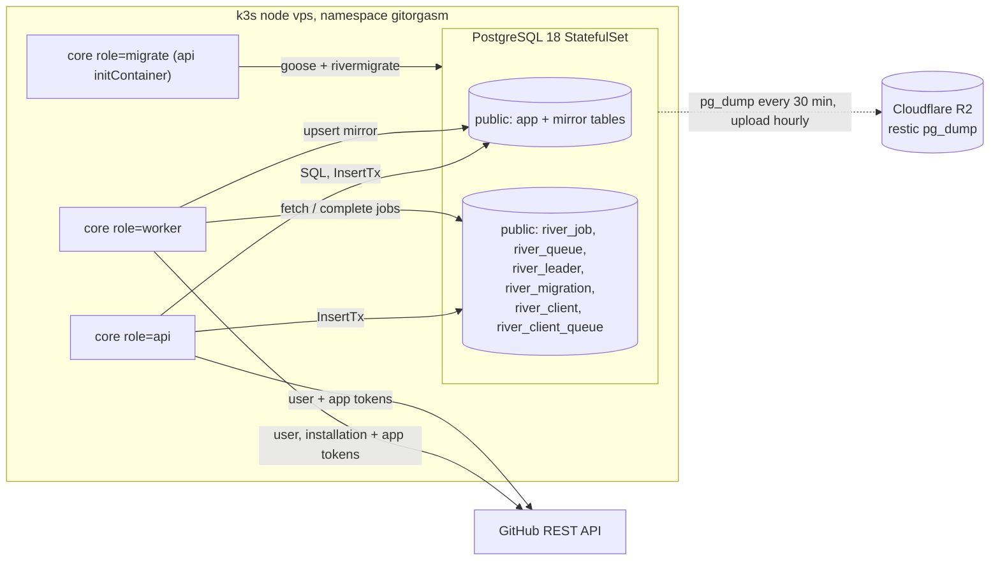

# Data architecture

Status: Stage 1 (Foundation). This document describes the data in `core` and the planned data for later stages.

Labels:

- **Verified**: a file path, a command, or an official URL proves the statement.
- **Assumption**: not proven. Check it before you rely on it.
- **Decision**: a choice for Gitorgasm. Source: integrator decisions (`decisions.md`, items 4, 5, 13, 18).
- **Alternative considered**: an option that we did not choose, with the reason.
- **Planned**: not implemented. A later stage adds it.

## 1. Storage topology

**Decision**: one PostgreSQL 18 instance is the only stateful service. It holds application tables, GitHub mirror tables, sessions, the webhook inbox, the audit trail, and the River job queue. Restic copies logical dumps to Cloudflare R2.

- **Verified**: `core/internal/db/db.go` runs goose migrations first, then `rivermigrate` (`Migrate`). Both take a PostgreSQL advisory lock, so concurrent runs are safe (`lock.NewPostgresSessionLocker`).
- **Verified**: the River table set comes from River's own migrations, not from the goose files in `core/internal/db/migrations/`. The exact River table list depends on the River version in `core/go.mod`. **Assumption**: the names in the diagram match River v0.x. Check with `\dt river_*` after `make up`.
- **Decision**: no Redis, NATS, Temporal, or ClickHouse. Reasons are in `decisions.md` item 4.
- **Alternative considered**: CloudNativePG. Rejected: operator overhead, and the single node gives no real HA.

## 2. Table ownership and classification

Categories:

- **Authoritative**: Gitorgasm is the only source. Loss means data loss.
- **Mirror**: a copy of GitHub data. GitHub stays the source. A full sync rebuilds it.
- **Derived**: computed from other tables. A recompute rebuilds it.
- **Cache / ephemeral**: safe to drop. Users log in again or jobs re-run.

Source: `core/internal/db/migrations/`. `00001_core.sql` is the immutable baseline already recorded as goose version 1 in production; `00002_schema_hardening.sql` adds CHECK constraints, and `00003_concurrent_indexes.sql` replaces the unique login index and adds a retention index. River manages its own tables separately.

| Table                | Class                                    | Writer (code)                                                                     | Reader (code)                                               | Notes                                                                                                   |
| -------------------- | ---------------------------------------- | --------------------------------------------------------------------------------- | ----------------------------------------------------------- | ------------------------------------------------------------------------------------------------------- |
| `users`              | Mirror (GitHub identity) + internal id   | `identity.UpsertUser` at login (`httpapi/auth/oauth.go` `Callback`)                     | `identity.LookupSession`                                    | `id` is internal. `github_id` is unique.                                                                |
| `sessions`           | Authoritative, ephemeral                 | `identity.CreateSession`, `identity.DeleteSession`, `identity.RevokeGitHubUser`   | `identity.LookupSession`                                    | Stores `SHA-256(session id)` and sealed GitHub tokens. Loss = users log in again.                       |
| `accounts`           | Mirror                                   | `tenancy.UpsertInstallation`                                                      | `tenancy.ListOrganizations`, `tenancy.AccessibleInstallation` | Non-unique index `accounts_login_recent_idx` on `(lower(login), updated_at DESC)` (migration 3). GitHub frees a login on rename; another account can take it before the mirror resyncs. `tenancy.AccessibleInstallation` picks the most recently updated account (test `TestReusedLoginResolvesToNewestAccount`). |
| `installations`      | Mirror                                   | `tenancy.UpsertInstallation`, `tenancy.MarkInstallationDeleted`                   | list and access queries                                     | Soft delete with `deleted_at`.                                                                          |
| `user_installations` | Authoritative grant, sourced from GitHub | `tenancy.ReplaceUserInstallations` (login), `tenancy.MarkInstallationDeleted`     | every org-scoped query                                      | The tenant boundary. See section 6.                                                                     |
| `repositories`       | Mirror                                   | `tenancy.UpsertRepositories`, `tenancy.TombstoneUnseenRepositories`               | `tenancy.ListRepositories`, repo count in `tenancy.ListOrganizations` | Tombstoned with `deleted_at`.                                                                           |
| `sync_state`         | Derived (sync metadata)                  | `tenancy.SyncStarted`, `tenancy.SyncFinished`                                     | `tenancy.ListOrganizations` (`last_succeeded_at`)           | Safe to drop. Next sync recreates it.                                                                   |
| `webhook_deliveries` | Authoritative inbox (short-lived)        | `webhooks.InsertWebhookDelivery`, `webhooks.FinishWebhookDelivery`                | `webhooks.GetWebhookDelivery`                               | Raw signed body as `BYTEA`. Dedupe key = `X-GitHub-Delivery`.                                           |
| `audit_events`       | Authoritative, append-only               | `audit.Audit`                                                                     | none yet                                                    | Actions in use: `session.created`, `installation.sync_requested`, `session.revoked_by_github`.          |
| `river_*`            | Authoritative work state                 | River client (`jobs` package, `httpapi`)                                          | River worker                                                | Job kinds: `sync_installation`, `process_webhook`, `reconcile_installations`, `purge_sessions`, `purge_webhook_deliveries` (`internal/jobs/queue`). |
| `administration_operations` | Authoritative | `store/administration`, transactional HTTP enqueue | Original-actor receipt/history queries and River worker | Intent, session hash, idempotency fingerprint, job binding and durable progress. No plaintext token. |
| `administration_targets` | Authoritative | Administration worker | Original-actor receipt query | Ordered target outcomes. Unknown external effects are never replayed automatically. |

The baseline `00001_core.sql` defines the GitHub mirror tables. GitHub stays the source of truth; the later schema-hardening migration does not change that ownership.

**Decision**: the backup class for the whole database is class A (decisions item 4). Mirror tables are in the backup only because one logical dump is simpler than a selective dump.

## 3. Transaction boundaries

Every boundary below is in code. **Verified** by the cited function.

| Use case            | One transaction contains                                                                                                                               | Code                                           |
| ------------------- | ------------------------------------------------------------------------------------------------------------------------------------------------------ | ---------------------------------------------- |
| Login callback      | upsert user, upsert each installation and account, replace grants, create session, `InsertTx` of one `sync_installation` job per installation, audit `session.created` | `httpapi/auth/oauth.go` `Callback` (`pgx.BeginFunc`) |
| Manual sync request | `InsertTx` of `sync_installation`, audit `installation.sync_requested`                                                                                 | `httpapi/organization` `Sync`                |
| Webhook receive     | insert `webhook_deliveries` row, `InsertTx` of `process_webhook`                                                                                       | `httpapi/webhook/deliveries.go` `deliver`                |
| Webhook apply       | event-specific writes, `InsertTx` of follow-up `sync_installation`                                                                                     | `jobs/webhook` `Worker.apply`                  |
| Repository page     | one multi-row `INSERT … ON CONFLICT` per page of 100                                                                                                   | `tenancy.UpsertRepositories`                   |
| Administration request | operation, ordered targets, `InsertTx` of `administer_organization`, job binding, audit | `httpapi/administration.Submit` |

Not in one transaction (**Verified**, `jobs/sync` `Worker.Work`):

- A full sync is many short statements, one per page. A crash between pages leaves some rows with the new `synced_at`. This is safe: tombstoning runs only after every page succeeded (section 7).
- `ReconcileWorker` (`jobs/maintenance`) calls `client.InsertMany` outside a transaction. This is safe: it only reads `installations` and inserts unique jobs.

**Decision**: no GitHub call runs inside an open database transaction. The login callback calls GitHub first and opens the transaction after. This keeps transactions short and avoids holding locks during network I/O.

## 4. Transactional outbox with River

**Verified** (`jobs/jobs.go` package comment): "Package jobs uses River's transactional outbox for durable PostgreSQL-backed work." A job is committed atomically with the data change that caused it.

- A job row exists if and only if its cause committed. No separate outbox table and no relay process exist.
- Dedupe: sync and webhook argument types in `internal/jobs/queue` use `UniqueOpts{ByArgs: true}`. A second insert while a matching job is pending returns `UniqueSkippedAsDuplicate`. `requestSync` returns this as `duplicate: true`.
- Retry policy: `sync_installation` has `MaxAttempts: 8` and a 15-minute timeout. `process_webhook` has `MaxAttempts: 10`. Rate limits snooze the job. 401, 403, and other 4xx cancel it (`internal/jobs/internal/execution`).
- **Alternative considered**: NATS JetStream as an event bus. Rejected: a second stateful system for no current consumer (decisions item 4).

## 5. Retention

`jobs.NewWorkerClient` registers the daily purge jobs `purge_sessions` and `purge_webhook_deliveries` (`core/internal/jobs/jobs.go`, workers in `core/internal/jobs/maintenance`). Each statement deletes at most 10,000 rows (`purgeBatch` in `core/internal/store/maintenance`).

| Data                                          | Growth driver               | Retention                                                                         | Mechanism                                                                                                                                                                                                                              |
| --------------------------------------------- | --------------------------- | --------------------------------------------------------------------------------- | -------------------------------------------------------------------------------------------------------------------------------------------------------------------------------------------------------------------------------------- |
| `sessions`                                    | one row per login           | delete rows with `expires_at < now()`                                             | **Implemented**: periodic River job `purge_sessions` (daily, also on worker start). Index `sessions_expires_at_idx`.                                                                                                                   |
| `webhook_deliveries`                          | one row per delivery        | keep processed rows 14 days. Keep unprocessed rows until they succeed or 30 days. | **Implemented**: periodic job `purge_webhook_deliveries` (daily, also on worker start). Ages count from `received_at`. Index `webhook_deliveries_received_at_idx` (`00003_concurrent_indexes.sql`).                                    |
| `audit_events`                                | one row per security action | keep 400 days                                                                     | **Planned**: periodic job `purge_audit_events` (weekly). **Alternative considered**: monthly partitions with `DROP PARTITION`. Defer until the table exceeds about 10 M rows.                                                          |
| `river_job` (completed, cancelled, discarded) | every job                   | River job cleaner retention                                                       | **Assumption**: River's built-in job cleaner deletes finalized jobs with its default retention. `river.Config` in `jobs.NewWorkerClient` sets no retention values. Verify the defaults for the pinned River version before production. |
| `repositories` tombstones                     | deleted repos               | keep 30 days, then hard delete                                                    | **Planned**: part of `purge_*` maintenance.                                                                                                                                                                                            |

**Decision**: each purge job deletes in batches of at most 10,000 rows per statement and logs the row count. This avoids long locks on the single node.

## 6. Tenant isolation in queries

**Decision**: tenant = GitHub installation. The grant edge is `user_installations` (decisions item 9).

**Verified** (`core/internal/store/tenancy`):

- `ListOrganizations` starts `FROM user_installations ui … WHERE ui.user_id = $1`. It also requires `i.deleted_at IS NULL`.
- `AccessibleInstallation` joins `user_installations ui ON … AND ui.user_id = $1`. A missing grant returns `ErrNotFound`. The handler maps it to HTTP 404 `organization_not_found` (`httpapi/internal/access/organization.go` `ResolveOrganization`).
- `ListRepositories` filters by `installation_id = $1`. The handler passes only an id that `AccessibleInstallation` returned.
- Every statement uses bind parameters (`$1`, `$2`, …). No handler builds SQL. All SQL lives in the domain packages under `core/internal/store`.
- `ReplaceUserInstallations` deletes grants that GitHub no longer reports, in the login transaction.
- `MarkInstallationDeleted` deletes all grants for a removed installation.

Rules for new code (**Decision**):

1. Every org-scoped query takes an installation id that came from `AccessibleInstallation` or joins `user_installations` itself.
2. Workers act on an installation id from a job argument. Workers never act on a user request directly.
3. Code review rejects a new store function that reads tenant data without one of the two patterns above.

**Planned** (Stage 6): PostgreSQL row-level security as a second layer. **Alternative considered**: RLS now. Deferred: one service role, one code path, and the store package already centralizes SQL. RLS adds per-connection `SET` overhead and complexity without a second client.

## 7. Reconciliation

GitHub is the source for mirror tables. Gitorgasm converges on GitHub state through three paths. **Verified** (`jobs/jobs.go` for the periodic schedule, `jobs/webhook`, `jobs/maintenance`):

1. Login: the callback enqueues `sync_installation` for every installation that GitHub lists for the user.
2. Webhooks: `installation`, `installation_repositories`, and `repository` events enqueue `sync_installation`. The handler does not trust payload contents for repository data. It re-reads GitHub.
3. Periodic: `reconcile_installations` runs every `RECONCILE_INTERVAL` (default `6h`, `config.go`) and at worker start (`RunOnStart: true`). It enqueues a sync for every installation that is not deleted and not suspended.

Sync algorithm (`jobs/sync` `Worker.Work`):

- `GET /app/installations/{id}`. A 404 marks the installation deleted and revokes grants.
- Suspended installation: update the row, skip repositories.
- Record `started` in `sync_state`. Upsert each page with `synced_at = started`.
- After every page succeeded: tombstone rows with `synced_at < started`. A failed pass never tombstones.

## 8. Schema migration standards

**Verified**: goose migrations are embedded (`//go:embed migrations/*.sql`) and run by the `migrate` role. River migrations run after them.

**Decision** (rules for all new migrations):

1. File name `NNNNN_<topic>.sql`, sequential. The deployed `00001_core.sql` must not be split, renumbered, or edited; add a new version for each logical schema change.
2. Production is forward-only. A `-- +goose Down` section exists for local development only. Never run `down` against production. Recover with a new forward migration or a restore.
3. Expand and contract for breaking changes:
   - Expand: add nullable column or new table. Deploy code that writes both shapes.
   - Migrate data: a River job backfills in batches.
   - Contract: a later release drops the old column after no code reads it.
4. No long locks: create indexes on populated tables with `CREATE INDEX CONCURRENTLY` in a migration with `-- +goose NO TRANSACTION`. Add `NOT NULL` with a `CHECK … NOT VALID` then `VALIDATE CONSTRAINT`.
5. The `migrate` initContainer on the `api` Deployment applies goose then River migrations before that pod starts. The worker can roll independently, so code must work with schema N and N+1 during a rollout.
6. CI runs migrations on empty PostgreSQL 18 databases. `internal/db/migration_upgrade_test.go` also migrates from deployed version 1 and checks reused logins after upgrade.
7. `00002_schema_hardening.sql` adds `NOT VALID` CHECK storage guards without rewriting the deployed baseline. `00003_concurrent_indexes.sql` uses `-- +goose NO TRANSACTION` and concurrent index operations for an online upgrade. CHECK constraints reject new invalid values; validate existing rows after cleanup.

**Session limits** (`core/internal/db/db.go` and `core/internal/config/config.go`): each connection sets its limits at startup.
`DB_STATEMENT_TIMEOUT` defaults to 15 seconds, `DB_LOCK_TIMEOUT` to five seconds, and `DB_IDLE_IN_TX_TIMEOUT` to 30 seconds.
Migrations disable the statement timeout but retain the lock timeout. Their pool has two connections.
Pool connections have a one-hour maximum lifetime, five-minute jitter, five-minute idle timeout, 30-second health interval, and five-second connect timeout.
The API manifest sets `DB_MAX_CONNS=8`. The worker manifest sets 15 at concurrency four.
The worker requires at least `2 * WORKER_CONCURRENCY + 7` connections.
Administration reserves a lock connection and a separate connection for fresh authorization. Sync jobs use their advisory-lock connection for SQL.
PostgreSQL sets `max_connections=60`, `log_lock_waits=on`, and a five-minute `idle_in_transaction_session_timeout`.
See `deployment-topology.md` §3 for the connection budget. These values describe repository configuration, not a live deployment check.

## 9. Job argument schema evolution

River stores job args as JSON in `river_job.args`. A job inserted by release N may run on release N+1. **Decision**:

1. Add fields only. New fields must have a safe zero value.
2. Never rename or remove a field while jobs of that kind can be pending. Drain or wait for retention first.
3. Never change the meaning of an existing field. Create a new kind (for example `sync_installation_v2`) and keep the old worker until no old rows remain.
4. Unique jobs dedupe by args (`ByArgs: true`). Adding a field changes the unique key. Treat that as a new kind if exact dedupe matters.
5. Job args hold IDs only, never secrets or tokens. Current keys include `installation_id`, `delivery_id`, and administration `operation_id`.

## 10. Planned tables (Stages 3 to 5)

All rows below are **Planned**. Column lists are proposals. Mapping from legacy tables is in `migration-plan.md`.

| Table                                             | Class                      | Key                                                                         | Source                                                                    | Stage |
| ------------------------------------------------- | -------------------------- | --------------------------------------------------------------------------- | ------------------------------------------------------------------------- | ----- |
| `teams`                                           | Mirror                     | `github_id`                                                                 | `GET /orgs/{org}/teams` (`teams/list`)                                    | 3     |
| `team_members`                                    | Mirror                     | `(team_id, user_github_id)`                                                 | `GET /orgs/{org}/teams/{team_slug}/members` (`teams/list-members-in-org`) | 3     |
| `org_members`                                     | Mirror                     | `(installation_id, user_github_id)` with `role`                             | `GET /orgs/{org}/members` (`orgs/list-members`)                           | 3     |
| `org_invitations`                                 | Mirror                     | `github_id`                                                                 | `GET /orgs/{org}/invitations` (`orgs/list-pending-invitations`)           | 3     |
| `scoring_presets` + 7 child tables                | Authoritative              | `(installation_id, name)`                                                   | seed or legacy import                                                     | 5     |
| `signals`                                         | Derived from GitHub events | dedup tuple `(user_id, type, repository_id, event_timestamp, content_hash)` | GraphQL ingest                                                            | 5     |
| `computed_scores`, `leaderboard_materializations` | Derived                    | see `database-audit.md` §7.2                                                | Rust `scoring`                                                            | 5     |
| `legacy_import_map`                               | Authoritative, audit       | `(source_table, legacy_id)`                                                 | preset import                                                             | 5     |

**Decision**: `signals` starts unpartitioned. Revisit partitioning above about 10 M rows (`database-audit.md` §7.2). The Rust scoring service reads `signals` and writes `computed_scores`. It talks to core only through tables and job rows (decisions item 3).
