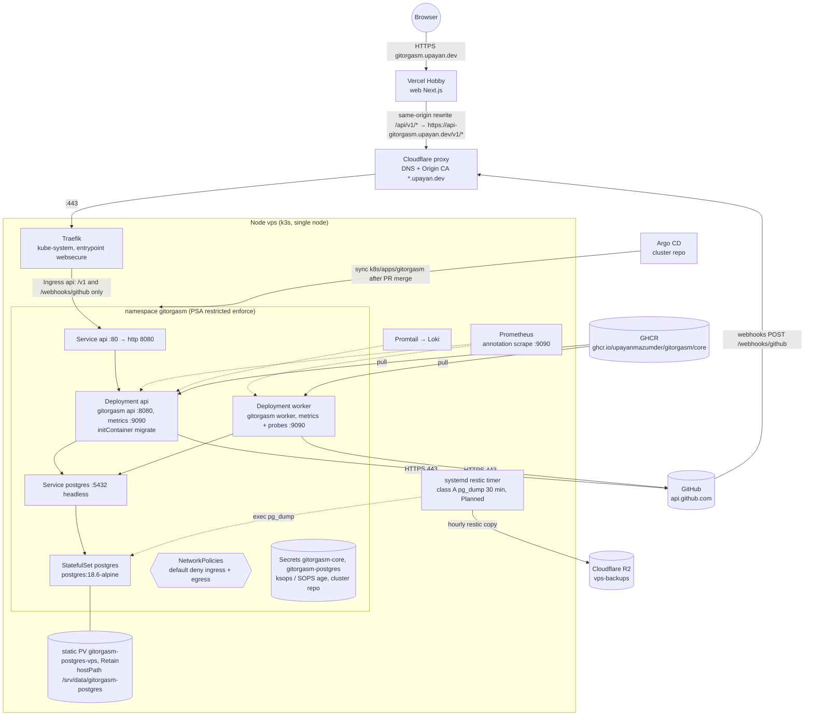

# Deployment topology

Status date: 2026-10-26. Labels: **Verified** (with source), **Assumption**, **Decision**, **Alternative considered**, **Proposal/Planned**.

The manifests live in `deploy/kustomize` (`base/` and `overlays/production/`, see `deploy/kustomize/README.md`). The reusable `.github/workflows/manifests.yml` renders the overlay and validates it with kubeconform (`-strict`, Kubernetes 1.34.0) when deployment files change; locally, run `make manifests`.

The production copy was deployed through `upayanmazumder/cluster#77` to `k8s/apps/gitorgasm/`. The frontend and API hostnames are live according to `implementation-roadmap.md` (Stage 1.5). All subsequent production changes require a cluster-repository PR; this repository's CI has no cluster credentials.

## 1. Target topology

## 2. Workloads

**Verified** in `deploy/kustomize/base/*.yaml` and `overlays/production/*.yaml`. All objects carry the label `app.kubernetes.io/name` (`api`, `worker`, `postgres`) and `app.kubernetes.io/part-of: gitorgasm`.

| Object                                                         | Role                                                                                           | Command              | Ports                       | Probes                                                                                                       |
| -------------------------------------------------------------- | ---------------------------------------------------------------------------------------------- | -------------------- | --------------------------- | ------------------------------------------------------------------------------------------------------------ |
| Deployment `api`                                               | HTTP API, OAuth, webhooks                                                                      | `/gitorgasm api`     | 8080 `http`, 9090 `metrics` | startup `GET /healthz` (2 s × 30), liveness `GET /healthz` (20 s), readiness `GET /readyz` (5 s, 2 failures) |
| initContainer `migrate` on `api`                               | goose + River migrations                                                                       | `/gitorgasm migrate` | none                        | none                                                                                                         |
| Deployment `worker`                                            | River jobs (sync, webhooks, reconcile)                                                         | `/gitorgasm worker`  | 9090 `metrics`              | liveness `GET /healthz :9090` (20 s), readiness `GET /readyz :9090` (10 s)                                   |
| StatefulSet `postgres`                                         | only stateful store                                                                            | `postgres:18.6-alpine` | 5432                        | startup, readiness and liveness `pg_isready -U gitorgasm -d gitorgasm`                         |
| Service `api`                                                  | ClusterIP                                                                                      | n/a                  | 80 → `http`                 | n/a                                                                                                          |
| Service `postgres`                                             | headless                                                                                       | n/a                  | 5432                        | n/a                                                                                                          |
| Ingress `api` (production overlay)                             | host `api-gitorgasm.upayan.dev`, paths `/v1` (Prefix) and `/webhooks/github` (Exact)           | n/a                  | 443 → Service `api` `http`  | n/a                                                                                                          |
| PersistentVolume `gitorgasm-postgres-vps` (production overlay) | 2Gi, `Retain`, hostPath `/srv/data/gitorgasm-postgres` (type `Directory`), node affinity `vps` | n/a                  | n/a                         | n/a                                                                                                          |

**Verified** (code): one image serves all roles (`core/cmd/gitorgasm/main.go`, `core/Dockerfile`, `ENTRYPOINT ["/gitorgasm"]`). The image is distroless static and runs as UID 65532. The worker refuses to start without the `GITHUB_*` configuration. The API starts without it and returns 503 `github_not_configured` on auth, sync, and webhook routes.

**Verified**: the Ingress exposes only `/v1` and `/webhooks/github`. `/healthz`, `/readyz`, and port 9090 are not reachable from the internet. Prometheus scrapes port 9090 directly by pod annotation.

**Verified** (pod hardening): `runAsNonRoot`, fixed UID/GID (65532 for api and worker, 70 for postgres), `readOnlyRootFilesystem: true`, `allowPrivilegeEscalation: false`, `capabilities.drop: [ALL]`, `seccompProfile: RuntimeDefault`, `automountServiceAccountToken: false`, `enableServiceLinks: false` on api and worker. Postgres writes only to its data volume and two `emptyDir` volumes (`/var/run/postgresql`, `/tmp`). The production overlay pins every Deployment and the StatefulSet with `nodeSelector: kubernetes.io/hostname: vps` (`pin-node.yaml`). No pod sets `priorityClassName` (preemption of Postgres breaks the API, `cluster-audit.md` §8).

**Decision** (`base/namespace.yaml`): the namespace enforces Pod Security `restricted`, not only warns. This is stricter than the cluster component `namespace-baseline` (enforce `baseline`, warn `restricted`, `cluster-audit.md` §3). The namespace and the PV carry `argocd.argoproj.io/sync-options: Delete=false,Prune=false`, so a GitOps mistake cannot delete the database.

### NetworkPolicies

**Verified** `deploy/kustomize/base/networkpolicies.yaml`:

| Policy             | Selects         | Allows                                                                                                                                                 |
| ------------------ | --------------- | ------------------------------------------------------------------------------------------------------------------------------------------------------ |
| `default-deny`     | all pods        | nothing (ingress and egress)                                                                                                                           |
| `allow-dns-egress` | all pods        | egress UDP/TCP 53 to pods `k8s-app=kube-dns` in `kube-system`                                                                                          |
| `api-ingress`      | `api`           | ingress TCP 8080 from pods `app.kubernetes.io/name=traefik` in `kube-system`                                                                           |
| `metrics-ingress`  | `api`, `worker` | ingress TCP 9090 from namespace `monitoring`                                                                                                           |
| `core-egress`      | `api`, `worker` | egress TCP 5432 to `postgres`. Egress TCP 443 to `0.0.0.0/0` except `10.0.0.0/8`, `172.16.0.0/12`, `192.168.0.0/16`, `100.64.0.0/10`, `169.254.0.0/16` |
| `postgres-ingress` | `postgres`      | ingress TCP 5432 from `api` (includes the `migrate` initContainer) and `worker`                                                                        |

**Decision**: egress to GitHub uses public IP ranges, not GitHub's published ranges. NetworkPolicy has no FQDN rule, and the GitHub ranges change.

**Assumption**: the k3s Traefik pods carry the label `app.kubernetes.io/name=traefik`. Check with `kubectl -n kube-system get pods --show-labels` before Stage 1.5. If the label differs, the API receives no traffic.

**Assumption**: the restic backup timer runs `pg_dump` through `kubectl exec` inside the postgres pod (`cluster-audit.md` §6, engine `postgres`). Exec does not pass through NetworkPolicy, so no extra rule is needed. Verify during Stage 1.5.

## 3. Resource budget and cluster fit

Source for capacity: `docs/architecture/cluster-audit.md` §2 and §8 (**Verified** on 2026-10-26). Values below are **Verified** in the manifests.

| Workload       | Replicas          | CPU req  | CPU limit | Mem req   | Mem limit | Notes                                                                                              |
| -------------- | ----------------- | -------- | --------- | --------- | --------- | -------------------------------------------------------------------------------------------------- |
| api            | 1                 | 50m      | 500m      | 128Mi     | 256Mi     | `GOMEMLIMIT=200MiB`, `DB_MAX_CONNS=8`                                                              |
| migrate (init) | per api pod start | 20m      | 500m      | 32Mi      | 128Mi     | runs to completion before `api` starts. Lower than app requests, so it adds nothing to the pod sum |
| worker         | 1                 | 50m      | 500m      | 128Mi     | 256Mi     | `GOMEMLIMIT=200MiB`, `DB_MAX_CONNS=12`, `WORKER_CONCURRENCY=4`                                     |
| postgres       | 1                 | 100m     | 1000m     | 256Mi     | 512Mi     | `shared_buffers=64MB`, `max_connections=60`, `work_mem=4MB`, `log_min_duration_statement=500ms`    |
| **Total**      |                   | **200m** | 2000m     | **512Mi** | 1024Mi    |                                                                                                    |

Fit (**Verified** inputs, arithmetic here):

- Free requests before Gitorgasm: 1120m CPU, 1508Mi memory.
- After Gitorgasm: 920m CPU and 996Mi memory free (87% memory requested).
- During a rollout, the surge pod adds 128Mi for a short time.
- If all five KEDA scale-to-zero apps wake, free memory requests fall to about 360Mi (**Assumption** from `cluster-audit.md` §2: 128Mi each).

**Decision**: memory is the binding constraint. Do not add replicas, Redis, or NATS. Reclaim memory from other apps first if requests stay above 85% (`cluster-audit.md` §8 Proposal).

Connection budget (**Verified** values, arithmetic here): the api uses `DB_MAX_CONNS=8` from the generated ConfigMap `gitorgasm-core` (`base/config.env`). The worker overrides it to 12 (`base/worker.yaml`). The worker minimum and default is 2 × `WORKER_CONCURRENCY` + 4 (`config.minWorkerConns`): two queues plus River headroom. The worker refuses to start below it. A sync job runs every statement on its advisory-lock connection, so each job uses one pool connection. In steady state the total is 20. During a rollout with one surge pod of each Deployment it is 2 × (8 + 12) = 40, plus 2 for `migrate` (`main.go` `db.Open(..., 2)`), so 42. This stays below `max_connections=60` and leaves room for `pg_dump` and `psql`. Postgres also sets `log_lock_waits=on` and a server-wide `idle_in_transaction_session_timeout=5min` as a backstop for those sessions. River uses the same pool.

## 4. Cluster repository and change path

The cluster repository is `upayanmazumder/cluster`. Its `k8s/apps/gitorgasm/` directory owns the production copy, the SOPS-encrypted Secrets, and the Argo CD Application. The `deploy/kustomize/overlays/production` tree here is the manifest source to copy into a cluster-repository pull request; it is not a live deployment target.

To change production, update this overlay and run `make manifests`; copy the change to `k8s/apps/gitorgasm/`, pin an immutable image tag (`sha-<full commit SHA>`), and open a cluster-repository pull request. Argo CD syncs only after that PR merges. Do not apply manifests directly or enable an automatic image-updater write-back that bypasses PR review. Node storage, backup settings, AppProject membership, and SOPS Secrets also belong in the cluster repository and need their own reviewed changes.

The initial node setup requires `/srv/data/gitorgasm-postgres` owned by UID/GID 70, Secrets `gitorgasm-core` and `gitorgasm-postgres`, image pull access, and a PostgreSQL backup target; track any missing item in the cluster repository rather than changing the live cluster by hand.

**Decision**: the source of truth for source manifests is `deploy/kustomize` in this repository. CI validates changes under `deploy/` on pull requests.

**Alternative considered**: Argo CD Application pointing at this repository directly. Rejected for now. The cluster repository owns the AppProject, SOPS keys, and deployment reviews.

**Decision**: one image, `ghcr.io/upayanmazumder/gitorgasm/core`, for all roles. `cluster-audit.md` §4 proposed two images (`gitorgasm/api`, `gitorgasm/worker`). The code and `base/kustomization.yaml` (`images: name: gitorgasm-core`) use one image. ADR 0002 records this.

## 5. Environments

| Environment | State                                                                                                                                                        | Where                                                                                                                    |
| ----------- | ------------------------------------------------------------------------------------------------------------------------------------------------------------ | ------------------------------------------------------------------------------------------------------------------------ |
| local       | **Verified**: `compose.yaml` (postgres:18-alpine on 127.0.0.1:55432, migrate, api, worker under profile `github`). `make up`, `make up-github`, `make smoke` | developer machine                                                                                                        |
| CI          | **Verified**: `.github/workflows/core.yml` job `test` runs `go test -race` with a `postgres:18` service container                                            | GitHub Actions                                                                                                           |
| production  | **Verified** manifests in `overlays/production`. **Deployed** 2026-10-26 via `upayanmazumder/cluster` `k8s/apps/gitorgasm`                                   | namespace `gitorgasm` on node `vps`, API host `api-gitorgasm.upayan.dev`, frontend origin `https://gitorgasm.upayan.dev` |
| staging     | **Proposal**, not now                                                                                                                                        | namespace `gitorgasm-staging` on the same node                                                                           |

**Verified** (`overlays/production/config.env`): `APP_ORIGIN=https://gitorgasm.upayan.dev` and `GITHUB_OAUTH_CALLBACK_URL=https://gitorgasm.upayan.dev/api/v1/auth/callback`. The callback goes through the Vercel rewrite, so the OAuth cookie stays on the frontend origin.

Staging cost note: a second copy of the budget costs 200m CPU and 512Mi memory requests. That would leave about 484Mi free (before KEDA wake-ups). **Decision**: no staging until memory is reclaimed elsewhere. CI with a real Postgres service and the local Compose stack cover pre-merge testing. A staging environment also needs a second GitHub App registration (separate webhook URL and callback).

## 6. Image pipeline

**Verified** (`.github/workflows/image.yml`, called from `ci.yml` job `image`):

1. The job runs after job `core` passes. It builds `core/Dockerfile` with buildx when core, contracts, or its workflows change. It does not push on PRs.
2. On a qualifying push to `main`, it logs in to GHCR with `GITHUB_TOKEN` (`packages: write` on the image job) and pushes `ghcr.io/upayanmazumder/gitorgasm/core`. Tags: `sha-<full commit SHA>` and `latest`. `VERSION` build arg = commit SHA (visible in the `app_version` log field). Provenance (`mode=max`) and SBOM are attached.
3. A cluster-repository pull request pins the immutable `sha-<full commit SHA>` tag in `images[].newTag`. Argo CD syncs after merge. Image publishing alone never changes production.

The cluster needs pull access to GHCR. If package visibility changes to private, the cluster repository must supply a SOPS-encrypted image pull secret and reference it in both Deployments before a rollout; otherwise image pulls fail. Risk R20 in `risk-register.md` tracks availability.

## 7. Secrets

**Verified** (`deploy/kustomize/README.md`, `base/api.yaml`, `base/postgres.yaml`): the cluster repository provides two Secrets, encrypted with SOPS and age. They are not in this repository.

| Secret               | Keys                                                                                                                                                                                     | Used by                                                   |
| -------------------- | ---------------------------------------------------------------------------------------------------------------------------------------------------------------------------------------- | --------------------------------------------------------- |
| `gitorgasm-core`     | `DATABASE_URL`, `TOKEN_ENCRYPTION_KEY` (base64, 32 bytes), `GITHUB_APP_ID`, `GITHUB_APP_SLUG`, `GITHUB_CLIENT_ID`, `GITHUB_CLIENT_SECRET`, `GITHUB_PRIVATE_KEY`, `GITHUB_WEBHOOK_SECRET` | api and worker (`envFrom`), migrate (`DATABASE_URL` only) |
| `gitorgasm-postgres` | `POSTGRES_PASSWORD`                                                                                                                                                                      | postgres                                                  |

Non-secret values are generated from `base/config.env` and merged from `overlays/production/config.env` into the hashed ConfigMap `gitorgasm-core`.

Never put secret values in this repository. Compose uses local development values only.

## 8. Migration coordination

**Verified**: the `migrate` role applies goose migrations and then River migrations, and exits (`main.go` `runMigrate`, `internal/db/db.go`). Both take a PostgreSQL advisory lock (`data-architecture.md` §2). It opens a pool of 2 connections.

**Verified** (`base/api.yaml`): `migrate` runs as an initContainer on the `api` Deployment. The api container starts only after migrations succeed. If a migration fails, the new pod stays in `Init:Error`. The old ReplicaSet keeps serving because the rollout uses `maxUnavailable: 0`. The advisory locks make overlapping pods during a rollout safe.

**Alternative considered**: an Argo CD `PreSync` hook Job. Rejected for now. The hook runs on every sync, also when only the worker changes, and failed hook Jobs need manual cleanup. Revisit if migrations become long-running.

**Worker ordering**: the worker does not wait for the migration. Rule for all schema changes: expand → deploy → contract. A migration must stay compatible with the previous binary for one release. Then the worker and api can roll in any order.

## 9. Rollout and rollback

- `api` (**Verified**): `RollingUpdate`, `maxSurge: 1`, `maxUnavailable: 0`, `revisionHistoryLimit: 5`. The startup and readiness probes gate traffic. `terminationGracePeriodSeconds: 35`, including a 5 s `preStop` drain.
- `worker` (**Verified**): no explicit strategy, so the Kubernetes default `RollingUpdate` (25% / 25%) applies. With one replica, the new pod starts before the old pod stops. For a short time two workers run. River claims each job once, and the per-installation advisory lock in `SyncWorker` prevents two passes on one installation. `terminationGracePeriodSeconds: 40`.
- `postgres` (**Verified**): `terminationGracePeriodSeconds: 60` for a clean shutdown.
- Graceful shutdown (**Verified** `main.go` `serve`): on SIGTERM the process stops HTTP servers, then stops River (`client.Stop`) and flushes traces within `SHUTDOWN_TIMEOUT` (`25s` in the ConfigMap). Both grace periods are longer than 25 s.
- Rollback: revert the image tag or manifest change through a cluster-repository pull request. Because of expand/contract, the previous binary must work on the new schema. Never roll back with a down migration in production.

## 10. Autoscaling

**Decision**: no HPA and no KEDA for Gitorgasm now. There is one node and 996Mi free memory requests. A second api or worker replica gives no node-failure protection.

**Proposal** (Stage 6): if job backlog grows, scale the worker with a KEDA `postgresql` trigger on `river_job` available count, min 1, max 2, with `ignoreDifferences` on `/spec/replicas` (`cluster-audit.md` §8).
