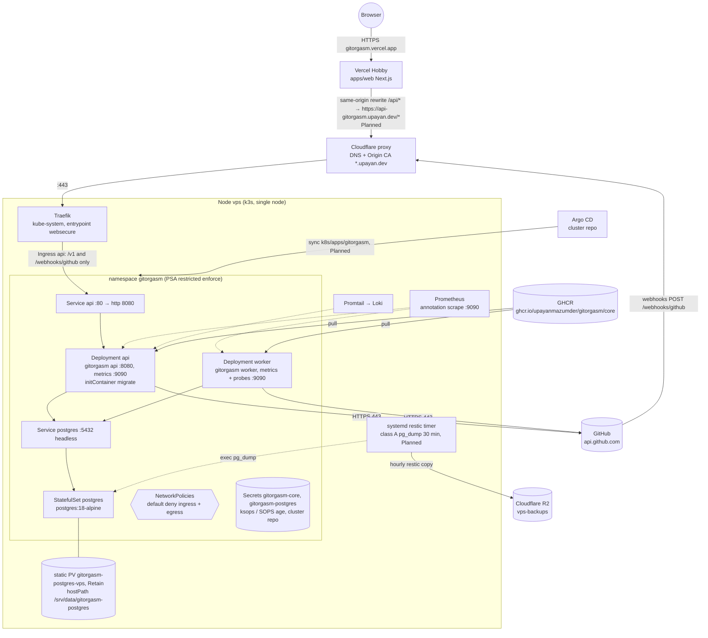

# Deployment topology

Status date: 2026-10-26. Labels: **Verified** (with source), **Assumption**, **Decision**, **Alternative considered**, **Proposal/Planned**.

**Verified**: the manifests exist in `deploy/kustomize` (`base/` and `overlays/production/`, see `deploy/kustomize/README.md`). The integrator rendered the production overlay with kustomize and validated it with kubeconform on 2026-10-26: 15 resources, all valid. The CI job `manifests` in `.github/workflows/ci.yml` runs the same check (`kubeconform -strict`, Kubernetes 1.34.0). Locally, run `make manifests`.

**Verified**: nothing runs in the live cluster yet. The cluster repository has no `k8s/apps/gitorgasm`. The DNS record does not exist. Deployment is Stage 1.5 (**Planned**).

## 1. Target topology

## 2. Workloads

**Verified** in `deploy/kustomize/base/*.yaml` and `overlays/production/*.yaml`. All objects carry the label `app.kubernetes.io/name` (`api`, `worker`, `postgres`) and `app.kubernetes.io/part-of: gitorgasm`.

| Object | Role | Command | Ports | Probes |
| --- | --- | --- | --- | --- |
| Deployment `api` | HTTP API, OAuth, webhooks | `/gitorgasm api` | 8080 `http`, 9090 `metrics` | startup `GET /healthz` (2 s × 30), liveness `GET /healthz` (20 s), readiness `GET /readyz` (5 s, 2 failures) |
| initContainer `migrate` on `api` | goose + River migrations | `/gitorgasm migrate` | none | none |
| Deployment `worker` | River jobs (sync, webhooks, reconcile) | `/gitorgasm worker` | 9090 `metrics` | liveness `GET /healthz :9090` (20 s), readiness `GET /readyz :9090` (10 s) |
| StatefulSet `postgres` | only stateful store | `postgres:18-alpine` | 5432 | readiness and liveness `pg_isready -U gitorgasm -d gitorgasm` |
| Service `api` | ClusterIP | n/a | 80 → `http` | n/a |
| Service `postgres` | headless | n/a | 5432 | n/a |
| Ingress `api` (production overlay) | host `api-gitorgasm.upayan.dev`, paths `/v1` (Prefix) and `/webhooks/github` (Exact) | n/a | 443 → Service `api` `http` | n/a |
| PersistentVolume `gitorgasm-postgres-vps` (production overlay) | 2Gi, `Retain`, hostPath `/srv/data/gitorgasm-postgres` (type `Directory`), node affinity `vps` | n/a | n/a | n/a |

**Verified** (code): one image serves all roles (`services/core/cmd/gitorgasm/main.go`, `services/core/Dockerfile`, `ENTRYPOINT ["/gitorgasm"]`). The image is distroless static and runs as UID 65532. The worker refuses to start without the `GITHUB_*` configuration. The API starts without it and returns 503 `github_not_configured` on auth, sync, and webhook routes.

**Verified**: the Ingress exposes only `/v1` and `/webhooks/github`. `/healthz`, `/readyz`, and port 9090 are not reachable from the internet. Prometheus scrapes port 9090 directly by pod annotation.

**Verified** (pod hardening): `runAsNonRoot`, fixed UID/GID (65532 for api and worker, 70 for postgres), `readOnlyRootFilesystem: true`, `allowPrivilegeEscalation: false`, `capabilities.drop: [ALL]`, `seccompProfile: RuntimeDefault`, `automountServiceAccountToken: false`, `enableServiceLinks: false` on api and worker. Postgres writes only to its data volume and two `emptyDir` volumes (`/var/run/postgresql`, `/tmp`). The production overlay pins every Deployment and the StatefulSet with `nodeSelector: kubernetes.io/hostname: vps` (`pin-node.yaml`). No pod sets `priorityClassName` (preemption of Postgres breaks the API, `cluster-audit.md` §8).

**Decision** (`base/namespace.yaml`): the namespace enforces Pod Security `restricted`, not only warns. This is stricter than the cluster component `namespace-baseline` (enforce `baseline`, warn `restricted`, `cluster-audit.md` §3). The namespace and the PV carry `argocd.argoproj.io/sync-options: Delete=false,Prune=false`, so a GitOps mistake cannot delete the database.

### NetworkPolicies

**Verified** `deploy/kustomize/base/networkpolicies.yaml`:

| Policy | Selects | Allows |
| --- | --- | --- |
| `default-deny` | all pods | nothing (ingress and egress) |
| `allow-dns-egress` | all pods | egress UDP/TCP 53 to pods `k8s-app=kube-dns` in `kube-system` |
| `api-ingress` | `api` | ingress TCP 8080 from pods `app.kubernetes.io/name=traefik` in `kube-system` |
| `metrics-ingress` | `api`, `worker` | ingress TCP 9090 from namespace `monitoring` |
| `core-egress` | `api`, `worker` | egress TCP 5432 to `postgres`. Egress TCP 443 to `0.0.0.0/0` except `10.0.0.0/8`, `172.16.0.0/12`, `192.168.0.0/16`, `100.64.0.0/10`, `169.254.0.0/16` |
| `postgres-ingress` | `postgres` | ingress TCP 5432 from `api` (includes the `migrate` initContainer) and `worker` |

**Decision**: egress to GitHub uses public IP ranges, not GitHub's published ranges. NetworkPolicy has no FQDN rule, and the GitHub ranges change.

**Assumption**: the k3s Traefik pods carry the label `app.kubernetes.io/name=traefik`. Check with `kubectl -n kube-system get pods --show-labels` before Stage 1.5. If the label differs, the API receives no traffic.

**Assumption**: the restic backup timer runs `pg_dump` through `kubectl exec` inside the postgres pod (`cluster-audit.md` §6, engine `postgres`). Exec does not pass through NetworkPolicy, so no extra rule is needed. Verify during Stage 1.5.

## 3. Resource budget and cluster fit

Source for capacity: `docs/architecture/cluster-audit.md` §2 and §8 (**Verified** on 2026-10-26). Values below are **Verified** in the manifests.

| Workload | Replicas | CPU req | CPU limit | Mem req | Mem limit | Notes |
| --- | --- | --- | --- | --- | --- | --- |
| api | 1 | 50m | 500m | 128Mi | 256Mi | `GOMEMLIMIT=200MiB`, `DB_MAX_CONNS=8` |
| migrate (init) | per api pod start | 20m | 500m | 32Mi | 128Mi | runs to completion before `api` starts. Lower than app requests, so it adds nothing to the pod sum |
| worker | 1 | 50m | 500m | 128Mi | 256Mi | `GOMEMLIMIT=200MiB`, `DB_MAX_CONNS=8`, `WORKER_CONCURRENCY=4` |
| postgres | 1 | 100m | 1000m | 256Mi | 512Mi | `shared_buffers=64MB`, `max_connections=40`, `work_mem=4MB`, `log_min_duration_statement=500ms` |
| **Total** | | **200m** | 2000m | **512Mi** | 1024Mi | |

Fit (**Verified** inputs, arithmetic here):

- Free requests before Gitorgasm: 1120m CPU, 1508Mi memory.
- After Gitorgasm: 920m CPU and 996Mi memory free (87% memory requested).
- During a rollout, the surge pod adds 128Mi for a short time.
- If all five KEDA scale-to-zero apps wake, free memory requests fall to about 360Mi (**Assumption** from `cluster-audit.md` §2: 128Mi each).

**Decision**: memory is the binding constraint. Do not add replicas, Redis, or NATS. Reclaim memory from other apps first if requests stay above 85% (`cluster-audit.md` §8 Proposal).

Connection budget (**Verified** values, arithmetic here): `DB_MAX_CONNS=8` comes from the shared ConfigMap `gitorgasm-core`, so api and worker each open up to 8. In steady state that is 16. During a rollout with one surge pod of each Deployment it is 32, plus 2 for `migrate` (`main.go` `db.Open(..., 2)`), so 34. This stays below `max_connections=40` and leaves a little room for `pg_dump` and `psql`. River uses the same pool.

## 4. Onboarding into the cluster repository (Planned, Stage 1.5)

Source: `cluster-audit.md` §4 (**Verified** cluster conventions) and `deploy/kustomize/README.md`. The cluster repository is `upayanmazumder/cluster`. Its `main` branch is protected and needs a PR with seven passing checks.

1. Create the host directory with the Ansible `data_volume` role or by hand: `install -d -o 70 -g 70 -m 700 /srv/data/gitorgasm-postgres` (**Verified** comment in `overlays/production/persistentvolume.yaml`).
2. Create a branch in the cluster repository.
3. Copy the production overlay (with its base) into `k8s/apps/gitorgasm/`. Keep `base/namespace.yaml` (PSA `restricted`). Do not add the `namespace-baseline` component, because it would set a weaker enforce level on the same namespace. Add a ksops generator.
4. Write `secrets.sops.yaml` with the Secrets `gitorgasm-core` and `gitorgasm-postgres` (section 7). Encrypt with `sops -e -i`. The `.sops.yaml` rule `k8s/.*secrets\.sops\.ya?ml$` encrypts `data` and `stringData`.
5. Give the cluster read access to the image (section 6, owner decision).
6. Add `k8s/argocd/applications/apps/gitorgasm.yaml` (copy `status-page.yaml`): `project: apps`, path `k8s/apps/gitorgasm`, image-updater annotations for one alias `core` (section 6).
7. Add `gitorgasm` to `destinations` in `k8s/argocd/projects/apps.yaml`.
8. Add a class A `engine: postgres` target to `ansible/files/backup-targets.yaml`. Run the Ansible `backup` role.
9. **Approval gate**: ask the owner to create DNS `A api-gitorgasm 138.201.157.147`, proxied, in Cloudflare. DNS is click-ops (`terraform/cloudflare.tf` manages zone settings only). Do not create the record without explicit approval.
10. Add an entry to `changelog/2026-10.md` (or the current month) in the same commit.
11. Open the PR. After merge, Argo CD syncs within about 3 minutes.

**Decision**: the source of truth for manifests is `deploy/kustomize` in this repository. CI validates it on every PR.

**Alternative considered**: Argo CD Application pointing at this repository directly. Rejected for now. The cluster repository owns the AppProject, SOPS keys, and image-updater write-back. One GitOps repository keeps one review path.

**Decision**: one image, `ghcr.io/upayanmazumder/gitorgasm/core`, for all roles. `cluster-audit.md` §4 proposed two images (`gitorgasm/api`, `gitorgasm/worker`). The code and `base/kustomization.yaml` (`images: name: gitorgasm-core`) use one image. ADR 0002 records this.

## 5. Environments

| Environment | State | Where |
| --- | --- | --- |
| local | **Verified**: `compose.yaml` (postgres:18-alpine on 127.0.0.1:55432, migrate, api, worker under profile `github`). `make up`, `make up-github`, `make smoke` | developer machine |
| CI | **Verified**: `.github/workflows/ci.yml` job `core` runs `go test -race` with a `postgres:18` service container | GitHub Actions |
| production | **Verified** manifests in `overlays/production`. Deploy **Planned** Stage 1.5 | namespace `gitorgasm` on node `vps`, API host `api-gitorgasm.upayan.dev`, frontend origin `https://gitorgasm.vercel.app` |
| staging | **Proposal**, not now | namespace `gitorgasm-staging` on the same node |

**Verified** (`overlays/production/config.yaml`): `APP_ORIGIN=https://gitorgasm.vercel.app` and `GITHUB_OAUTH_CALLBACK_URL=https://gitorgasm.vercel.app/api/v1/auth/callback`. The callback goes through the Vercel rewrite, so the oauth cookie stays on the frontend origin.

Staging cost note: a second copy of the budget costs 200m CPU and 512Mi memory requests. That would leave about 484Mi free (before KEDA wake-ups). **Decision**: no staging until memory is reclaimed elsewhere. CI with a real Postgres service and the local Compose stack cover pre-merge testing. A staging environment also needs a second GitHub App registration (separate webhook URL and callback).

## 6. Image pipeline

**Verified** (`.github/workflows/ci.yml`, job `image`):

1. The job runs after job `core` passes. It builds `services/core/Dockerfile` with buildx on every PR and push. It does not push on PRs.
2. On a push to `main`, it logs in to GHCR with `GITHUB_TOKEN` (`packages: write` on this job only) and pushes `ghcr.io/upayanmazumder/gitorgasm/core`. Tags: the full commit SHA and `latest`. `VERSION` build arg = commit SHA (embedded via `-X main.version`, visible in the `app_version` log field). Provenance (`mode=max`) and SBOM are attached.

**Planned** (Stage 1.5):

3. argocd-image-updater watches alias `core` with `update-strategy: digest` and writes the new digest back to the cluster repository `main` through `git:secret:argocd/git-creds-updater` (**Verified** pattern in `k8s/argocd/applications/apps/status-page.yaml`, `cluster-audit.md` §3).
4. Argo CD syncs the digest change. The `api` and `worker` Deployments roll.

**Owner decision required (open)**: the repository is private, so the GHCR package is private by default. The cluster cannot pull it as it is. Choose one:

- Make the package public. The image contains no secrets. This is the simplest option and avoids the image cache failures recorded in `cluster-audit.md` §7.
- Keep it private and add an image pull secret (`dockerconfigjson`, SOPS-encrypted) to namespace `gitorgasm`, referenced by `imagePullSecrets` in both Deployments. argocd-image-updater then also needs registry credentials to read digests.

Risk R20 in `risk-register.md` tracks this decision.

## 7. Secrets

**Verified** (`deploy/kustomize/README.md`, `base/api.yaml`, `base/postgres.yaml`): the cluster repository provides two Secrets, encrypted with SOPS and age. They are not in this repository.

| Secret | Keys | Used by |
| --- | --- | --- |
| `gitorgasm-core` | `DATABASE_URL`, `TOKEN_ENCRYPTION_KEY` (base64, 32 bytes), `GITHUB_APP_ID`, `GITHUB_APP_SLUG`, `GITHUB_CLIENT_ID`, `GITHUB_CLIENT_SECRET`, `GITHUB_PRIVATE_KEY`, `GITHUB_WEBHOOK_SECRET` | api and worker (`envFrom`), migrate (`DATABASE_URL` only) |
| `gitorgasm-postgres` | `POSTGRES_PASSWORD` | postgres |

Non-secret values are in the ConfigMap `gitorgasm-core` (`base/config.yaml`, production overrides in `overlays/production/config.yaml`).

Never put secret values in this repository. Compose uses local development values only.

## 8. Migration coordination

**Verified**: the `migrate` role applies goose migrations and then River migrations, and exits (`main.go` `runMigrate`, `internal/db/db.go`). Both take a PostgreSQL advisory lock (`data-architecture.md` §2). It opens a pool of 2 connections.

**Verified** (`base/api.yaml`): `migrate` runs as an initContainer on the `api` Deployment. The api container starts only after migrations succeed. If a migration fails, the new pod stays in `Init:Error`. The old ReplicaSet keeps serving because the rollout uses `maxUnavailable: 0`. The advisory locks make overlapping pods during a rollout safe.

**Alternative considered**: an Argo CD `PreSync` hook Job. Rejected for now. The hook runs on every sync, also when only the worker changes, and failed hook Jobs need manual cleanup. Revisit if migrations become long-running.

**Worker ordering**: the worker does not wait for the migration. Rule for all schema changes: expand → deploy → contract. A migration must stay compatible with the previous binary for one release. Then the worker and api can roll in any order.

## 9. Rollout and rollback

- `api` (**Verified**): `RollingUpdate`, `maxSurge: 1`, `maxUnavailable: 0`, `revisionHistoryLimit: 5`. The startup and readiness probes gate traffic. `terminationGracePeriodSeconds: 30`.
- `worker` (**Verified**): no explicit strategy, so the Kubernetes default `RollingUpdate` (25% / 25%) applies. With one replica, the new pod starts before the old pod stops. For a short time two workers run. River claims each job once, and the per-installation advisory lock in `SyncWorker` prevents two passes on one installation. `terminationGracePeriodSeconds: 40`.
- `postgres` (**Verified**): `terminationGracePeriodSeconds: 60` for a clean shutdown.
- Graceful shutdown (**Verified** `main.go` `serve`): on SIGTERM the process stops HTTP servers, then stops River (`client.Stop`) and flushes traces within `SHUTDOWN_TIMEOUT` (`25s` in the ConfigMap). Both grace periods are longer than 25 s.
- Rollback: revert the digest commit in the cluster repository (or `argocd app rollback`). Because of expand/contract, the previous binary works on the new schema. Never roll back with a down migration in production.

## 10. Autoscaling

**Decision**: no HPA and no KEDA for Gitorgasm now. There is one node and 996Mi free memory requests. A second api or worker replica gives no node-failure protection.

**Proposal** (Stage 6): if job backlog grows, scale the worker with a KEDA `postgresql` trigger on `river_job` available count, min 1, max 2, with `ignoreDifferences` on `/spec/replicas` (`cluster-audit.md` §8).
