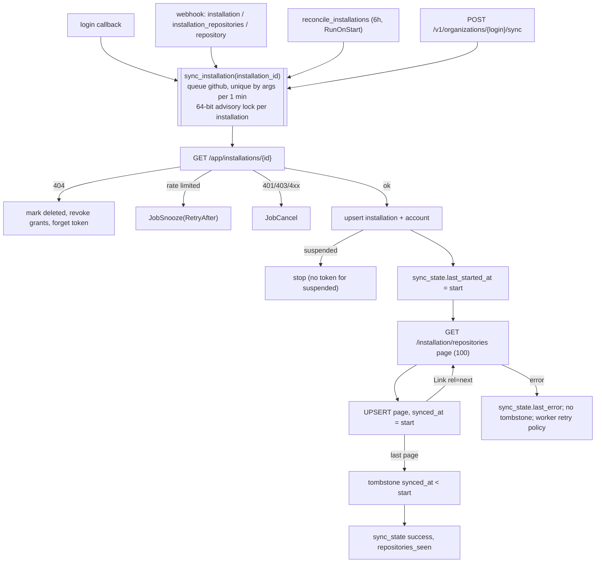

# GitHub integration

Status: Stage 1 (Foundation). This document describes how `core` talks to GitHub now and the design for later stages.

Labels: **Verified** (file path, command, or official URL), **Assumption**, **Decision**, **Alternative considered**, **Planned**.

Pinned API description: `github/rest-api-description` release v2.1.0, file `descriptions/api.github.com/api.github.com.json` (OpenAPI `info.version` 1.1.4). Local copy: `/tmp/gh-rest.json`. Every endpoint and `operationId` below was checked with `jq '.paths["<path>"]'` against that file. **Verified**.

## 1. Identity model

**Decision**: Gitorgasm is a GitHub App. It uses three credentials.

| Credential                | How it is made                                                                            | Lifetime                                                                     | Used for                                                         | Code                              |
| ------------------------- | ----------------------------------------------------------------------------------------- | ---------------------------------------------------------------------------- | ---------------------------------------------------------------- | --------------------------------- |
| App JWT (RS256)           | signed with `GITHUB_PRIVATE_KEY`, `iss` = App id, `iat` = now − 60 s, `exp` = now + 9 min | 9 minutes                                                                    | `apps/get-installation`, `apps/create-installation-access-token` | `github.Client.appJWT`            |
| Installation access token | `POST /app/installations/{id}/access_tokens`                                              | 1 hour. Cache refreshes 5 min before expiry.                                 | `GET /installation/repositories`                                 | `github.Client.installationToken` |
| User access token         | web application flow with `state` + PKCE S256                                             | 8 hours when expiring tokens are on. Refresh token 6 months. Else no expiry. | `GET /user`, `GET /user/installations`                           | `github.Client.ExchangeCode`      |

- **Verified** (JWT): "set this 60 seconds in the past" and "no more than 10 minutes into the future". <https://docs.github.com/en/apps/creating-github-apps/authenticating-with-a-github-app/generating-a-json-web-token-jwt-for-a-github-app>
- **Verified** (installation token): "The installation access token will expire after 1 hour." <https://docs.github.com/en/apps/creating-github-apps/authenticating-with-a-github-app/generating-an-installation-access-token-for-a-github-app>
- **Verified** (user token): "By default, the user access token expires after 8 hours." `refresh_token_expires_in` is "always `15897600` (6 months)". Expiring tokens are an optional App feature. <https://docs.github.com/en/apps/creating-github-apps/authenticating-with-a-github-app/generating-a-user-access-token-for-a-github-app>
- **Verified**: the installation token cache is in process memory (`map[int64]installationToken` in `client.go`). It is not shared between worker replicas. Each replica mints its own tokens. This is acceptable at one worker replica.
- **Verified**: the slice does not use the user token after login. The sealed token and refresh token are stored in `sessions` for Stage 2 (`httpapi/auth.go` `createSession`). Refresh is **Planned** (Stage 2).

### Installation and grant-refresh browser entry points

Configure the GitHub App **Setup URL** to the frontend `/api/v1/auth/login`, enable **Redirect on update**, and disable **Request user authorization (OAuth) during installation**. The backend `GITHUB_OAUTH_CALLBACK_URL` and GitHub App Callback URL remain the frontend `/api/v1/auth/callback`. Local values are `http://localhost:3000/api/v1/auth/login` and `http://localhost:3000/api/v1/auth/callback`; use HTTPS in production.

The install entry `/api/v1/auth/install` redirects to GitHub. Its return starts a fresh browser-bound OAuth state and PKCE exchange through the Setup URL. The same `/api/v1/auth/login` supports manual grant refresh. The callback ignores any supplied `installation_id`; it replaces grants exclusively from all pages of `GET /user/installations` using the fresh user token and redirects to the fixed `/organizations` UI. Grant changes, session creation, audit, and `InsertTx` sync jobs share one transaction.

**Verified**: GitHub's [Setup URL documentation](https://docs.github.com/en/apps/creating-github-apps/registering-a-github-app/about-the-setup-url) warns that installation ids in setup returns can be spoofed and requires checking the user's installations instead. Its [user access-token documentation](https://docs.github.com/en/apps/creating-github-apps/authenticating-with-a-github-app/generating-a-user-access-token-for-a-github-app) describes the separate automatic installation authorization flow; Gitorgasm initiates its own flow to supply state and PKCE. Full local settings and browser/error behavior are in [Authentication and authorization](authentication-authorization.md#installation-return-and-local-browser-contract).


## 2. Endpoints in use

**Verified**: all requests send `Accept: application/vnd.github+json`, `X-GitHub-Api-Version: 2022-11-28`, and `User-Agent: gitorgasm` (`client.go` `do`).

| Method and path                                           | operationId                                      | Credential                           | Pagination             | Caller              |
| --------------------------------------------------------- | ------------------------------------------------ | ------------------------------------ | ---------------------- | ------------------- |
| `GET /app/installations/{installation_id}`                | `apps/get-installation`                          | App JWT                              | none                   | `SyncWorker.Work`   |
| `POST /app/installations/{installation_id}/access_tokens` | `apps/create-installation-access-token`          | App JWT                              | none                   | `installationToken` |
| `GET /installation/repositories`                          | `apps/list-repos-accessible-to-installation`     | installation                         | `Link`, `per_page=100` | `SyncWorker.Work`   |
| `GET /user`                                               | `users/get-authenticated`                        | user                                 | none                   | login `callback`    |
| `GET /user/installations`                                 | `apps/list-installations-for-authenticated-user` | user                                 | `Link`, `per_page=100` | login `callback`    |
| `POST https://github.com/login/oauth/access_token`        | not in REST description (OAuth endpoint)         | client id + secret + `code_verifier` | none                   | login `callback`    |
| `GET https://github.com/login/oauth/authorize`            | browser redirect                                 | none                                 | none                   | `login`             |

- **Verified**: `per_page` max is 100 (`components.parameters.per-page`: "The number of results per page (max 100)").
- **Verified**: OAuth errors return HTTP 200 with an `error` field. `ExchangeCode` maps that to `KindInvalid`.

## 3. Required App permissions

**Verified** against <https://docs.github.com/en/rest/authentication/permissions-required-for-github-apps>.

| Stage     | Permission                                       | Access | Why                                                                                                                                                                                                                                                    |
| --------- | ------------------------------------------------ | ------ | ------------------------------------------------------------------------------------------------------------------------------------------------------------------------------------------------------------------------------------------------------ |
| 1 (slice) | Repository "Metadata"                            | read   | Mandatory for every App. Required to subscribe to the `repository` event: "a GitHub App must have at least read-level access for the "Metadata" repository permission" (<https://docs.github.com/en/webhooks/webhook-events-and-payloads#repository>). |
| 2         | Organization "Members"                           | read   | `GET /user/memberships/orgs/{org}` (`orgs/get-membership-for-authenticated-user`) is listed under "Members" read, token type UAT only. Needed for admin role checks.                                                                                   |
| 3         | Organization "Members"                           | read   | `GET /orgs/{org}/members`, `GET /orgs/{org}/invitations`, `GET /orgs/{org}/teams/{team_slug}/members` (all "Members" read, UAT and IAT). Also required to subscribe to `organization`, `member`, `membership`, `team` events.                          |
| 4         | Organization "Members"                           | write  | `POST /orgs/{org}/invitations`, `PUT /orgs/{org}/memberships/{username}`, `PUT /orgs/{org}/teams/{team_slug}/memberships/{username}` (all "Members" write, UAT and IAT).                                                                               |
| 5         | Repository "Contents", "Issues", "Pull requests" | read   | Current contribution ingest reads commits, pull requests and reviews, and issue events through the REST API. See [ADR 0004](../adr/0004-daily-organization-scoring.md). |

`GET /installation/repositories`, `GET /user`, and `GET /user/installations` do not appear under any permission heading on the permissions page. **Verified** by search of the page. **Assumption**: they need no extra permission beyond the token type.

**Decision**: request the smallest set per stage. Adding a permission makes every org owner approve it again (`installation` event action `new_permissions_accepted`). Plan Stage 4 permission changes ahead.

## 4. Webhook events

**Verified** against <https://docs.github.com/en/webhooks/webhook-events-and-payloads>.

| Event                                                   | Subscription                                                                                                                                                                     | Handling now (`internal/jobs/webhook`)                                                                                                                    |
| ------------------------------------------------------- | -------------------------------------------------------------------------------------------------------------------------------------------------------------------------------- | ------------------------------------------------------------------------------------------------------------------------------------------------------------ |
| `installation`                                          | "All GitHub Apps receive this event by default. You cannot manually subscribe to this event." Actions: `created`, `deleted`, `new_permissions_accepted`, `suspend`, `unsuspend`. | `deleted`: forget token, mark deleted, revoke grants. Other actions: upsert installation, enqueue sync.                                                      |
| `installation_repositories`                             | Received by default.                                                                                                                                                             | Enqueue sync.                                                                                                                                                |
| `repository`                                            | Subscribe. Needs "Metadata" read.                                                                                                                                                | Enqueue sync.                                                                                                                                                |
| `github_app_authorization`                              | "A GitHub App receives this webhook by default and cannot unsubscribe from this event."                                                                                          | `revoked`: `store.RevokeGitHubUser` deletes all sessions and installation grants of `sender.id` in one transaction, then audits `session.revoked_by_github`. |
| `ping` and others                                       | n/a                                                                                                                                                                              | Acknowledge, no action.                                                                                                                                      |
| `organization`, `member`, `membership`, `team`          | Subscribe. Needs "Members" read.                                                                                                                                                 | **Planned** (Stage 3).                                                                                                                                       |
| `push`, `pull_request`, `pull_request_review`, `issues` | Subscribe.                                                                                                                                                                       | **Planned** (Stage 5), as ingest hints.                                                                                                                      |

## 5. Webhook ingestion

**Verified** (`httpapi/orgs.go` `webhook`):

1. Read at most 25 MB (`maxWebhookBytes`). GitHub caps payloads at 25 MB and does not deliver larger ones. **Verified**: "Payloads are capped at 25 MB." (events page).
2. Verify `X-Hub-Signature-256` with HMAC-SHA256 in constant time (`github.VerifySignature`, `hmac.Equal`). **Verified**: the header "always starts with `sha256=`" and docs require a constant-time compare. <https://docs.github.com/en/webhooks/using-webhooks/validating-webhook-deliveries>
3. Require `X-GitHub-Delivery` (≤ 100 chars) and `X-GitHub-Event`.
4. In one transaction: insert `webhook_deliveries` (`ON CONFLICT DO NOTHING`) and enqueue `process_webhook`. A duplicate GUID inserts nothing and enqueues nothing.
5. Respond `202` with `{"accepted":true,"duplicate":bool}`. GitHub requires a 2XX within 10 seconds. **Verified**: <https://docs.github.com/en/webhooks/using-webhooks/best-practices-for-using-webhooks>

```mermaid
sequenceDiagram
  autonumber
  participant GH as GitHub
  participant CF as Cloudflare + Traefik
  participant API as core api
  participant PG as PostgreSQL
  participant W as core worker
  GH->>CF: POST /webhooks/github (signed)
  CF->>API: forward
  API->>API: read ≤25 MB, verify HMAC
  alt bad signature
    API-->>GH: 401 invalid_signature
  end
  API->>PG: BEGIN; INSERT webhook_deliveries ON CONFLICT DO NOTHING
  API->>PG: InsertTx process_webhook (if inserted); COMMIT
  API-->>GH: 202 accepted
  W->>PG: fetch process_webhook
  W->>PG: load delivery; skip if processed_at set
  W->>PG: BEGIN; apply event; InsertTx sync_installation; COMMIT
  W->>PG: set processed_at or last_error
```

### Delivery semantics

- **No ordering**. **Decision**: handlers treat events as hints. They enqueue a sync that re-reads GitHub. Out-of-order events converge.
- **Duplicates**: a redelivery keeps the same `X-GitHub-Delivery`. **Verified**: "If you request a redelivery, the `X-GitHub-Delivery` header will be the same as in the original delivery." (best practices page). The primary key dedupes it.
- **No automatic retry**: "GitHub does not automatically redeliver failed deliveries." Manual or API redelivery covers "the past 3 days". **Verified**: <https://docs.github.com/en/webhooks/using-webhooks/handling-failed-webhook-deliveries>, <https://docs.github.com/en/webhooks/testing-and-troubleshooting-webhooks/redelivering-webhooks>
- **Missed events**: `reconcile_installations` every 6 h is the backstop for installations and repositories. **Planned**: a job that lists failed App deliveries and requests redelivery (`/app/hook/deliveries` endpoints, verify operationIds before use).
- **Replay**: GitHub webhooks carry no signed timestamp. **Decision**: replay protection = signature + delivery GUID dedupe. A replay of an old GUID is a no-op. A replay after the row is purged re-runs an idempotent sync only.

## 6. Synchronization



**Verified**: `internal/jobs/sync`, `internal/jobs/internal/execution`, and `store/tenancy.TombstoneUnseenRepositories`.

Cost estimate (**Assumption**, from decisions workload numbers): one full sync = `ceil(repos / 100)` + 2 requests. 1,000 repos ≈ 12 requests. 10,000 repos ≈ 102 requests. Legacy dev data (372 repos over 10 orgs) needs about 25 requests per full reconcile.

## 7. Rate limits and error classification

Primary limits. **Verified**: <https://docs.github.com/en/rest/using-the-rest-api/rate-limits-for-the-rest-api>

| Credential         | REST limit                                                                                                                                                                   |
| ------------------ | ---------------------------------------------------------------------------------------------------------------------------------------------------------------------------- |
| Installation token | 5,000 req/h minimum. Plus 50 per repo above 20 and 50 per user above 20. Max 12,500 req/h. GitHub Enterprise Cloud org: 15,000 req/h.                                        |
| User access token  | 5,000 req/h, shared with the user's other tokens. 15,000 req/h if the App is owned by a GHEC org.                                                                            |
| GraphQL (Stage 5)  | 5,000 points/h per user. Installations 5,000 to 12,500 points/h. GHEC 10,000. <https://docs.github.com/en/graphql/overview/rate-limits-and-query-limits-for-the-graphql-api> |

Secondary limits (**Verified**, same REST page): at most 100 concurrent requests (shared REST and GraphQL). At most 900 points per minute per REST endpoint. In general at most 80 content-generating requests per minute and 500 per hour. Too many requests can lead to "banning of your integration".

Documented retry rule (**Verified**, same page): honor `retry-after`. Else if `x-ratelimit-remaining` is `0`, wait until `x-ratelimit-reset`. Else wait at least one minute. On repeated secondary limits, back off exponentially.

Classification (**Verified**, `github/errors.go`):

| Response                                                                               | Kind                                                                 | Job outcome (worker retry policy)                          | API outcome (`githubError`)               |
| -------------------------------------------------------------------------------------- | -------------------------------------------------------------------- | ------------------------------------------------------ | ----------------------------------------- |
| 429, or 403 with `x-ratelimit-remaining: 0`, `retry-after`, or "rate limit" in message | `KindRateLimited`, `RetryAfter` = `retry-after` → reset + 1 s → 60 s | `JobSnooze(RetryAfter)`                                | 503 `github_rate_limited` + `Retry-After` |
| 401                                                                                    | `KindUnauthorized`                                                   | `JobCancel`                                            | 400 `github_auth_failed`                  |
| other 403                                                                              | `KindForbidden`                                                      | `JobCancel`                                            | 502 `github_unavailable`                  |
| 404                                                                                    | `KindNotFound`                                                       | installation: mark deleted. Else retried with backoff. | 502 `github_unavailable`                  |
| 5xx, network error, read error                                                         | `KindTransient`                                                      | River backoff retry                                    | 502 `github_unavailable`                  |
| other 4xx, decode error, OAuth `error`                                                 | `KindInvalid`                                                        | `JobCancel`                                            | 400 `github_auth_failed`                  |

Concurrency (**Verified**, `jobs.NewWorkerClient`): queue `github` has `MaxWorkers = WORKER_CONCURRENCY` (default 4). With one worker replica, at most 4 GitHub-bound jobs run at once. Each sync is sequential. This stays far below 100 concurrent requests.

Gaps (**Planned**):

- Snooze does not apply exponential growth on repeated secondary limits. River's attempt counter does not grow on snooze. Add a per-installation backoff record in Stage 3.
- No proactive throttle on `x-ratelimit-remaining`. Metric `gitorgasm_github_rate_limit_remaining{credential}` exists. Add a pre-check that snoozes when remaining is below a floor.
- A 404 from a page call (not the installation call) retries with backoff. It cannot tombstone. This is safe.

Security guard (**Verified**, `client.go` `newRequest`): `Link` URLs must start with `APIBaseURL + "/"`. Else the client refuses. This prevents a token leak to another host through a forged `Link` header. Every request is built with `http.NewRequestWithContext`, so job and request cancellation and timeouts reach the GitHub call.

## 8. Bulk operations (Planned, Stage 4)

**Decision**: GitHub has no transaction across API calls. A bulk operation has **no atomicity and no universal rollback**. The design gives a durable plan, a dry run, per-item results, and cancellation.

```mermaid
sequenceDiagram
  autonumber
  actor U as Org admin
  participant API as core api
  participant PG as PostgreSQL
  participant W as worker (queue github)
  participant GH as GitHub
  U->>API: POST /v1/organizations/{login}/operations (kind, items, Idempotency-Key)
  API->>API: validate items (logins, roles), cap count
  API->>GH: GET /user/memberships/orgs/{org} (user token): role = admin?
  API->>PG: tx: INSERT operations(status=planned), operation_items(pending)
  API-->>U: 201 operation id
  U->>API: POST …/operations/{id}/dry-run
  API->>W: enqueue dry_run_operation
  W->>GH: read-only checks per item (user exists, already member, pending invite)
  W->>PG: item.predicted = would_invite | already_member | not_found
  U->>API: POST …/operations/{id}/execute
  API->>GH: re-check admin role (user token)
  API->>PG: tx: status=running; InsertManyTx one job per item
  loop each item job (checkpointed)
    W->>PG: skip if item terminal or operation cancelled
    W->>GH: mutation (installation token)
    alt rate limited
      W->>PG: snooze until reset
    else ok / 4xx
      W->>PG: item = succeeded | failed(code)
    end
  end
  W->>PG: when no pending items: status = completed | partially_failed | cancelled
  U->>API: GET …/operations/{id} (or SSE) → per-item report
  U->>API: POST …/operations/{id}/cancel → pending items cancelled
```

Rules:

1. One River job per item. The job key is `(operation_id, item_key)`, unique. A retry never repeats a succeeded item.
2. Each item records its outcome before the job ends. Partial success is a normal final state.
3. Authorization is checked at plan time and again at execute time. Workers do not trust the stored role.
4. Cancellation sets the operation to `cancelling`. Workers check it before each mutation. In-flight calls finish.
5. Compensation is per kind and explicit. Example: an invite can be cancelled with `DELETE /orgs/{org}/invitations/{invitation_id}`. A role change cannot be reverted safely in general. The report lists what changed so an admin can act.
6. Pace mutations to stay under 80 content-generating requests per minute.
7. Never call `PUT /orgs/{org}/memberships/{username}` for a user who is not a member. GitHub then sends an invitation. With `role: admin` that invites an owner (legacy SEC-9). The dry run must flag non-members.

## 9. Legacy GitHub calls to port later

Source: `legacy-audit.md` §5.3. operationIds **Verified** in `/tmp/gh-rest.json`.

| Legacy call                                                | operationId                                      | Target stage | Note                                                                                                                 |
| ---------------------------------------------------------- | ------------------------------------------------ | ------------ | -------------------------------------------------------------------------------------------------------------------- |
| `GET /users/{username}`                                    | `users/get-by-username`                          | 4            | resolve login to id for invites                                                                                      |
| `POST /orgs/{org}/invitations`                             | `orgs/create-invitation`                         | 4            | Members write. Use `invitee_id`.                                                                                     |
| `GET /orgs/{org}/members/{username}`                       | `orgs/check-membership-for-user`                 | 4            | prefer `orgs/get-membership-for-user` (`GET /orgs/{org}/memberships/{username}`) for role and state                  |
| `PUT /orgs/{org}/memberships/{username}`                   | `orgs/set-membership-for-user`                   | 4            | only for existing members                                                                                            |
| `PUT /orgs/{org}/teams/{team_slug}/memberships/{username}` | `teams/add-or-update-membership-for-user-in-org` | 4            |                                                                                                                      |
| `GET /user/orgs`                                           | `orgs/list-for-authenticated-user`               | not ported   | replaced by `GET /user/installations` + membership check                                                             |
| GraphQL `OrgTeamsData`                                     | n/a                                              | 3            | replace with REST `teams/list` + `teams/list-members-in-org` with full pagination (legacy dropped members above 100) |
| GraphQL `OrgRepositories`                                  | n/a                                              | not ported   | replaced by `apps/list-repos-accessible-to-installation`                                                             |
| GraphQL `RepoScoring*` (4 queries)                         | n/a                                              | 5            | port with cost accounting. Remove the 20-page cap that ignored `since`.                                              |
| GraphQL `ViewerProfile`, `SearchUsers`                     | n/a                                              | 2 / 4        | re-evaluate; avoid a generic GraphQL proxy                                                                           |

New calls planned: `GET /user/memberships/orgs/{org}` (`orgs/get-membership-for-authenticated-user`), `GET /orgs/{org}/members` (`orgs/list-members`), `GET /orgs/{org}/invitations` (`orgs/list-pending-invitations`), `GET /orgs/{org}/teams` (`teams/list`), `GET /orgs/{org}/teams/{team_slug}/members` (`teams/list-members-in-org`). All **Verified** present in the pinned description.

## 10. GHES and GHEC

- **Verified** (`config.go`): `GITHUB_API_BASE_URL` (default `https://api.github.com`) and `GITHUB_WEB_BASE_URL` (default `https://github.com`) are configurable. The OAuth URLs and install URL derive from the web base URL.
- GHES uses `https://<host>/api/v3` as the REST base. **Assumption**: the pinned description is for github.com. GHES versions lag. Check each endpoint against the `ghes-3.x` description before support.
- GHEC: higher limits (15,000 REST req/h for installations). No code change needed. **Verified** (rate-limit page).
- GHE.com data residency (`*.ghe.com`) uses a different API host. **Assumption**: the base URL settings cover it. Not tested.
- **Decision**: GHES support is not a Stage 1 to 4 goal. The configuration exists so no endpoint is hard-coded.
