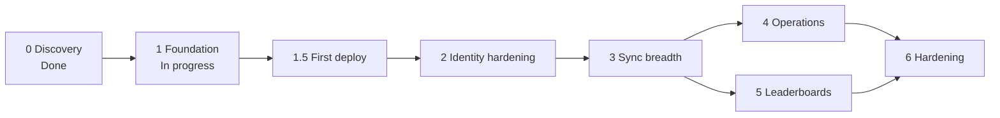

# Implementation roadmap

Status date: 2026-10-26. Labels: **Verified** (with source), **Assumption**, **Decision**, **Planned**.

Stages are ordered by dependency, not by calendar. No dates are promised. A stage is done only when every acceptance criterion holds and CI is green.

**Decision**: Stage 4 and Stage 5 depend on Stage 3, not on each other. They can run in either order.

## Stage 0: Discovery — Done

Deliverables (**Verified**, files exist):

- `docs/architecture/legacy-audit.md`, `feature-inventory.md`, `database-audit.md`, `cluster-audit.md`, `requirements.md`.
- `tests/performance/lang-bench/` with `RESULTS.md` (two full runs on 2026-10-26).

Outcome: legacy data worth migrating is limited to scoring presets (186 rows, all unmodified defaults). Everything else is rebuilt from GitHub (decisions §18).

## Stage 1: Foundation — deployed, with further changes under review

| Item                                                                                                                                              | Status at time of writing                                                                                   |
| ------------------------------------------------------------------------------------------------------------------------------------------------- | ----------------------------------------------------------------------------------------------------------- |
| Go core `core` with roles `api`, `worker`, `migrate`                                                                                              | **Verified** exists (`cmd/gitorgasm/main.go`)                                                               |
| Immutable deployed baseline `00001_core.sql`, additive `00002_schema_hardening.sql` and `00003_concurrent_indexes.sql`, River migrations          | **Verified** in `core/internal/db/migrations` and `internal/db`                                             |
| GitHub App login (state + PKCE), sessions, sealed tokens                                                                                          | **Verified** exists (`internal/httpapi/auth.go`, `internal/secure`)                                         |
| `GET /v1/me`, `/v1/organizations`, repositories (keyset), `POST …/sync`, `POST /webhooks/github`                                                  | **Verified** routes in `internal/httpapi/server.go`                                                         |
| Jobs `sync_installation` (unique by args per 1 minute, 64-bit advisory lock per installation), `process_webhook`, `reconcile_installations`       | **Verified** `internal/jobs/jobs.go`                                                                        |
| App authorization revocation deletes sessions and grants                                                                                          | **Verified** `store.RevokeGitHubUser`                                                                       |
| OpenAPI contract `contracts/openapi/v1.yaml` with a shared `default` Error response on every non-probe operation                                  | **Verified** exists                                                                                         |
| Docker Compose local stack and Makefile (`up`, `up-github`, `down`, `db`, `smoke`, `fmt`, `lint`, `test`, `build`, `manifests`, `vuln`, `verify`) | **Verified** `compose.yaml`, `Makefile`                                                                     |
| `web` from template (Next.js 16.4.3, pnpm 11.28.6 pinned by `packageManager`)                                                                     | **Verified** `web/package.json`; `/api/v1` rewrite in `web/next.config.ts`                                  |
| CI `.github/workflows/ci.yml` orchestrator with reusable `core.yml`, `web.yml`, `scoring.yml`, `bench.yml`, `manifests.yml`, `image.yml`          | **Verified** files exist; run the required `CI` check on each pull request                                  |
| Dependabot, CODEOWNERS, PR and issue templates                                                                                                    | **Verified** `.github/`                                                                                     |
| Kustomize `deploy/kustomize` (base + `overlays/production`)                                                                                       | **Verified** exists. The integrator validated the render with kustomize and kubeconform: 15 resources valid |
| Architecture docs and ADRs                                                                                                                        | **Verified** `docs/architecture/`, `docs/adr/`                                                              |

The first core image and cluster deployment are recorded under Stage 1.5. Argo CD now deploys every merge to `main` (ADR 0012). Each change needs a green `CI` status and a reviewed pull request in this repository.

Acceptance criteria:

- `make verify` passes locally. It runs lint (gofmt, go vet, golangci-lint), Go tests against real Postgres (isolated database per test, `internal/testdb`), web checks, build, `manifests`, and `vuln` (govulncheck).
- API responses validate against `contracts/openapi/v1.yaml` in tests (kin-openapi).
- `make manifests` passes: kustomize render plus `kubeconform -strict`.
- Docker image builds, runs as non-root, and starts each role.
- CI runs the same checks on every PR. Workflow default permission is `contents: read`. Only job `image` gets `packages: write`, and it pushes only on `main`.

Test requirements: unit tests for `secure` (seal/open, key version), GitHub client (classification, pagination host guard, token cache) with `httptest`, job tests with real Postgres, HTTP tests for auth, CSRF origin check, 404 on inaccessible orgs, webhook signature, app authorization revocation.

Risks: R5, R15 (`risk-register.md`). Infra: none beyond a developer machine and GitHub Actions.

## Stage 1.5: First deploy — Mostly done (2026-10-26)

Status:

- **Done:** GHCR package public. Cluster PR merged (`upayanmazumder/cluster#77`). Host directory created. New GitHub App `gitorgasm` (id 5482665, Metadata and Members read). Vercel project on `gitorgasm.upayan.dev` (DNS-only CNAME to Vercel) with the `/api` rewrite. `api-gitorgasm.upayan.dev` is served by the existing `*.upayan.dev` wildcard.
- **Verified:** api, worker, and postgres Running. PVC bound to the static PV. `GET /v1/me` returns 401 `unauthenticated` directly and through `https://gitorgasm.upayan.dev/api/v1/me`. `/readyz` returns 404 publicly. `/api/v1/auth/login` redirects to GitHub with PKCE. A signed webhook through Cloudflare returned 202 and the worker processed it. A bad signature returned 401. Memory requests are 86% of allocatable.
- **Open:** sign in with a real account and install the App on a test org. Apply the Ansible backup role so the new `pg_dump` target runs, then do one restore. Grafana dashboard and alerts.

Deliverables:

- GHCR package public (done; keep cluster pull access and immutable tag pinning, R20).
- Cluster repository PR `upayanmazumder/cluster#77` merged with `k8s/apps/gitorgasm`, Application, AppProject destination, and SOPS Secrets. Later production changes are pull requests in this repository (ADR 0012, `deployment-topology.md` §4).
- Host directory `/srv/data/gitorgasm-postgres` owned by UID/GID 70.
- GitHub App `gitorgasm` registered for the callback `https://gitorgasm.upayan.dev/api/v1/auth/callback` and webhook `https://api-gitorgasm.upayan.dev/webhooks/github` (see Stage 1.5 status).
- Vercel project for `web` at `gitorgasm.upayan.dev` with the rewrite `/api/v1/:path*` → `https://api-gitorgasm.upayan.dev/v1/:path*`. Login requires the callback on the Vercel origin.
- DNS: `api-gitorgasm.upayan.dev` uses the existing `*.upayan.dev` wildcard. `gitorgasm.upayan.dev` is a DNS-only CNAME to Vercel.
- Grafana dashboard and first alerts (`observability.md` §6). Restore runbook.

Dependencies: Stage 1 CI publishes the image to GHCR. Owner approval for DNS, GHCR access, and the cluster PR.

Acceptance criteria:

- Argo CD shows `gitorgasm` Synced and Healthy.
- `kubectl -n gitorgasm get pods` shows api and worker Ready (readiness checks Postgres). The Ingress does not expose `/readyz`. From outside, `curl https://api-gitorgasm.upayan.dev/v1/me` returns 401 with error code `unauthenticated`.
- A test GitHub org installs the App. Login lists it. Repositories sync. A webhook delivery shows 202 in GitHub's delivery log.
- First class A backup appears in restic. One restore into a scratch database succeeds.
- Memory requests after deploy stay ≤ 88% of allocatable.

Risks: R2, R3, R17, R20, R21. Infra: 200m CPU / 512Mi memory requests, `/srv/data/gitorgasm-postgres` on `vps-data`.

## Stage 2: Identity hardening

Deliverables:

- Periodic grant re-verification from `GET /user/installations` (user token), with removal of lost grants.
- Server-side org role check via `GET /user/memberships/orgs/{org}` before any mutation.
- Refresh-token use for expiring user tokens. Key rotation command for `TOKEN_ENCRYPTION_KEY`.
- In-app rate limiter. River job metrics (`observability.md` §2).
- Frontend: login, organization list, repository list, sync button, sync status. Typed API client from `contracts/openapi/v1.yaml`. The Vercel rewrite exists from Stage 1.5.

Dependencies: Stage 1.5 (a real App and callback URL).

Acceptance criteria: a user removed from an org loses access within one re-verification interval. Non-admin users get 404 or 403 on admin routes, proved by tests. Expired user tokens refresh without re-login. Frontend E2E test (Playwright) covers login → orgs → repos against a stubbed GitHub.

Test requirements: authorization matrix tests (member, admin, outsider, uninstalled). Contract tests for every new route.

Risks: R9, R10, R11.

## Stage 3: Sync breadth

Deliverables: mirror teams, members, team memberships, and pending invitations through REST. Webhook coverage for `membership`, `team`, `organization`, `member`, and `installation_repositories` events. Each event enqueues a scoped sync.

Dependencies: Stage 2 role checks (team data is visible only to authorized users).

Acceptance criteria: after a full sync, counts match GitHub for a test org. Duplicate and out-of-order webhooks converge (test replays deliveries in random order). A failed pass never tombstones.

Test requirements: recorded GitHub fixtures per endpoint, pagination tests, tombstone tests.

Risks: R5, R6 (more requests per installation). Infra: Postgres size grows. Estimate stays far below the 2Gi PVC for the legacy data size (10 orgs, 372 repos).

## Stage 4: Operations

Deliverables: mass invite, bulk role change, team bulk-add. Each runs as a planned job: plan (dry run) → confirm → execute with per-item results and checkpoints. `Idempotency-Key` header on mutations. SSE progress stream. Audit log table.

Dependencies: Stage 2 (role checks), Stage 3 (members and teams mirrored).

Acceptance criteria: a worker crash mid-operation resumes from the checkpoint and does not repeat completed items. The same `Idempotency-Key` returns the first result. Every mutation writes one audit row with actor, target, and outcome. Rate-limit snooze is visible as progress state.

Test requirements: crash-resume tests (kill the worker during a job), idempotency tests, secondary rate-limit simulation.

Risks: R6 (secondary limits on write endpoints), R10.

## Stage 5: Leaderboards

Deliverables: signal ingest via GitHub GraphQL with cost accounting. A Rust scoring binary on top of the existing `scoring` crate that reads signals from Postgres and writes `computed_scores` (ADR 0003). Default scoring presets reseeded per installation, optional import from the legacy dump keyed on `(installation_id, name)`.

Already done: the `scoring` crate with golden tests that match legacy `lib/scoring` bit for bit, and its CI job.

Dependencies: Stage 3 (members). Re-run the language benchmark with the crate and legacy-shaped data before you build the binary (R15).

Acceptance criteria: golden tests stay green. GraphQL point usage per sync is logged and stays inside budget.

Risks: R15, R6 (GraphQL 5,000 points/h). Infra: one more small Deployment (**Assumption**: ≤ 64Mi request, based on 3.7 MB idle RSS measured in `RESULTS.md`; not measured under load).

## Stage 6: Hardening

Deliverables: load tests against the deployed API, monthly restore drill evidence, optional OTel trace backend, full alert set, SLOs from measured data (`reliability.md` §3), KEDA worker scaling if backlog requires it.

Dependencies: production traffic data from Stages 1.5 to 5.

Acceptance criteria: restore drill meets the documented RTO. SLO dashboards exist and alerts fire in a test. Load test report stored under `tests/performance/` with raw data.

Risks: R1, R2, R16.
