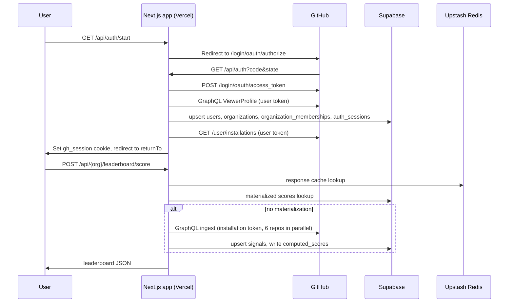
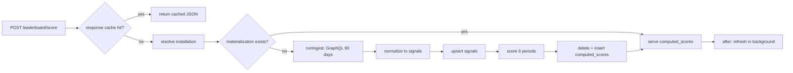

# Legacy audit: GH Org Tool

This document records the state of the legacy "GH Org Tool". Gitorgasm replaces it. The audit is read-only. Nobody changed the legacy repository.

- Legacy path: `~/dev/CodeChefVIT/gh-org-tool`
- Audit date: 2026-10-26
- Companion document: [feature-inventory.md](./feature-inventory.md)

## 0. Labels and method

Each statement has one of these labels:

| Label | Meaning |
|---|---|
| **Verified** | We read the code or ran a command. The evidence (file path, line, or command) follows the label. |
| **Inference** | We reasoned from code plus documented GitHub, Supabase, or Upstash behavior. We did not observe it in production. |
| **Assumption** | We believe it, but we have no direct evidence. |
| **Decision** | A choice for Gitorgasm. |
| **Proposal** | A recommendation that needs approval. |

Method:

1. We read every `route.ts` under `app/api/`, all of `lib/`, `supabase/migrations/`, `hooks/`, `stores/`, and the main components.
2. We ran read-only `git` and `vercel` CLI commands.
3. We did not run the build, tests, or the app. All runtime claims are **Inference** unless a command output supports them.

Line numbers refer to the legacy `main` branch at commit `1b166a4`.

## 1. Repository facts

| Fact | Value | Evidence |
|---|---|---|
| Current branch | `main` at `1b166a4` ("Merge pull request #147 from upayanmazumder/main") | **Verified**: `git log --oneline -5` |
| Commit count on `HEAD` | 398 | **Verified**: `git rev-list --count HEAD` |
| First and last commit dates | 2026-02-26 to 2026-09-14 | **Verified**: `git log --format=%ad --date=short` |
| Remotes | `origin` = `github.com/upayanmazumder/gh-org-tool`, `upstream` = `github.com/CodeChefVIT/gh-org-tool`, `Taksh-Singhal` = `github.com/taksh-singhal/gh-org-tool` | **Verified**: `git remote -v` |
| Local branches | `main`, `design`, `design-01`, `design-tokens`, `docs/agent-docs-mcp-integration`, `docs/github-api-grounding`, `fix/pullrequest-databaseid-deprecation` | **Verified**: `git branch -a` |
| Top authors | Upayan (199), Gslmao (49), Harshil Maheshwari (45), Upayan Mazumder (27), Rewansh Choudhary (23), dependabot (16) | **Verified**: `git shortlog -sn HEAD` |
| Tracked files | 534 | **Verified**: `git ls-files \| wc -l` |
| TypeScript lines (tracked) | 34,639 total. `components/` has 15,200, of which `components/ui/` (shadcn) has 6,351. `app/` + `lib/` + `hooks/` have about 18,100. | **Verified**: `wc -l` |
| API route files | **38**, not 37 as `AGENTS.md` says | **Verified**: `find app -name route.ts` |
| Test files | 8, not 4 as `AGENTS.md` says | **Verified**: `git ls-files '*.test.ts'` |
| Docs pages | 45 MDX files in `content/`, served by Nextra at `/docs` | **Verified**: `ls content -R` |
| Untracked env files in the working tree | `.env`, `.env.production`, `.env.staging`. They are git-ignored (`.gitignore:40`). We did not read them. | **Verified**: `git ls-files` shows none |

### 1.1 Vercel

| Fact | Value | Evidence |
|---|---|---|
| CLI identity | `upayanmazumder`, team scope `upayan` | **Verified**: `vercel whoami` |
| Project | `gh-org-tool`, ID `prj_y0ACVp8W1mVZt6AJjxe3XS3zaBuW`, Next.js preset, Node 24.x, root `.` | **Verified**: `vercel project inspect gh-org-tool` |
| Production URL | `https://gh-org-tool.upayan.dev` | **Verified**: `vercel project ls` |
| Last deployments | 3 Production and 2 Preview deployments 20 days ago, all "Ready". Older ones show `UNKNOWN`. | **Verified**: `vercel ls gh-org-tool` |
| Env var names (Preview + Production) | `VERCEL_DEEP_CLONE`, `REDIS_CACHE_PREFIX`, `UPSTASH_REDIS_REST_URL`, `UPSTASH_REDIS_REST_TOKEN`, `TOKEN_ENCRYPTION_KEY`, `GITHUB_WEBHOOK_SECRET`, `SUPABASE_SERVICE_ROLE_KEY`, `NODE_ENV`, `GITHUB_APP_ID`, `GITHUB_PRIVATE_KEY`, `GITHUB_CLIENT_ID`, `GITHUB_CLIENT_SECRET`, `GITHUB_APP_NAME`, `NEXT_PUBLIC_APP_URL`, `AUTH_SESSION_SECRET`, `NEXT_PUBLIC_SUPABASE_URL`, `NEXT_PUBLIC_SUPABASE_PUBLISHABLE_DEFAULT_KEY`, `CRON_SECRET` | **Verified**: `vercel env ls --project gh-org-tool` (names only) |
| `vercel link` | Not needed and not done. `--project` gave read access. The legacy repo has no `.vercel/` directory. | **Verified**: `ls -d .vercel` fails |
| `CRON_SECRET` | Set in Vercel, but no code reads it and no `vercel.json` exists. No cron job runs. | **Verified**: grep for `CRON_SECRET` finds nothing in code |
| `ENABLE_DEBUG_ROUTES` | Not set in Vercel. Debug routes return 403 in production. | **Verified**: env list, `lib/auth/debug.ts:8-13` |
| `maxDuration = 300` | Two routes set it. Hobby plan caps functions at 60 s. | **Verified**: `app/api/[organization]/leaderboard/score/route.ts:31`, `.../recompute/route.ts:19`. Plan tier is an **Assumption**. |

## 2. Product summary

The app is a multi-tenant GitHub organization dashboard. A user signs in with a GitHub App. The app then shows each organization that the user belongs to. It has three product areas.

1. **Contributor scoring.** The app pulls commits, pull requests, issues, reviews, and comments through GraphQL. It turns them into "signals". It scores signals with a configurable ruleset. It shows leaderboards for contributors, repositories, and teams.
2. **Analytics.** The app shows org overview counts, activity trends, top contributors, an activity feed, per-repository metrics, and a per-contributor profile with a heatmap.
3. **Org administration.** Admins can mass-invite users, change org roles in bulk, and add users to a team in bulk.

### 2.1 Main workflows



**Verified**: `app/api/auth/start/route.ts`, `app/api/auth/route.ts`, `app/api/[organization]/leaderboard/score/route.ts`, `lib/leaderboard/pipeline.ts`.

## 3. Frontend architecture

### 3.1 Stack

| Item | Version or value | Evidence |
|---|---|---|
| Next.js | 16.2.11 (exact pin), App Router, Turbopack in dev | **Verified**: `package.json` |
| React | 19.2.3 (exact pin) | **Verified**: `package.json` |
| Styling | Tailwind CSS 4, shadcn/ui (54 primitives in `components/ui/`), one `styled-components` use in `components/ui/loader.tsx` | **Verified** |
| Server state | TanStack Query 5. Defaults: `staleTime` 30 s, `refetchOnWindowFocus: false`, `retry` default (3). | **Verified**: `components/providers/QueryProvider.tsx:8-20` |
| Client state | 5 Zustand stores in `stores/`. None persists. | **Verified**: `stores/*.ts` |
| Charts | `recharts` 2.15.4, `framer-motion` 12 | **Verified** |
| Docs | Nextra 4 at `/docs`, Pagefind search built in `pnpm build` | **Verified**: `next.config.ts`, `package.json` scripts |
| Env | `@t3-oss/env-nextjs` with zod. Validation is **skipped in production**. | **Verified**: `lib/env/index.ts` (`skipValidation: ... \|\| process.env.NODE_ENV === 'production'`) |
| Package manager | pnpm 10.33.1 | **Verified**: `package.json` |

### 3.2 Rendering and routing

- There is no `middleware.ts` or `proxy.ts`. No server-side page gate exists. **Verified**: file search.
- `/[organization]/**` pages render inside `ProtectedRoute`, a client component. It redirects to `/api/auth/start` when the session query returns no session. It never checks org membership. **Verified**: `components/layout/OrganizationLayoutClient.tsx:20`, `components/auth/ProtectedRoute/ProtectedRoute.tsx:48-58`.
- Admin-only screens hide controls on the client with `useIsOrganizationAdmin`. The API routes are the real gate. **Verified**: `lib/organization/use-is-organization-admin.ts`, `app/[organization]/settings/installation/page.tsx`.
- Most org pages are thin server wrappers around large client components. The leaderboards, settings, and account pages are client components. **Verified**: `'use client'` markers.
- `/{org}/settings` has a layout but no `page.tsx`. That URL returns 404. **Verified**: `app/[organization]/settings/`.
- Only `app/error.tsx` and `app/not-found.tsx` exist. No `global-error.tsx`. No nested error boundaries. No `notFound()` call for an unknown org. **Verified**.

### 3.3 Data fetching

- Every hook calls `fetch` directly and repeats its own `if (!res.ok) throw` logic. **Verified**: `hooks/queries/*.ts`.
- `lib/api/client.ts` defines an axios client with toasts and a 401 redirect. No code imports it. **Verified**: grep for `apiClient`.
- Leaderboard queries use `staleTime` and `gcTime` of 24 h and do not refetch on mount, focus, or reconnect. **Verified**: `lib/constants/time.ts:61-62`, `hooks/queries/useContributorLeaderboardQuery.ts`.
- `useTeamLeaderboardQuery` omits `timePeriod` from its query key. A period change reuses stale data for up to 24 h. **Verified**: `hooks/queries/useTeamLeaderboardQuery.ts:18` versus the request body at `:26`.
- 7 hooks bypass the query-key factory in `hooks/query-keys.ts`. **Verified** (see the inventory for the list).
- `buildPathWithQuery` writes to a Zustand store and calls `console.log` during render of every sidebar link. **Verified**: `lib/organization/url-state.ts:~95-108`.
- `useSyncStatusQuery` calls `/api/sync/status`. That route does not exist. The hook has no callers. **Verified**: `hooks/queries/useSyncStatusQuery.ts:18`.

### 3.4 Validation and error handling

- No client form uses `react-hook-form` or `zodResolver`. Forms use plain `useState`. **Verified**: grep for `useForm`, `zodResolver`.
- Server routes validate input by hand. Only `app/api/github/graphql/route.ts` uses a zod schema (`lib/schemas/api.ts:4-8`). **Verified**.
- Scoring rules from the client are stored without schema validation. **Verified**: `app/api/[organization]/leaderboard/rules/route.ts` (PUT), `.../rules/presets/route.ts:71`.
- Client code casts response JSON to types. It never validates it at runtime. **Verified**.
- Several routes return raw Supabase `error.message` to the client. **Verified**: `app/api/[organization]/analytics/overview/route.ts:33,53`.

### 3.5 Accessibility and performance

| Concern | Evidence |
|---|---|
| Unlabelled controls: mass-invite file input, user-search input, team select and textarea, contributor selector label, leaderboard selects | **Verified**: `components/organization/MassInvite.tsx:279-283`, `UserSearchPanel.tsx`, `TeamManagement.tsx:95,112`, `components/analytics/ContributorSelector.tsx:43` |
| Heatmap cells are `div`s with `title` only. Intensity is color only. | **Verified**: `components/analytics/ContributionHeatmap.tsx:186-193` |
| `window.confirm` for preset delete | **Verified**: `components/leaderboards/scoring/ScoringRules.tsx` |
| `Loader` has no `role="status"` | **Verified**: `components/ui/loader.tsx` |
| `xlsx` imported at module top level in a client component | **Verified**: `components/organization/MassInvite.tsx:2` |
| `recharts` and `framer-motion` imported statically in about 10 client components. No `next/dynamic`. | **Verified** |
| No list virtualization in the contributor table or member lists | **Verified**: `components/leaderboards/contributor/ContributorLeaderboardTable.tsx:62` |
| Contributor search calls `router.replace` on every keystroke | **Verified**: `components/leaderboards/contributor/ContributorLeaderboard.tsx:~155` |
| Repository timeline invents per-user daily data by proportional split and shows it as real data | **Verified**: `components/leaderboards/RepositoryContributorsTimeline.tsx:176-181` |
| `useAuthSession` uses `staleTime: 0` and refetches on mount and focus. Several components mount it. | **Verified**: `hooks/use-auth-session.ts:34-42` |

## 4. Authentication, sessions, and tokens

### 4.1 Flow

1. `GET /api/auth/start` signs a 10-minute HS256 JWT state with `csrf`, `mode`, and `returnTo`. It sets the `gh_auth_csrf` cookie (`HttpOnly`, `Secure`, `SameSite=None`). It redirects to `https://github.com/login/oauth/authorize` with `scope=read:org user:email` and `allow_signup=false`. **Verified**: `app/api/auth/start/route.ts:9-31`, `lib/auth/state.ts`, `lib/auth/server/cookies.ts`.
2. `GET /api/auth` checks the JWT, compares the cookie with `!==`, and exchanges the code at `POST https://github.com/login/oauth/access_token`. It sends no PKCE verifier. **Verified**: `app/api/auth/route.ts:41-44`, `lib/auth/server/oauth.ts:31-89`.
3. The callback loads the viewer with GraphQL `ViewerProfile` (`viewer.organizations(first: 100)` with `viewerCanAdminister`). It upserts `users`, `organizations`, and `organization_memberships`. It creates an `auth_sessions` row with a 24 h TTL. **Verified**: `lib/auth/server/oauth.ts:163-235`, `lib/auth/server/session.ts:130-188`, `lib/constants/time.ts:10`.
4. It then calls `GET /user/installations` and links the org installations to the session in `session_installations`. **Verified**: `app/api/auth/route.ts:87-96`, `lib/auth/server/installation-service.ts:12-84`.
5. It sets `gh_session` (`HttpOnly`, `SameSite=Lax`, `Secure` only when `NODE_ENV=production`) and redirects to `returnTo`. **Verified**: `app/api/auth/route.ts:98-121`, `lib/auth/server/cookies.ts:8-13`.

The install flow is similar. `GET /api/install/start` signs an install state and redirects to `https://github.com/apps/{GITHUB_APP_NAME}/installations/new`. `GET /api/install/callback` links the returned `installation_id` to the session. **Verified**: `app/api/install/start/route.ts`, `app/api/install/callback/route.ts:40-114`.

### 4.2 Token storage

- Access and refresh tokens are encrypted with AES-256-GCM, a random 12-byte IV, and a 16-byte tag. No AAD. **Verified**: `lib/auth/server/crypto.ts:6-41`.
- The key is `TOKEN_ENCRYPTION_KEY` read as hex. A key shorter than 64 chars is padded with `'0'`. **Verified**: `lib/auth/server/crypto.ts:10-14`.
- If `TOKEN_ENCRYPTION_KEY` is unset, the key falls back to a string built from the client secret, app ID, and client ID. That string is not hex. **Verified**: `lib/env/index.ts` (`initAuthEnv`). **Inference**: `Buffer.from(..., 'hex')` stops at the first non-hex character, so the key has the wrong length and `createCipheriv` throws. Sign-in then fails.
- `AUTH_SESSION_SECRET` falls back to `${GITHUB_CLIENT_SECRET}:${GITHUB_APP_ID}`. **Verified**: `lib/env/index.ts`.
- The session ID is 32 random bytes in hex. It is stored in plain text as the `auth_sessions` primary key. The same value works as the cookie and as an `Authorization: Bearer` token. **Verified**: `lib/auth/server/session.ts:11-13`, `lib/auth/request-session.ts:18-33`.
- `GET /api/auth/session` returns the session ID in the JSON body. `mode=mobile` returns it as `sessionToken`. **Verified**: `app/api/auth/session/route.ts:21`, `app/api/auth/route.ts:103-112`.
- Token refresh uses `grant_type=refresh_token` when the access token is within 5 minutes of expiry. Only `/api/auth/session` and `/api/github/graphql` call it. Concurrent refreshes race on the single-use refresh token. **Verified**: `lib/auth/server/token-refresh.ts`, grep for `refreshAndUpdateSession`.
- Org roles come from `organization_memberships`. The app writes them only at sign-in. No code deletes a membership row. A user removed from an org on GitHub keeps access. **Verified**: `lib/auth/server/user-service.ts:51-68`, `lib/auth/server/session.ts:15-43`.

## 5. GitHub integration

### 5.1 GitHub App permissions

| Source | Permissions | Evidence |
|---|---|---|
| Setup docs | Org: Members (Read), "Teams" (Read). Repo: Metadata, Contents, Pull requests, Issues (Read). Account: Email addresses (Read). Events: Installation, Installation repositories. | **Verified**: `content/getting-started/local-development.mdx:44-56` |
| Runtime check | `metadata`, `contents`, `pull_requests`, `issues`, `members`, all `read` | **Verified**: `lib/github/required-permissions.ts:31-67` |
| Needed by bulk admin routes | `members: write`. The routes call `POST /orgs/{org}/invitations`, `PUT /orgs/{org}/memberships/{username}`, and `PUT /orgs/{org}/teams/{team_slug}/memberships/{username}` with the **installation** token. | **Verified**: calls in `app/api/organizations/[login]/*/route.ts`. **Inference**: GitHub requires Organization "Members" write for these endpoints. |
| OAuth `scope` param | `read:org user:email` | **Verified**: `app/api/auth/start/route.ts:25`. **Inference**: GitHub App user tokens ignore `scope`. The App permissions apply. |

**Inference**: With the documented permissions, the three bulk admin features fail with "Resource not accessible by integration". The runtime check does not report the gap.

There is no separate "Teams" permission for GitHub Apps. **Inference** from GitHub App permission docs. Team access is part of "Members".

### 5.2 Token types

| Token | Created by | Used for |
|---|---|---|
| App JWT | `octokit` `App` with `GITHUB_APP_ID` + `GITHUB_PRIVATE_KEY` (`lib/github/client-factory.ts:9-20`) | `GET /app/installations/{id}`, `POST /app/installations/{id}/access_tokens` |
| Installation token | `createInstallationAccessToken`, cached in process until 1 min before expiry (`lib/github/client-factory.ts:25-47`) | Ingest GraphQL, bulk admin REST calls, `InstallationAccessSnapshot` |
| User token (GitHub App user-to-server) | OAuth code exchange (`lib/auth/server/oauth.ts:31-89`) | `ViewerProfile`, `/user/installations`, the GraphQL proxy, and the leaderboard fallback |

The leaderboard uses the installation token only if the org installation ID is in `session.installationIds`. Otherwise it falls back to the user token. **Verified**: `lib/github/create-leaderboard-octokit.ts:31-70`. The cache keys for org repositories and GraphQL responses do not include the token type. Results from a user token and an installation token can mix. **Verified**: `lib/github/fetch-graphql.ts:150`, `lib/github/graphql-response-cache.ts:112-120`.

### 5.3 API call catalog

REST (all **Verified** by grep for `octokit.rest`, `octokit.request`, and `fetch(` in `app/` and `lib/`):

| Call | Octokit method | Token | Caller |
|---|---|---|---|
| `GET https://github.com/login/oauth/authorize` | redirect | none | `app/api/auth/start/route.ts:22-27` |
| `POST https://github.com/login/oauth/access_token` (code, refresh) | `fetch` | client secret | `lib/auth/server/oauth.ts:39`, `lib/auth/server/token-refresh.ts:44` |
| `GET /user/installations?per_page=100&page=N` | `octokit.request` | user | `lib/auth/server/oauth.ts:105-126` |
| `GET /user` | `users.getAuthenticated` | user | fallback in `lib/auth/server/oauth.ts:201` |
| `GET /user/orgs?per_page=100` (one page only) | `orgs.listForAuthenticatedUser` | user | fallback in `lib/auth/server/oauth.ts:211`. Sets `viewerCanAdminister: false` for every org. |
| `GET /app/installations/{installation_id}` | `apps.getInstallation` | app JWT | `lib/auth/server/oauth.ts:128-161` |
| `POST /app/installations/{installation_id}/access_tokens` | `apps.createInstallationAccessToken` | app JWT | `lib/github/client-factory.ts:36` |
| `GET /users/{username}` | `users.getByUsername` | installation | `app/api/organizations/[login]/mass-invite/route.ts:70` |
| `POST /orgs/{org}/invitations` (`invitee_id`, `role: direct_member`) | `orgs.createInvitation` | installation | `.../mass-invite/route.ts:71` |
| `GET /orgs/{org}/members/{username}` | `orgs.checkMembershipForUser` | installation | `.../bulk-role/route.ts:81` |
| `PUT /orgs/{org}/memberships/{username}` (`role: member\|admin`) | `orgs.setMembershipForUser` | installation | `.../bulk-role/route.ts:91` |
| `PUT /orgs/{org}/teams/{team_slug}/memberships/{username}` (`role: member`) | `teams.addOrUpdateMembershipForUserInOrg` | installation | `.../teams/bulk-add/route.ts:59` |

GraphQL (all **Verified** in `lib/github/queries/*.ts`, `lib/github/operations/registry.ts`, and `lib/auth/server/installation-service.ts:199-220`):

| Operation | Shape | Pagination | Token |
|---|---|---|---|
| `ViewerProfile` | `viewer { databaseId login name avatarUrl organizations(first:100) { databaseId login name avatarUrl viewerCanAdminister } }` | none. `hasNextPage` ignored. | user |
| `OrgRepositories` | `organization(login) { repositories(first:$first, after, orderBy:UPDATED_AT DESC) { nameWithOwner databaseId name isPrivate isArchived isFork updatedAt defaultBranchRef{name} } }` | full cursor loop, `first: 100`. Redis cache 5 min. | installation or user. Also exposed through the proxy. |
| `OrgTeamsData` | `organization { teams(first:100, after) { databaseId slug name members(first:100){databaseId login} repositories(first:100){databaseId nameWithOwner} } }` | teams paged. Members and repos are **not** paged. Only a warning above 100. | installation or user |
| `TeamRepositories` | `organization { team(slug) { repositories(first, after) { nameWithOwner } } }` | full loop | installation or user |
| `RepoScoringDataCore` | default branch `history(since, first:100)` with `authors(first:3)`. `pullRequests(first:50, UPDATED_AT DESC)`. `issues(first:50, UPDATED_AT DESC)`. | up to 20 pages each. PRs and issues stop when `updatedAt < since`. | installation or user |
| `RepoScoringPrMeta` | `pullRequests(first:50)` with `mergedBy`, `mergeCommit`, `closingIssuesReferences(first:20)`, `commits(first:100)` | up to 20 pages. No early stop. | same |
| `RepoScoringReviews` | `pullRequests(first:50)` with `reviews(first:50){comments(first:50)}` and `comments(first:100)` | up to 20 pages, early stop | same |
| `RepoScoringIssueLinks` | `issues(first:50){ timelineItems(first:20, CROSS_REFERENCED_EVENT) }` | up to 20 pages | same |
| `InstallationAccessSnapshot` | `viewer { repositories(first:100) { totalCount nodes{nameWithOwner url isPrivate} } }` | none | installation |
| `SearchUsers` | `search(first:10, type:USER, query)` | none | user, through the proxy |
| `OrganizationSummary`, `OrganizationRepositories` (`first:100`, no paging), `OrgScoringData` (`first:50`) | allowlisted but unused by the client | none | user |

**Verified**: only `OrgRepositories` and `SearchUsers` are called through the proxy (`hooks/queries/useOrgRepositoriesQuery.ts:23`, `hooks/queries/useSearchUsersQuery.ts:33`). The other 5 allowlisted operations have no client caller.

The app never lists org members or pending invitations. No call to `GET /orgs/{org}/members`, `membersWithRole`, or `GET /orgs/{org}/invitations` exists. **Verified**: grep. Member data comes only from team membership in `OrgTeamsData`.

### 5.4 Pagination, rate limits, retries, concurrency

- `PAGE_SAFETY_CAP = 20` for commits, PRs, issues, and reviews. The function ignores its `since` argument. Per repo this is at most 2,000 commits, 1,000 PRs, and 1,000 issues. **Verified**: `lib/github/ingest-limits.ts:16-27`.
- Repo fetches run in a custom worker pool with `REPO_CONCURRENCY = 6`. Inside a repo, reviews and issue links run in parallel. **Verified**: `lib/github/fetch-graphql.ts:47`, `:660-700`, `:777`.
- The pool catches each repo error, logs it, and drops the repo. The ingest still reports success. **Verified**: `lib/github/fetch-graphql.ts:~660-700`, `lib/leaderboard/ingest.ts:89-96`.
- The code has no explicit retry, backoff, or `Retry-After` logic. **Verified**: grep.
- The `octokit` 5.0.5 `Octokit` class bundles `@octokit/plugin-retry` and `@octokit/plugin-throttling`. Its default handlers retry once on primary and secondary rate limits. **Verified**: `node_modules/octokit/dist-src/octokit.js`. **Inference**: a long `Retry-After` can exceed the 300 s function limit.
- A 90 s GraphQL response cache sits in process memory (64 entries) and in Redis (`github:graphql:*`). **Verified**: `lib/github/graphql-response-cache.ts`.

### 5.5 Bulk operations

| Route | Order | Admin gate | Max | Failure handling | Defects |
|---|---|---|---|---|---|
| `POST /api/organizations/{login}/mass-invite` | All logins in parallel with `Promise.allSettled` (`route.ts:68-76`) | `requireOrganizationAdmin` (DB role, case-insensitive) | 50 unique (`:56`) | Per-item `{success[], failed[{login,error}]}` | 50 parallel calls risk secondary rate limits. No retry. Repeated invite returns a GitHub error. |
| `POST /api/organizations/{login}/bulk-role` | Sequential | Inline `org.login === login` (case-sensitive, `:52-54`) | 50 (`:48`) | Per-item `{success, invited, failed}` | `PUT /orgs/{org}/memberships/{user}` invites a non-member. With `role: admin`, it invites the user as an org **owner**. A non-string item crashes the route before the per-item `try`. |
| `POST /api/organizations/{login}/teams/bulk-add` | Sequential | Inline, case-sensitive (`:39-43`) | 50 (`:37`) | Per-item by membership `state` (`active` / `pending`) | Same crash on non-string items. Role is fixed to `member`. |

**Verified** for all rows by reading the three route files. No route records an audit log. No route runs as a background job. The client stubs for job progress return `[]` (`hooks/queries/useMassInviteJobsQuery.ts:13`).

## 6. Backend behavior

### 6.1 Route guards

All routes use the Supabase service-role client. Row-level security does not apply. Isolation is in application code only. **Verified**: `lib/supabase/server.ts`.

Guard helpers:

- `requireApiSession` reads a Bearer token, then the `gh_session` cookie, then loads `auth_sessions`. **Verified**: `lib/api/server.ts:57-71`.
- `requireOrganizationAccess` matches the org login, case-insensitive, against the session org list. It returns 404 when not found. **Verified**: `lib/api/server.ts:73-97`.
- `requireOrganizationAdmin` also requires `viewerCanAdminister`. It returns 403. **Verified**: `lib/api/server.ts:99-120`.
- `resolveInstallationForOrganization` repeats the org check, then finds `github_installations` by org ID. On a miss it calls `GET /user/installations` and upserts rows during a GET request. **Verified**: `lib/leaderboard/resolve-installation.ts:12-47`.

The full per-route table is in [feature-inventory.md §3](./feature-inventory.md#3-api-route-inventory).

### 6.2 Webhook

`POST /api/install/webhook`:

- It checks `X-Hub-Signature-256` with HMAC-SHA256 and `timingSafeEqual`. **Verified**: `lib/auth/server/webhook.ts:6-20`.
- If `GITHUB_WEBHOOK_SECRET` is empty, it logs a warning and **accepts every payload**. **Verified**: `lib/auth/server/webhook.ts:8-11`.
- It handles `installation` and `installation_repositories`. Delete removes the installation rows. Other actions upsert the installation with `repositoryCount: 0` and an empty repository list. `organization`, `membership`, and `member` events are only logged. **Verified** by RoutesAudit: `app/api/install/webhook/route.ts:42-70`.
- It does not deduplicate `X-GitHub-Delivery`. It does not ingest `push`, `pull_request`, or `issues`. **Verified**.
- Delete leaves `session_installations`, `scoring_presets`, and `signals` rows. **Verified**: `lib/supabase/installation-repository.ts:153-156`.

### 6.3 Serverless constraints, locks, and jobs

- Ingest, scoring, and materialization run inside the `leaderboard/score` request or inside `after()` in the same function. `maxDuration = 300`. **Verified**: `app/api/[organization]/leaderboard/score/route.ts:31,157-234`.
- No code checks a deadline or aborts work. A timeout leaves the Redis ingest lock for its 5-minute TTL and leaves `ingest_log` unchanged. **Verified**: `lib/leaderboard/ingest.ts:101-164`, `lib/constants/time.ts:50`.
- Locks use Redis `SET NX EX 300`. Release is an unconditional `DEL` with no owner check. **Verified**: `lib/cache/redis.ts:99-113`, `lib/leaderboard/ingest.ts:161`.
- If Redis is not configured, `redisSetNx` returns `true`. All locks then succeed. **Verified**: `lib/cache/redis.ts:99-101`.
- Per-process dedupe maps (`activeIngests`, `activeScoreComputes`) do not work across instances. **Verified**: `lib/leaderboard/ingest.ts:17-20`, `lib/leaderboard/score.ts:225`.
- `redisPatternDel` loops `while (cursor !== 0)` with a numeric `0`. **Inference**: Upstash REST returns the SCAN cursor as the string `"0"`, so the loop does not stop. Preset create, update, activate, and delete call it. **Verified** loop: `lib/cache/redis.ts:137-173`. Production behavior is not observed.
- No cron exists. SQL functions `purge_expired_auth_sessions`, `cleanup_expired_sessions`, `drop_old_signals_partitions`, and `purge_superseded_materializations` have no caller. **Verified**: grep, `supabase/migrations/001,006,008,010`.
- `setLastSuccessfulIngestAt` runs an `UPDATE` and returns when there is no error. It inserts only on an error. **Verified**: `lib/supabase/ingest-state.ts:62-119`. **Inference**: PostgREST returns no error when an update matches zero rows. So the first `ingest_log` row is never created. The 24 h cooldown and the freshness TTLs never take effect. Check with `SELECT count(*) FROM ingest_log` in production.

### 6.4 Caching layers

| Layer | Key | TTL | Evidence |
|---|---|---|---|
| Response LRU (process) | `{org}:{scope}:{entity}:{period}[...]` | 30 s, 64 entries | `lib/leaderboard/request-cache.ts:9-45` |
| Response (Redis) | `leaderboard:response:{same}` | 24 h | `lib/leaderboard/request-cache.ts:53,67` |
| Snapshot (Redis) | `leaderboard:snapshot:preset:{id}:{scope}:entity:{e}:period:{p}:v:{n}` | 24 h | `lib/leaderboard/redis-cache.ts` |
| GraphQL responses | `github:graphql:{op}:{vars}` | 90 s | `lib/github/graphql-response-cache.ts` |
| Org repositories / teams | `github:org-repositories:{org}`, `github:org-teams:v2:{org}` | 5 min | `lib/github/fetch-graphql.ts:150,923` |
| Repo fetch log | `github:repo-fetch:id:{id}`, `github:repo-fetch:name:{name}` | 24 h | `lib/supabase/repo-cache.ts:28-31` |
| Materialized scores | `leaderboard_materializations` + `computed_scores` | persistent | `lib/supabase/leaderboard-db.ts` |

Preset changes clear `leaderboard:response:*` for **all** orgs, not one. **Verified**: `lib/supabase/leaderboard-db.ts:634,708,747,789`.

## 7. Data model (Supabase)

- 11 migrations, Postgres 17 locally. **Verified**: `supabase/migrations/001-011`, `supabase/config.toml`.
- **No migration enables RLS or creates a policy.** **Verified**: grep for `ROW LEVEL`, `POLICY`, `GRANT` returns nothing. **Inference**: Supabase default grants give `anon` access to `public` tables through PostgREST. `NEXT_PUBLIC_SUPABASE_PUBLISHABLE_DEFAULT_KEY` ships to the browser. So the public key can read and write every table, including `auth_sessions`. The app never uses that key.
- `signals` is range-partitioned by `event_timestamp`. The request path calls `ensure_signals_monthly_partitions` (DDL) through RPC on every signal upsert. **Verified**: `supabase/migrations/008_signals.sql`, `lib/supabase/signals.ts:211`.
- The signal dedup index omits `installation_id`. **Verified**: `008_signals.sql` (`idx_signals_dedup`).
- The `computed_scores` unique index includes nullable columns. It enforces nothing. **Verified**: `011_computed_scores.sql` (`idx_cs_unique_entity`).
- Tables or columns defined but never written: `installation_repositories`, the `repository_sync_state` ETag columns and `pr_ids_hash`, the materialization retention columns, `signals_partition_health` (written by trigger, never read). **Verified** by DataPipelineAudit grep.
- `ensureUsersExist` upserts contributors with `name: null` and `avatar_url: ''`. This erases stored names and avatars. **Verified**: `lib/supabase/signals.ts:115-142`.
- `config.toml` sets `max_rows = 1000`. Several unpaginated selects truncate silently. **Verified**: `supabase/config.toml:18`, `app/api/[organization]/analytics/overview/route.ts:47-50`, `app/api/public/stats/route.ts:18`, `lib/supabase/leaderboard-db.ts:1070-1076`. **Assumption**: production uses the same limit.
- `fetchOrgScoringDataGraphQL` upserts repositories with `organization_id: null`. `ingestGitHubSignals` sets the real ID only after the GitHub fetch ends. During that window, or after a crash, analytics for the org return zeros. **Verified**: `lib/github/fetch-graphql.ts:851-864`, `lib/leaderboard/ingest.ts:56-69`, `lib/supabase/repository.ts:35-38`.

## 8. Leaderboard pipeline



1. **Repo resolution.** Org scope uses `OrgRepositories`. Team scope uses `TeamRepositories`. Repository scope uses the request value with no org check. Forks and archived repos are excluded. **Verified**: `lib/leaderboard/resolve-scope.ts`, `lib/github/fetch-graphql.ts:846`.
2. **Ingest window.** `since = from` or now minus 90 days. The time period is not used. `half_year` and `all_time` only cover data ingested in 90-day windows. **Verified**: `lib/constants/time.ts:22`, `lib/leaderboard/ingest.ts:22-26` (`computeSince`).
3. **Incremental fetch.** `since = max(requested, lastFetchedAt − 5 min)`. **Verified**: `lib/github/ingest-limits.ts:34-46`. The repo fetch log is written per repo before signals are saved. A failure after that point loses the window for good. **Verified**: `lib/github/fetch-graphql.ts:876-882`, `lib/leaderboard/ingest.ts:79`.
4. **Normalize and store.** See §9.1. Signals with `userId <= 0` are dropped. **Verified**: `lib/supabase/signals.ts:156-166`.
5. **Score.** All org signals load into memory once. The 6 periods are scored in sequence. Each period writes one materialization. **Verified**: `lib/leaderboard/score.ts:274-297`.
6. **Materialize.** The version increments before the old rows are deleted and the new rows are inserted in chunks of 100. No transaction wraps this. A reader in that gap sees an empty leaderboard. **Verified**: `lib/supabase/leaderboard-db.ts:965-1005,1145-1196`.
7. **Serve.** Precomputed rows are read with no `.range()`. A custom `from`/`to` is computed per request and never stored. **Verified**: `lib/leaderboard/serve.ts:70-166`.

## 9. Scoring engine (port specification)

This section is precise so that Gitorgasm can port the engine and reproduce legacy scores. Source: `lib/scoring/*.ts`, `lib/leaderboard/score.ts`, `lib/leaderboard/time-range.ts`, `types/scoring/*.ts`.

### 9.1 Signals (normalize)

`normalizeGitHubData(raw)` turns raw GitHub data into `Signal { userId, userLogin, type, value: 1, repo, eventTimestamp, contentHash, metadata }`. **Verified**: `lib/scoring/normalize.ts:311-354`.

| Raw item | Signals emitted | Timestamp | Metadata used by scoring |
|---|---|---|---|
| Commit (default branch only) | 1 `commit` for the first author with a GitHub user, plus 1 `commit` per other linked co-author (max 3 authors per commit) | `committedDate` | `isInMergedPR`, `isBot`, `additions`, `deletions` (each split evenly across authors with `Math.round`) |
| Pull request | `pr_open` always. Then `pr_merge` if merged, else `pr_close_no_merge` if closed. | `createdAt`, `mergedAt`, `closedAt` | `isSelfMerge` (merger = author), `hasLinkedIssue` (`closingIssuesReferences` not empty), `isBot` |
| Issue | `issue_open` always. `issue_close` if closed. **Both go to the issue author**, not the closer. | `createdAt`, `closedAt` | `hasLinkedPR` (a cross-referenced PR exists), `isBot` |
| Review | `review` | `submittedAt` | `state` (`approved` / `changes_requested` / `commented`), `isSelfReview`, `isBot` |
| Review comment | `review_comment` | `createdAt` | `isBot` |
| PR conversation comment | `comment` | `createdAt` | `isBot` |

- Issue comments are not fetched. `comment` signals come only from PR conversations. **Verified**: `lib/github/queries/repoScoringDataCore.ts`, `repoScoringDataReviews.ts`.
- No code emits `spam`. **Verified**: grep for `'spam'`.
- A bot is `__typename == Bot` or a login that ends in `[bot]`. **Verified**: `lib/scoring/normalize.ts:8-14`.
- `contentHash = sha256(parts.join('|')).hex[0:32]`, with parts `(type or 'coauthor', userId, repo, timestamp, sha/number/id)`. **Verified**: `lib/scoring/normalize.ts:4-6`.
- Only signals with `eventTimestamp >= since` are kept. **Verified**: `lib/github/fetch-graphql.ts:255,290-292,334-335,457,480,496`.

### 9.2 Ruleset

Type `ScoringRuleset` (`types/scoring/rules.ts`). Default values (`lib/scoring/rules.ts:4-48`), **Verified**:

| Field | Default |
|---|---|
| `basePoints` | commit 10, pr_merge 50, review 20, review_comment 5, issue_open 10, issue_close 10, comment 3. All other types: 0 (`pr_open`, `pr_close_no_merge`, `spam`). |
| `multipliers` | `merged_pr_commit` ×1.2 on [commit]. `pr_linked_to_issue` ×1.1 on [pr_merge, commit]. `first_activity` ×1.5 on [commit, pr_merge, review, issue_open, issue_close, comment]. |
| `reviewStateWeights` | approved 1.25, changes_requested 1.0, commented 0.5 |
| `dailyQuotas` | commit 4, comment 4 |
| `diminishingReturns` | `weeklyThreshold` 9, `decayFactor` 0.11, `floorFraction` 0.2 |
| `zeroPointConditions` | self_review, self_merge, bot_activity, issue_closed_no_pr, pr_closed_no_merge. All enabled. |
| `spamPenalty` | −12 |
| `prClosedNoMergePenalty` | −10 |

### 9.3 Per-contributor algorithm

`computeScores(signals, rules)`, **Verified**: `lib/scoring/engine.ts:274-342`.

```text
group signals by userId
for each user:
  sort signals by Date(eventTimestamp) ascending (stable sort)
  ctx = { firstSeen: {}, weekly: {}, daily: {}, currentDay: null }
  lastWeek = null
  for each signal s:
    week = Monday (UTC) of s.eventTimestamp            # engine.ts:32-38
    if week != lastWeek: lastWeek = week; ctx.weekly = {}
    (score, penalty) = scoreSignal(s, ctx, rules)
    total += score; penalties += penalty
    breakdown[category(s.type)] += score; counts[category(s.type)] += 1
    if s.type == commit: additions += s.additions; deletions += s.deletions
  final = max(0, total + penalties)                      # engine.ts:333
```

`scoreSignal(s, ctx, rules, skipQuota=false)`, **Verified**: `lib/scoring/engine.ts:85-182`.

```text
base = rules.basePoints[s.type] or 0
if any enabled zero-point condition matches: return (0, 0)     # engine.ts:45-77, 98-100
    self_review        : type == review   and isSelfReview
    self_merge         : type == pr_merge and isSelfMerge
    bot_activity       : isBot (any type)
    pr_closed_no_merge : type == pr_close_no_merge
    issue_closed_no_pr : type == issue_close and not hasLinkedPR
if type == spam:              return (0, rules.spamPenalty)
if type == pr_close_no_merge: return (0, rules.prClosedNoMergePenalty)
if base == 0:                 return (0, 0)
if skipQuota: eff = base
else:
  day = s.eventTimestamp[0:10]                                   # string slice
  if day != ctx.currentDay: ctx.currentDay = day; ctx.daily = {}; ctx.firstSeen = {}
  ctx.daily[type] += 1; ctx.weekly[type] += 1                    # both before the quota test
  if quota(type) exists and ctx.daily[type] > quota: eff = 0
  else: eff = diminishing(ctx.weekly[type] - 1, base)
m = 1
if first_activity applies to type and not ctx.firstSeen[type]: ctx.firstSeen[type] = true; m *= factor
if merged_pr_commit applies to type and isInMergedPR:          m *= factor
if pr_linked_to_issue applies to type and hasLinkedIssue:      m *= factor
if type == review: m *= weight[state] (default 1, state default 'commented')
return (eff * m, 0)
```

`diminishing(i, base)`, **Verified**: `lib/scoring/diminishing.ts:3-17`:

```text
if i <= T: return base
return max(0, base * max(F, 1 - (i - T) * d))
```

With defaults (T=9, d=0.11, F=0.2), occurrences 1–10 of a type in a UTC week score full base. Occurrence 11 scores 0.89×, 12 scores 0.78×, and so on. Occurrence 18 and later score the 0.2× floor.

Categories for `breakdown` and `counts` (`lib/scoring/engine.ts:184-261`): commit → commits. `pr_open`, `pr_merge`, `pr_close_no_merge` → pullRequests. review → reviews. review_comment → reviewComments. `issue_open`, `issue_close` → issues. comment → comments. `breakdown.penalties` holds the penalty sum.

`buildLeaderboard` sorts by score descending and gives rank `index + 1`. Equal scores get different ranks. **Verified**: `lib/scoring/engine.ts:345-360`.

Scores are floats. The server does not round. The UI uses `Math.round`. **Verified**: `components/leaderboards/team/TeamCard.tsx:39`.

### 9.4 Repository and team aggregation

- **Repository** (`aggregateByRepository`, `lib/scoring/aggregate.ts:15-95`, **Verified**): group signals by repo. Remove the `first_activity` multiplier. Score each signal with `skipQuota: true`, so no daily quota and no diminishing returns. Zero-point rules, penalties, the other multipliers, and review weights still apply. Score = `max(0, total + penalties)`.
- **Team** (`aggregateByTeamSignals`, `lib/scoring/aggregate.ts:159-220`, **Verified**): for each team, keep signals whose user is a member. If the team has repositories, also keep only signals in those repos. Run the full contributor `computeScores` on that subset. Team score = sum of member scores. `memberCount` = number of distinct member IDs.
- **Contributor with team scope** (`lib/leaderboard/score.ts:199-204`): score all signals, then keep only team members.
- **Login merge** ("GA-7", `lib/leaderboard/score.ts:176-190`): a signal with a negative synthetic ID moves to the real positive ID with the same login (case-insensitive). Signals with `userId <= 0` are never stored (`lib/supabase/signals.ts:156-166`). So this branch has no effect on stored data.
- **Synthetic IDs** (`lib/leaderboard/synthetic-user-id.ts`): `-abs(fold(c => (acc*31 + code(c)) | 0))` over the lowercase string. Repository and team rows use them as `userId`. Collisions are possible in the 2³¹ space.
- **Valid combinations** (`types/scoring/presets.ts:47-56`): org scope allows contributor, team, and repository entities. Team and repository scopes allow only contributor.

### 9.5 Time periods

`getDateRangeForScoreTimePeriod` (`lib/leaderboard/time-range.ts`), **Verified**. `to` = the next 00:00 UTC.

| Period | `from` |
|---|---|
| today | today 00:00 UTC |
| week | now − 7 days |
| month | now − 30 days |
| quarter | now − 90 days |
| half_year | now − 180 days |
| all_time | no bound |

A signal is in range when `from <= t <= to` (`lib/leaderboard/score.ts:23-35`). The UI labels "This Week" and "This Month" describe rolling windows, not calendar periods (`lib/constants/time.ts:86-93`). A second, different period helper (`7d`/`30d`/`90d`, local-time arithmetic) serves repository analytics (`lib/time-period.ts`).

### 9.6 Engine defects to fix or keep on purpose

| ID | Defect | Evidence |
|---|---|---|
| S1 | With defaults, `pr_closed_no_merge` zero-point returns `(0, 0)` before the penalty branch. The −10 penalty never applies. | **Verified**: `lib/scoring/engine.ts:65-67` runs before `:106-108` |
| S2 | `spamPenalty` is dead. Nothing emits `spam`. | **Verified**: grep |
| S3 | `pr_linked_to_issue` lists `commit`, but commits never carry `hasLinkedIssue`. | **Verified**: `lib/scoring/normalize.ts:55-62` |
| S4 | Over-quota signals still increase the weekly counter. They push later signals into diminishing returns. | **Verified**: `lib/scoring/engine.ts:131-145` |
| S5 | The day key is a string slice. Commit dates are `GitTimestamp`, which can carry the committer's offset. The day key then uses local committer time while the week key uses UTC. | **Verified**: `lib/scoring/engine.ts:28-30`. **Inference**: GitHub documents `GitTimestamp` as not converted to UTC. |
| S6 | `issue_close` credits the issue author, not the person who closed it. | **Verified**: `lib/scoring/normalize.ts:197-221` |
| S7 | One merged PR counts as 2 in `counts.pullRequests` (`pr_open` + `pr_merge`). | **Verified**: `lib/scoring/engine.ts:242-246` |
| S8 | Ties get distinct ranks in insertion order. | **Verified**: `lib/scoring/engine.ts:345-360` |
| S9 | Co-authors beyond the first 3 commit authors are lost. Merged-PR commits beyond 100 per PR do not get `isInMergedPR`. | **Verified**: `repoScoringDataCore.ts` (`authors(first: 3)`), `repoScoringDataPrMeta.ts` (`commits(first: 100)`) |

**Decision**: Gitorgasm ports the algorithm as written first. It adds golden tests built from legacy fixtures. Then it fixes S1–S9 behind a ruleset version field, so old presets keep their scores.

## 10. Security findings

Ordered by severity.

| ID | Finding | Evidence |
|---|---|---|
| SEC-1 | **Cross-org leaderboard leak.** `leaderboard/score` reads the response cache (process LRU + Redis, 24 h) with a key built from the URL org. It returns a hit before it checks membership. Any signed-in user can read another org's cached leaderboard. | **Verified**: `app/api/[organization]/leaderboard/score/route.ts:88-96` runs before `:99` and `:115-122`, key from `lib/leaderboard/request-cache.ts:43-45` |
| SEC-2 | **Installation-linking IDOR.** `install/complete` and `install/callback` accept any installation ID that exists. They do not check that the user can access it. `install/status` then uses that installation's token to list up to 100 repo names, including private ones. | **Verified**: `app/api/install/complete/route.ts:16-31`, `app/api/install/callback/route.ts:67-102`, `app/api/install/status/route.ts:35-42`, `lib/auth/server/installation-service.ts:194-224` |
| SEC-3 | **Stale authorization.** Memberships are never deleted. Admin flags change only at sign-in. Bulk admin routes act with the installation token, so this stale DB flag is the only gate. | **Verified**: §4.2 |
| SEC-4 | **RLS off** on every table while the publishable key is public. | **Verified** (no policies). Exposure is **Inference** (§7). |
| SEC-5 | **Open redirect.** `returnTo` is not validated. `new URL(returnTo, base)` accepts absolute URLs. | **Verified**: `app/api/auth/start/route.ts:10`, `app/api/auth/route.ts:98-99`, `app/api/install/callback/route.ts:104` |
| SEC-6 | **Webhook fails open** when the secret is unset. Env validation is skipped in production, so nothing detects a missing secret. | **Verified**: `lib/auth/server/webhook.ts:8-11`, `lib/env/index.ts` |
| SEC-7 | **Session ID exposure.** The session credential is stored in plain text, accepted as Bearer, and returned in JSON by `/api/auth/session`. | **Verified**: §4.2 |
| SEC-8 | **Debug routes** need no auth when `NODE_ENV != production`. In production with the flag, any signed-in user can read or wipe any org's data. | **Verified**: `lib/auth/debug.ts:8-20`, `app/api/debug/*` |
| SEC-9 | **Bulk-role can invite an outsider as org owner.** `PUT /orgs/{org}/memberships/{user}` with `role: admin` invites non-members. | **Verified**: `app/api/organizations/[login]/bulk-role/route.ts:81-97` |
| SEC-10 | **Weak secret fallbacks.** Session secret and token key derive from the client secret. | **Verified**: `lib/env/index.ts` |
| SEC-11 | No PKCE. CSRF compares with `!==`. Session cookie is `Secure` only when `NODE_ENV=production`. | **Verified**: `lib/auth/server/oauth.ts:21-29`, `lib/auth/server/cookies.ts:8-13` |
| SEC-12 | `xlsx` 0.18.5 parses user files in the browser. | **Verified**: `package.json`, `components/organization/MassInvite.tsx:139-182`. **Inference**: CVE-2023-30533 and CVE-2024-22363 affect 0.18.5. |
| SEC-13 | `contributor/heatmap` and `contributor/profile` use `.ilike('login', input)`. `%` and `_` act as wildcards against the global `users` table. | **Verified** by RoutesAudit: `app/api/[organization]/contributor/heatmap/route.ts`, `.../profile/route.ts` |

**Cross-org analytics leak status.** `AGENTS.md:244` and `content/contributing/known-issues.mdx:12` say the four `analytics/*` routes query `signals` with no org filter. Commit `47bce64` (2026-09-01) fixed that. The routes now select `repositories.organization_id = org.id` first, then filter `signals` with `.in('repository_id', ids)`. **Verified**: `app/api/[organization]/analytics/overview/route.ts:17-50`, `git show --stat 47bce64`. The documented leak is closed. The live leak is SEC-1. The docs are stale.

## 11. Code health

### 11.1 Tests and CI

- 8 test files, all under `lib/`: `scoring/normalize.test.ts`, `scoring/engine.test.ts`, `github/fetch-graphql.test.ts`, `github/required-permissions.test.ts`, `leaderboard/pipeline.test.ts`, `leaderboard/cache-key.test.ts`, `leaderboard/ingest-freshness.test.ts`, `test/mdx-validation.test.ts`. **Verified**: `git ls-files '*.test.ts'`.
- No tests cover routes, auth, hooks, components, bulk operations, the quota and diminishing logic in depth, or end-to-end flows. **Verified**.
- `@testing-library/*` and `msw` are installed but unused. `@testing-library/react` 14 targets React 18. **Verified**: `package.json`, grep.
- CI runs `pnpm lint`, `pnpm test:ci`, `pnpm build` on Node 24. It has no separate `tsc --noEmit`. It skips push events on the CodeChefVIT repo. It does not deploy. **Verified**: `.github/workflows/ci.yml`.
- `mdx-validation.test.ts` asserts the doc text `16.2.6` while `package.json` pins Next.js 16.2.11. The test checks docs against docs. **Verified** by FrontendAudit.
- Husky pre-commit runs only Prettier through lint-staged. **Verified**: `.husky/pre-commit`.

### 11.2 Dead code and duplication

- Dead modules: `stores/leaderboard-store.ts`, `lib/api/client.ts`, `lib/api/errors.ts`, `components/auth/AuthConsole/{AuthConsole,SessionSummary,InstallationAccessPanel}.tsx`, `lib/analytics/rollups.ts` (types only), `lib/auth/server/oauth.ts:getOAuthAuthorizationUrl` (duplicate of `auth/start`). **Verified** by grep.
- Stub hooks that return `[]` or do nothing: `useActivityTimelineQuery`, `useMassInviteJobsQuery`, `useOrganizationSummaryQuery`, `useTeamMembershipsQuery`, `useLeaderboardSyncMutation`. Unused hooks: `useSyncStatusQuery`, `useMassInviteMutation`, `useOrganizationDetailQuery`. **Verified**.
- About 29 shadcn primitives have no importer outside `components/ui/`. **Verified** by FrontendAudit grep.
- Sign-out logic exists 3 times. `MassInvite.tsx` re-implements `useMassInviteMutation`. `PeriodKey` is defined 3 times. Two time-period helpers coexist (`lib/time-period.ts`, `lib/leaderboard/time-range.ts`). Two session-purge SQL functions do the same thing. **Verified**.
- Debug `console.log` remains in `lib/organization/url-state.ts:105`, `hooks/queries/useRepositoryLeaderboardQuery.ts:46`, and `app/api/[organization]/repository/metrics/route.ts:56-61`. **Verified**.
- `AGENTS.md` and `content/` contain stale facts: route count, test count, the analytics leak, orphaned components that are in use. **Verified**.

## 12. Dependency health

| Package | State | Evidence |
|---|---|---|
| `xlsx` ^0.18.5 | Last npm release. Known CVEs (**Inference**). Used in the browser. | `package.json`, `MassInvite.tsx:2` |
| `axios`, `fuse.js`, `next-mdx-remote`, `next-themes`, `date-fns`, `msw`, `@testing-library/*`, `react-hook-form`, `@hookform/resolvers` | No live importer | **Verified**: grep |
| `embla-carousel-react`, `input-otp`, `react-day-picker`, `vaul`, `react-resizable-panels`, `@base-ui/react` | Imported only by unused shadcn primitives | **Verified** |
| `rehype-*`, `remark-gfm`, `shiki`, `@theguild/remark-mermaid` | Not referenced by config or code | **Verified** |
| `gray-matter` | Used only in a test. It is in `dependencies`. | **Verified**: `lib/test/mdx-validation.test.ts:4` |
| `styled-components` | One file, for one loader animation | **Verified**: `components/ui/loader.tsx:1` |
| `eslint-config-next` 16.1.6 vs `next` 16.2.11 | Version mismatch | **Verified**: `package.json` |
| `@types/node` ^20 vs Node 24 runtime | Two majors behind | **Verified** |
| `vitest` ^3.2.6 vs `@vitest/coverage-v8` 3.2.4 | Patch mismatch | **Verified** |
| `octokit` 5.0.5 | Current. Bundles retry and throttling. | **Verified**: `node_modules/octokit/package.json` |
| `pnpm.overrides` for `express-rate-limit`, `flatted`, `hono` | Transitive security pins, likely from `shadcn` tooling | **Verified**: `package.json` |

## 13. Ranked defect list

| Rank | Defect | Section |
|---|---|---|
| 1 | Cross-org leaderboard leak through the response cache | SEC-1 |
| 2 | Installation-linking IDOR exposes other tenants' private repo names | SEC-2 |
| 3 | Memberships never revoked. Admin role stale. Bulk admin actions gated only by that stale flag. | SEC-3 |
| 4 | RLS disabled on all tables with a public key in the browser | SEC-4 |
| 5 | Open redirect after sign-in and install | SEC-5 |
| 6 | Webhook fails open. Env validation off in production. Webhook resets `repository_count` to 0. | SEC-6, §6.2 |
| 7 | `ingest_log` never inserted, so cooldown and freshness logic do not work | §6.3 |
| 8 | Ingest limited to 90 days for every period. Team members and repos above 100 dropped. 1000-row silent truncation. | §5.3, §7, §8 |
| 9 | Non-atomic materialization. Owner-less locks. Locks always succeed without Redis. Fetch log written before signals. | §6.3, §8 |
| 10 | Bulk admin routes need `members: write` but the docs and runtime check say `read`. Bulk-role can invite an outsider as owner. Mass invite fires 50 parallel calls. | §5.1, §5.5 |

## 14. Implications for Gitorgasm

- **Decision**: Do not reuse legacy auth or session code as is. Rebuild it with PKCE, validated `returnTo`, hashed session IDs, and membership refresh.
- **Decision**: Port the scoring engine (§9) with golden tests before any change.
- **Proposal**: Move ingest, scoring, and bulk operations to background workers on the cluster. Request handlers only enqueue and read. This removes the 300 s limit and the `after()` coupling.
- **Proposal**: Subscribe to `organization`, `member`, `membership`, `team`, `push`, `pull_request`, `pull_request_review`, and `issues` webhooks. Use them for membership revocation and incremental ingest.
- **Proposal**: Declare the GitHub App permissions in one place. Check them at runtime against every feature, including `members: write` for admin actions.
- **Proposal**: Enforce tenant isolation in the database (RLS or a server-only database with no public key). Do not rely only on handler code.
