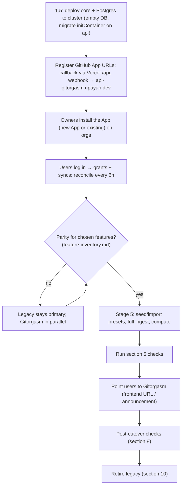

# Migration plan: legacy GH Org Tool to Gitorgasm

Status: Proposal for Stages 1.5 to 5. Evidence: `database-audit.md`, `legacy-audit.md`, `feature-inventory.md`. Integrator decisions: `decisions.md` item 18.

Labels: **Verified** (file path, command, or official URL), **Assumption**, **Decision**, **Alternative considered**, **Proposal**, **Planned**.

## 1. Principles

- **Decision**: no big-bang migration. Gitorgasm rebuilds almost all state from GitHub. Users log in again.
- **Decision**: migrate only data that GitHub cannot recreate. That is the scoring presets (8 tables, 186 rows). **Verified**: `database-audit.md` §1, §4.3.
- **Decision**: the legacy app keeps running until Gitorgasm reaches parity for the chosen features. Cutover = point users at Gitorgasm.

## 2. What migrates, rebuilds, or is discarded

Source: `database-audit.md` §6. **Verified**.

| Legacy item | Rows | Action | Gitorgasm target | Stage |
|---|---:|---|---|---|
| `users` | 29 | Rebuild | `users` at login. Org members in `org_members` (Planned). | 1 / 3 |
| `organizations`, `github_installations` | 10, 8 | Rebuild | `accounts`, `installations` from login and `reconcile_installations` | 1 |
| `repositories` | 372 | Rebuild | `repositories` via `sync_installation` | 1 |
| `organization_memberships` | 16 | Rebuild | `org_members` (Planned) + `user_installations` grants | 3 |
| `teams`, `team_members`, `team_repositories` | 7, 25, 4 | Rebuild | Planned team tables | 3 |
| `installation_repositories` | 0 | Discard | none (no writer existed) | – |
| `scoring_presets` + 7 child tables | 186 | **Migrate or reseed** | Planned preset tables | 5 |
| `signals` | 50 | Rebuild | Planned `signals` via full ingest. Dump used only to reconcile. | 5 |
| `leaderboard_materializations`, `computed_scores` | 106, 109 | Rebuild | Rust scoring service output | 5 |
| `signals_default`, `signals_partition_health` | – , 1 | Discard | none | – |
| `ingest_log`, `repository_sync_state` | 2, 17 | Discard | `sync_state` and Planned ingest state start empty | – |
| `auth_sessions`, `session_installations` | 2, 5 | Discard | none. Both sessions expired. Tokens bound to the legacy key. | – |
| Redis keys (all namespaces) | n/a | Discard | none. Databases are NXDOMAIN. Cache only. | – |

## 3. Schema mapping for scoring presets (Planned, Stage 5)

**Proposal**. Legacy columns from `database-audit.md` §2.2. Gitorgasm tables do not exist yet.

| Legacy table | Gitorgasm table | Natural key | Column changes |
|---|---|---|---|
| `scoring_presets` (`id bigserial`, `installation_id`, `preset_name`, `is_active`) | `scoring_presets` (`id GENERATED ALWAYS AS IDENTITY`, `installation_id → installations.github_id`, `name`, `is_active`) | `(installation_id, name)` | rename `preset_name` → `name`. Keep partial unique index "one active preset per installation". |
| `scoring_preset_rules` | `scoring_preset_rules` | `preset_id` (1:1) | same columns and defaults: 9, 0.11, 0.2, -12, -10 |
| `scoring_preset_base_points` | `scoring_preset_base_points` | `(preset_id, signal_type)` | `signal_type` enum kept with same values |
| `scoring_preset_multipliers` | `scoring_preset_multipliers` | `(preset_id, kind)` | identity id |
| `scoring_preset_multiplier_signal_types` | `scoring_preset_multiplier_signal_types` | `(multiplier_id, signal_type)` | resolve `multiplier_id` through `(preset, kind)` |
| `scoring_preset_review_state_weights` | same | `(preset_id, state)` | – |
| `scoring_preset_daily_quotas` | same | `(preset_id, signal_type)` | – |
| `scoring_preset_zero_point_conditions` | same | `(preset_id, kind)` | – |

Rules (**Decision**): no `updated_at` triggers. The store sets `updated_at = now()` in each `UPDATE`, as in `store.UpsertInstallation`. Drop single-column indexes that duplicate a PK prefix (`database-audit.md` §2.5 item 4).

## 4. Seed or import

**Verified**: all 6 legacy presets are unedited defaults with identical values (`database-audit.md` §4.3).

**Decision** (decisions item 18): seed a `Default` preset for every installation in Stage 5. Seed it in the same transaction that first upserts the installation, so every installation always has exactly one active preset.

**Alternative considered** (kept as an option): import from the dump for exact provenance. Design below.

### 4.1 Idempotent import design (optional)

1. Verify the dump. Compare each file's SHA-256 with `MANIFEST.json` in `~/.local/share/gitorgasm-dumps/supabase-dev-2026-10-26/`. Stop on mismatch.
2. Precondition: `reconcile_installations` has run. A preset whose `installation_id` is not in `installations` is skipped and logged.
3. One transaction per preset with all children.
4. Upsert by natural key: `INSERT … ON CONFLICT (installation_id, name) DO UPDATE`, and the child natural keys from section 3.
5. Record provenance in `legacy_import_map`:

```sql
CREATE TABLE legacy_import_map (
    source_table TEXT        NOT NULL,
    legacy_id    TEXT        NOT NULL,   -- composite keys serialized as "a:b"
    new_id       BIGINT,
    import_run   UUID        NOT NULL,
    imported_at  TIMESTAMPTZ NOT NULL DEFAULT now(),
    PRIMARY KEY (source_table, legacy_id)
);
```

6. A re-run with the same dump changes no values and only updates `imported_at`. A re-run never creates duplicates because every insert targets a natural key.
7. The import is a one-shot command of the `migrate` role (for example `gitorgasm import-presets --dir <path>`). It is not an HTTP endpoint. It reads the dump from a mounted path, never from the repository.

## 5. Validation and reconciliation queries

Run after the import or seed. Pass conditions from `database-audit.md` §7.4.

```sql
-- 1. Exactly one active preset per live installation.
SELECT i.github_id
  FROM installations i
  LEFT JOIN scoring_presets p ON p.installation_id = i.github_id AND p.is_active
 WHERE i.deleted_at IS NULL
 GROUP BY i.github_id
HAVING count(p.id) <> 1;                       -- expect 0 rows

-- 2. Child counts for imported presets (expect 6/42/18/54/18/12/30 for 6 presets).
SELECT
  (SELECT count(*) FROM scoring_preset_rules)                   AS rules,
  (SELECT count(*) FROM scoring_preset_base_points)             AS base_points,
  (SELECT count(*) FROM scoring_preset_multipliers)             AS multipliers,
  (SELECT count(*) FROM scoring_preset_multiplier_signal_types) AS multiplier_signal_types,
  (SELECT count(*) FROM scoring_preset_review_state_weights)    AS review_weights,
  (SELECT count(*) FROM scoring_preset_daily_quotas)            AS quotas,
  (SELECT count(*) FROM scoring_preset_zero_point_conditions)   AS zero_point;

-- 3. Value fingerprint per preset; compare with the same hash computed from the dump.
SELECT p.installation_id, p.name,
       md5(string_agg(bp.signal_type || ':' || bp.points::text, ',' ORDER BY bp.signal_type)) AS base_points_hash
  FROM scoring_presets p JOIN scoring_preset_base_points bp ON bp.preset_id = p.id
 GROUP BY p.installation_id, p.name;

-- 4. Legacy installations that did not come back (explain each: uninstalled on GitHub?).
SELECT legacy_id FROM unnest($1::bigint[]) AS legacy_id   -- the 8 ids from the dump
 WHERE legacy_id NOT IN (SELECT github_id FROM installations WHERE deleted_at IS NULL);

-- 5. Repository count per org vs. legacy (difference = repos created/deleted since 2026-10-06).
SELECT a.login, count(r.*) FROM accounts a
  JOIN installations i ON i.account_id = a.github_id
  LEFT JOIN repositories r ON r.installation_id = i.github_id AND r.deleted_at IS NULL
 GROUP BY a.login ORDER BY a.login;
```

Stage 5 signal and leaderboard checks: the legacy dedup tuple set is a subset of the rebuilt set. Top-10 contributor order matches per org and period, or the difference is explained by activity after 2026-10-06 (`database-audit.md` §7.4).

## 6. Cutover



**Decision**: whether to register a new GitHub App or reuse the legacy App is a Stage 1.5 owner decision (decisions roadmap). If the legacy App is reused, the webhook URL can point at only one receiver. Then legacy webhook handling stops at that moment. **Assumption**: legacy webhook handling is not critical (it only upserts installations, `legacy-audit.md` §6.2).

## 7. Rollback

| Failure | Rollback |
|---|---|
| Gitorgasm deploy fails | Remove the Argo CD Application. Legacy is unaffected. |
| Preset import wrong | Delete rows listed in `legacy_import_map` for the run, or restore the `pg_dump -Fc` taken just before the import. |
| Cutover rejected by users | Point users back to the legacy URL. |
| Database corruption | Restore the latest restic `pg_dump` from R2. RPO ≤ about 1 h (decisions item 4). |

**Verified** constraint: the legacy app has no live production database. Staging and production Supabase projects and both Upstash databases are NXDOMAIN. Only the dev project resolves (`database-audit.md` §3). So "roll back to legacy" means the legacy UI backed by the dev Supabase project, with its known defects. **Assumption**: that is acceptable to the owner. Confirm before cutover.

## 8. Post-cutover checks

- Every live installation has exactly 1 active preset (query 1).
- `sync_state.last_succeeded_at` is within 6 h for every active installation.
- `webhook_deliveries` rows arrive and `processed_at` is set. No growing backlog in `webhook_deliveries_unprocessed_idx`.
- `gitorgasm_github_rate_limit_remaining` stays above 20 % of the budget.
- No `river_job` in `discarded` state for `sync_installation` over 24 h.
- Purge jobs (Planned) log row counts.
- A restic backup of the new database exists in R2. A restore drill to a scratch database succeeds.

## 9. Dump handling

**Verified**: dumps are in `~/.local/share/gitorgasm-dumps/` with directory mode 700 and file mode 600, outside any repository. They exclude session ids and token ciphertext. They contain personal data (logins, names, avatars, commit messages, PR bodies) (`database-audit.md` §8).

**Proposal**:

1. Never copy dumps into this repository, CI artifacts, container images, or the cluster, except as a short-lived mounted Secret or volume for the import Job.
2. Encryption at rest: keep the dump directory on an encrypted disk (LUKS or equivalent), or wrap it with `age` to the owner's key. **Assumption**: the workstation disk encryption state is not verified.
3. Retention: delete the dump directory at most 30 days after the section 5 checks pass. If the owner chooses seed instead of import, delete it 30 days after Stage 5 checks pass. Record the deletion date in the release notes.
4. Do not back up the dump directory to R2.

## 10. Legacy app retirement criteria

Retire the legacy Vercel app and the dev Supabase project when all are true:

1. Gitorgasm covers every feature that the owner marks "keep" in `feature-inventory.md`.
2. Post-cutover checks (section 8) pass for 14 consecutive days.
3. No legacy login in the last 14 days. **Assumption**: Vercel logs show this. Check access.
4. The dump is deleted per section 9, or the owner keeps it under an explicit exception.
5. The legacy GitHub App is uninstalled from all orgs, or its URLs point at Gitorgasm.

Retirement steps: remove the Vercel project, delete the dev Supabase project, revoke legacy secrets (`TOKEN_ENCRYPTION_KEY`, client secret, webhook secret, private key if the App is retired), archive the legacy repository.
