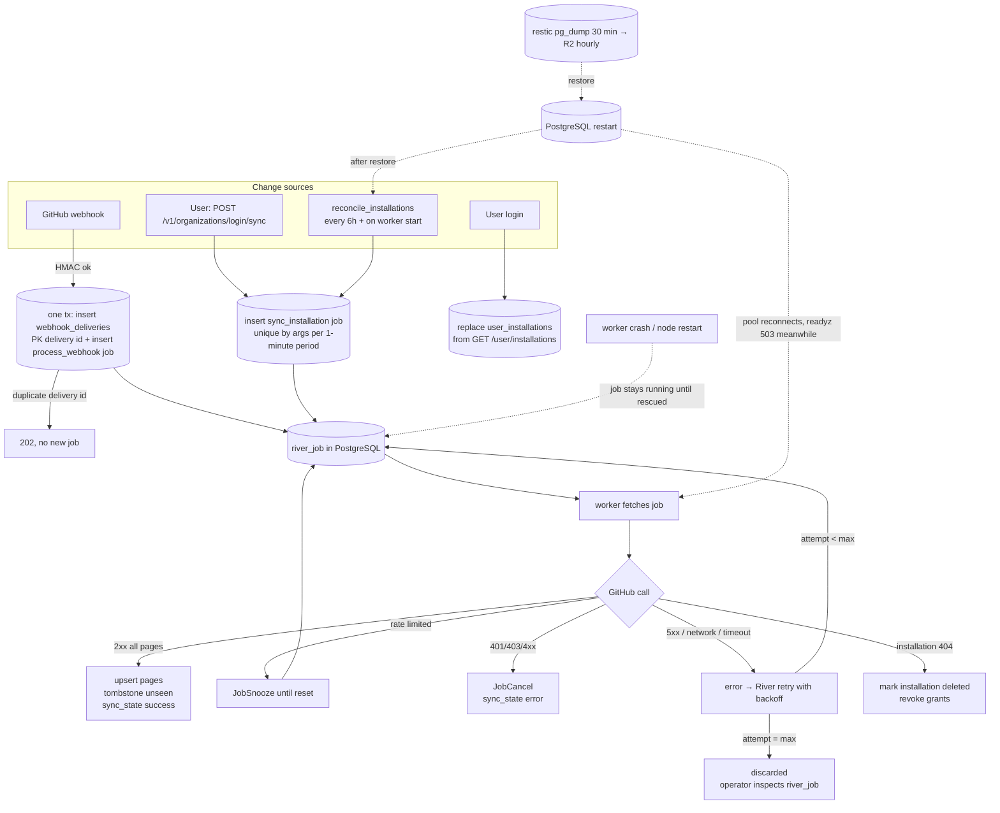

# Reliability

Status date: 2026-10-26. Labels: **Verified** (with source), **Assumption**, **Decision**, **Alternative considered**, **Planned**.

Gitorgasm runs on one node (`cluster-audit.md` §1). It has no high availability. The design goal is **correct recovery**, not uptime: after any failure, data converges to GitHub's state without manual repair, and no work is lost silently.

## 1. Recovery model

## 2. Failure modes

| #   | Failure                                  | Detection                                               | Behaviour (current code or Planned)                                                                                                                                                                                                                                                                                                                                                                                                                                                                                                                                                                                              | Residual risk                                                                                                                                |
| --- | ---------------------------------------- | ------------------------------------------------------- | -------------------------------------------------------------------------------------------------------------------------------------------------------------------------------------------------------------------------------------------------------------------------------------------------------------------------------------------------------------------------------------------------------------------------------------------------------------------------------------------------------------------------------------------------------------------------------------------------------------------------------- | -------------------------------------------------------------------------------------------------------------------------------------------- |
| F1  | Worker crash mid-job                     | pod restart count, `absent(up)`                         | **Verified** River keeps the row in state `running`. River's rescuer moves stuck jobs back to retryable after its rescue threshold (River default, **Assumption**: 1 h). Sync is idempotent: upserts keyed by GitHub id, tombstone only after a full pass (`jobs.go`).                                                                                                                                                                                                                                                                                                                                                           | Sync delayed up to the rescue threshold.                                                                                                     |
| F2  | Node failure or reboot                   | external uptime check (Planned), Cloudflare 5xx         | Everything stops. k3s restarts pods after boot. Jobs resume from Postgres. Webhooks sent during the outage fail at GitHub. Reconcile `RunOnStart` (**Verified** `jobs.go` `PeriodicJobOpts{RunOnStart: true}`) re-reads all installations when the worker starts.                                                                                                                                                                                                                                                                                                                                                                | Downtime equals node downtime. Lost deliveries are covered by reconcile, not replayed.                                                       |
| F3  | PostgreSQL restart                       | `/readyz` 503, error logs                               | **Verified** `/readyz` pings Postgres. The api pod leaves the Service. pgx pool reconnects on next use. Jobs in flight fail and retry. Liveness does not check the DB, so pods are not killed.                                                                                                                                                                                                                                                                                                                                                                                                                                   | Requests fail with 503 or 500 during the restart.                                                                                            |
| F4  | GitHub rate limit (primary or secondary) | `gitorgasm_github_rate_limit_remaining`, 403/429 counts | **Verified** client classifies by `retry-after`, then `x-ratelimit-reset`, then 60 s (`github/client.go`, per [GitHub rate-limit docs](https://docs.github.com/en/rest/using-the-rest-api/rate-limits-for-the-rest-api)). Worker returns `river.JobSnooze` until then (`jobs.go` `retryDecision`). A rate-limited pass never tombstones. Queue `github` has `WORKER_CONCURRENCY` (default 4) workers, which keeps concurrency far below GitHub's 100 concurrent request limit.                                                                                                                                                   | One large org can delay others on the same queue.                                                                                            |
| F5  | GitHub outage                            | `gitorgasm_github_requests_total{status=~"5xx\|error"}` | **Verified** 5xx and network errors return plain errors. River retries with backoff up to `MaxAttempts` (8 for sync). Login fails with an error response. Data already synced stays readable.                                                                                                                                                                                                                                                                                                                                                                                                                                    | After 8 failed attempts a sync job is discarded. The next reconcile re-enqueues it.                                                          |
| F6  | Duplicate webhooks                       | none needed                                             | **Verified** `webhook_deliveries` primary key is the `X-GitHub-Delivery` GUID. `process_webhook` is unique by delivery id. Handlers enqueue a sync that re-reads GitHub, so order does not matter (decisions §11).                                                                                                                                                                                                                                                                                                                                                                                                               | none known                                                                                                                                   |
| F7  | Poison message                           | River `discarded` state                                 | **Verified** `process_webhook` max 10 attempts, `sync_installation` max 8 (`jobs.go`). After that River sets the job to `discarded`. Invalid input returns `JobCancel` (state `cancelled`) without retries. Inspect: `SELECT id, kind, args, errors FROM river_job WHERE state IN ('discarded','cancelled') ORDER BY finalized_at DESC LIMIT 50;`. Retry one job with `river.Client.JobRetry` (Planned admin command).                                                                                                                                                                                                           | No alert yet (Planned with job metrics).                                                                                                     |
| F8  | Partial sync                             | `sync_state.last_error`                                 | **Verified** each page upserts with `synced_at = pass start`. Tombstoning runs only after every page succeeded. A failed pass records the error and the count seen and leaves old rows (`jobs.go`, `store.SyncFinished`).                                                                                                                                                                                                                                                                                                                                                                                                        | Stale rows remain visible until the next full pass. Users see `synced_at`.                                                                   |
| F9  | Network partition (pod ↔ GitHub)         | GitHub `error` status count                             | Same as F5. HTTP client timeout `GITHUB_REQUEST_TIMEOUT` (default 20 s, `config.go`). Job timeout 15 min (`SyncWorker.Timeout`).                                                                                                                                                                                                                                                                                                                                                                                                                                                                                                 | none beyond F5                                                                                                                               |
| F10 | Retry storm                              | GitHub request rate, rate-limit gauge                   | River backoff grows per attempt (**Assumption**: River default policy, attempt⁴ seconds plus jitter). Unique jobs collapse repeat sync requests for the same installation (**Verified** `jobs.go`: `UniqueOpts{ByArgs: true, ByPeriod: time.Minute}`). Rate limits snooze instead of retry. Concurrency is capped per queue.                                                                                                                                                                                                                                                                                                     | A burst of many installations at reconcile time. Reconcile every 6 h keeps this small (estimate: 10k repos ≈ 102 requests per installation). |
| F11 | Deployment interruption                  | Argo CD sync status                                     | **Verified** manifests (`deploy/kustomize/base`): api uses `RollingUpdate` with `maxUnavailable: 0`. The `migrate` initContainer blocks a bad image before it serves. The worker uses the default `RollingUpdate`, so old and new workers overlap for a short time. River claims each job once. A session advisory lock per installation (`hashtextextended('gitorgasm:sync_installation:' \|\| id, 0)`, 64-bit, `jobs.go`) stops two sync passes on one installation. The second pass snoozes 30 s. Graceful shutdown drains in 25 s within a grace period of 30 s (api) or 40 s (worker). Interrupted jobs retry after rescue. | Jobs cut off after the grace period wait for the River rescuer.                                                                              |
| F12 | Schema evolution                         | migrate initContainer fails, pod `Init:Error`           | **Decision** expand → deploy → contract. Each migration stays compatible with the previous binary for one release. No down migrations in production. River migrations run in the same `migrate` role (`internal/db/db.go`).                                                                                                                                                                                                                                                                                                                                                                                                      | A long-running migration blocks api rollout. Test migrations on a restored dump first (Stage 6 drill).                                       |
| F13 | Data loss on disk                        | backup staleness alerts                                 | Restore from restic (section 4). Then reconcile rebuilds all GitHub-derived data.                                                                                                                                                                                                                                                                                                                                                                                                                                                                                                                                                | Data written after the last offsite copy is lost (sessions, webhook rows). Users log in again.                                               |
| F14 | Token key loss                           | decrypt errors on refresh (Planned)                     | Sealed tokens become unreadable. Users log in again. `key_version` allows rotation (decisions §8).                                                                                                                                                                                                                                                                                                                                                                                                                                                                                                                               | Back up `TOKEN_ENCRYPTION_KEY` only through SOPS in `deploy/argocd/secrets.sops.yaml`.                                                       |

GitHub webhook facts (**Verified** official docs):

- GitHub does not redeliver failed deliveries automatically. Manual redelivery is possible for recent deliveries ([Redelivering webhooks](https://docs.github.com/en/webhooks/testing-and-troubleshooting-webhooks/redelivering-webhooks)). **Decision**: rely on reconcile instead of redelivery.
- GitHub expects a 2XX response within 10 seconds ([Best practices for using webhooks](https://docs.github.com/en/webhooks/using-webhooks/best-practices-for-using-webhooks)). The handler stores the body and returns 202 without calling GitHub.

## 3. SLO candidates

No numbers are achieved yet. Nothing is deployed. Targets below are **Proposals** to confirm after four weeks of production data (Stage 6).

| SLI                | Measurement                                                                                                                                                                                                                   | Candidate target                                       |
| ------------------ | ----------------------------------------------------------------------------------------------------------------------------------------------------------------------------------------------------------------------------- | ------------------------------------------------------ |
| API availability   | `1 - (sum(rate(gitorgasm_http_requests_total{status=~"5.."}[30d])) / sum(rate(gitorgasm_http_requests_total[30d])))`, excluding health routes. Server-side only, so it misses node-down time. Add an external probe for that. | 99.0% per 30 days (single node; planned reboots count) |
| API latency        | `histogram_quantile(0.95, …gitorgasm_http_request_duration_seconds_bucket…)` for `GET /v1/*`                                                                                                                                  | p95 < 300 ms                                           |
| Webhook acceptance | share of `POST /webhooks/github` with status 202 or duplicate 202                                                                                                                                                             | 99.5%                                                  |
| Sync freshness     | share of active installations with `sync_state.last_succeeded_at` newer than 2 × `RECONCILE_INTERVAL` (12 h). SQL on `sync_state`                                                                                             | 99%                                                    |
| Job success        | share of River jobs finalized as `completed` or `cancelled` vs `discarded` (needs job metrics, Planned)                                                                                                                       | 99.9% not discarded                                    |

## 4. Backup, RPO, RTO

Design (**Verified** cluster mechanism in `cluster-audit.md` §6, **Planned** for Gitorgasm):

- Class A restic target, `engine: postgres`: logical `pg_dump -Fc` inside the postgres pod every 30 minutes to the local repository `/var/backups/restic`.
- Hourly `restic copy` to Cloudflare R2 bucket `vps-backups`.
- Retention: `--keep-within 48h --keep-daily 30 --keep-weekly 12 --keep-monthly 12`.
- Weekly `restic check`. Monthly restore drill for class A on the 1st.

| Scenario                               | RPO                                                                        | RTO                                                                                          |
| -------------------------------------- | -------------------------------------------------------------------------- | -------------------------------------------------------------------------------------------- |
| Postgres data corruption, node healthy | ≤ 30 min (local snapshot)                                                  | manual. Estimate < 1 h (restore dump into empty PV, run migrate, start worker). Not measured |
| Node or disk loss                      | ≤ 1.5 h worst case (30 min dump interval + 1 h copy interval)              | node rebuild per cluster `docs/disaster-recovery.md`, then restore. Not measured             |
| GitHub-derived data                    | 0 effective: reconcile rebuilds repositories and installations from GitHub | one reconcile pass                                                                           |

**Conflict noted**: decisions §4 states "RPO ≤ ~1 h offsite". `cluster-audit.md` §6 computes about 1.5 h worst case (30 min + 1 h). This document uses the worst case.

Restore runbook outline (Planned, write in Stage 1.5):

1. Scale `worker` and `api` to 0.
2. `restic restore` the latest class A snapshot for `gitorgasm`.
3. `pg_restore --clean --if-exists` into the postgres pod.
4. Run `gitorgasm migrate`. Start `worker`. `RunOnStart` reconcile re-syncs all installations.
5. Start `api`. Users with lost sessions log in again.
