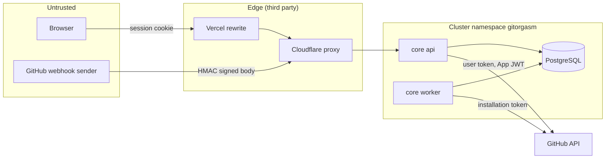

# Requirements

This document defines who uses Gitorgasm, what it must do, and how well it must do it. It derives the capability list from the legacy audit. It does not approve features by itself.

Sources:

- [feature-inventory.md](./feature-inventory.md) (legacy features, status, recommendation).
- [legacy-audit.md](./legacy-audit.md) (legacy defects, security findings SEC-1 to SEC-13).
- Integrator decisions (the decision numbers below, for example D9, refer to that list).
- Implemented code in `core` (the only code that exists in the backend now).

Labels: **Verified** (cites a file, command, or URL), **Assumption**, **Decision**, **Alternative considered**, **Planned**.

## 1. Rule: a missing feature is not an approved requirement

**Decision**: a legacy gap, a stub hook, or an unused table does not become a requirement automatically. A capability becomes a requirement only when it appears in sections 4.1 to 4.3 with a milestone. Sections 4.4 and 4.5 are candidates. They need an explicit decision before work starts.

Examples:

- Legacy has a stub `useActivityTimelineQuery` that returns `[]` (**Verified**: feature-inventory §2.6). This shows intent. It is not a requirement. It is in section 4.5.
- Legacy has ETag columns that are always null (**Verified**: database-audit.md finding 3). Conditional requests are an optimization candidate, not a requirement.

## 2. Personas

| Persona                | Description                                                                        | Main goals                                                        | GitHub role                              |
| ---------------------- | ---------------------------------------------------------------------------------- | ----------------------------------------------------------------- | ---------------------------------------- |
| Org admin              | Owner of a GitHub organization (for example a student club lead).                  | Invite members in bulk, change roles, manage teams, see activity. | Organization owner.                      |
| Org member             | Member of an organization that installed the App.                                  | See repositories, see own contribution and leaderboard rank.      | Organization member.                     |
| App installer          | The person who installs the GitHub App on an org. Often the same as the org admin. | Install, check permissions, see sync status.                      | Owner, or a member who requests install. |
| Operator               | The person who runs the cluster (one person today).                                | Deploy, back up, restore, watch budgets and errors.               | None in the target orgs. Cluster admin.  |
| Contributor (indirect) | A GitHub user whose activity is scored. They may never sign in.                    | Fair scoring. Correct name and avatar.                            | Any.                                     |

**Assumption**: the scale is student orgs and small communities. Legacy dev data has 10 orgs, 372 repos, and 29 users (decisions, workload numbers). Large enterprise orgs are not the target, but the design must not break at 10,000 repositories (see [workload-model.md](./workload-model.md)).

## 3. Trust boundaries

| Boundary               | What crosses it          | Control                                                                                                                                   | Status                                                                                                                     |
| ---------------------- | ------------------------ | ----------------------------------------------------------------------------------------------------------------------------------------- | -------------------------------------------------------------------------------------------------------------------------- |
| Browser → api          | Session cookie, JSON     | Opaque 256-bit session id in `__Host-gitorgasm_session`. Only its SHA-256 hash is stored. Origin check on unsafe methods.                 | **Verified**: `core/internal/httpapi/auth/oauth.go`, `sessions.id_hash` in `core/internal/db/migrations/00001_core.sql`          |
| User → tenant data     | Org and repository reads | Grant edge `user_installations`, written only from `GET /user/installations` with the user's token.                                       | **Verified**: `tenancy.ReplaceUserInstallations`, `tenancy.AccessibleInstallation` in `core/internal/store/tenancy`        |
| GitHub → webhook route | Signed event body        | HMAC-SHA256 `X-Hub-Signature-256`, constant-time compare, 25 MiB cap, delivery-id dedupe.                                                 | **Verified**: `core/internal/httpapi/webhook/deliveries.go` (`maxWebhookBytes = 25 << 20`, `github.VerifySignature`)                 |
| api/worker → GitHub    | Tokens                   | App private key, installation tokens cached in memory, user tokens sealed with AES-256-GCM at rest. Link-following stays on the API host. | **Verified**: `core/internal/github/tokens.go`, `core/internal/github/transport.go`, `core/internal/secure/secure.go`      |
| api/worker → Postgres  | SQL                      | Default-deny NetworkPolicy allows TCP 5432 from `api` and `worker`; application uses one DB user.                                         | **Verified**: `deploy/kustomize/base/networkpolicies.yaml`, `postgres.yaml`                                                |
| Operator → cluster     | Secrets                  | SOPS + age through ksops in `deploy/argocd`.                                                                                              | First deploy via `upayanmazumder/cluster#77`; encrypted secret values are in `deploy/argocd/secrets.sops.yaml` (ADR 0012). |

**Decision**: the browser never holds a GitHub token, a Supabase key, or any privileged credential (D7). This removes legacy SEC-4 and SEC-7.

## 4. Capabilities

### 4.1 Preserve (port the behavior)

| Capability                                                                             | Legacy evidence              | Milestone | Status in Gitorgasm                                                                                                                                         |
| -------------------------------------------------------------------------------------- | ---------------------------- | --------- | ----------------------------------------------------------------------------------------------------------------------------------------------------------- |
| GitHub App sign-in and sign-out                                                        | feature-inventory §2.1, §2.3 | M1        | **Verified** implemented (redesigned with PKCE): `GET /v1/auth/login`, `GET /v1/auth/callback`, `POST /v1/auth/logout` in `core/internal/httpapi/routes.go` |
| Installation access and permission check page                                          | feature-inventory §2.1       | M2        | Planned. Needs a permission manifest.                                                                                                                       |
| Scoring engine (normalize, rules, quotas, diminishing returns, multipliers, penalties) | legacy-audit §9              | M5        | Planned. Port with golden tests.                                                                                                                            |
| Scoring presets and ruleset import/export                                              | feature-inventory §2.1       | M5        | Planned. Reseed defaults (D18).                                                                                                                             |
| Contributor, repository, and team leaderboards                                         | feature-inventory §2.2       | M5        | Planned                                                                                                                                                     |
| Contributor profile with heatmap                                                       | feature-inventory §2.1       | M5        | Planned                                                                                                                                                     |
| GitHub user search for invites                                                         | feature-inventory §2.1       | M4        | Planned                                                                                                                                                     |

### 4.2 Redesign (keep the goal, change the design)

| Capability                            | Legacy defect                                        | New design                                                                              | Milestone | Status                                                                |
| ------------------------------------- | ---------------------------------------------------- | --------------------------------------------------------------------------------------- | --------- | --------------------------------------------------------------------- |
| Sessions and token storage            | SEC-7, SEC-10, plain session id                      | Hashed session id, sealed token with AAD = user id, `key_version`                       | M1        | **Verified** implemented: `sessions` table, `secure.Sealer`           |
| Installation linking                  | SEC-2 IDOR                                           | Grants only from `GET /user/installations`                                              | M1        | **Verified** implemented: `auth.go` callback                          |
| Membership and admin role tracking    | SEC-3 stale roles                                    | Re-check `GET /user/memberships/orgs/{org}` before each mutation. Periodic re-verify.   | M2        | Planned                                                               |
| Installation webhook | SEC-6 fail-open, no dedupe | Fail closed. Store raw body. Dedupe by `X-GitHub-Delivery`. Process in a job. | M1 | **Verified** implemented: `webhook_deliveries`, `internal/jobs/webhook` |
| Mass invite, bulk role, team bulk-add | 50 parallel calls, owner-invite (SEC-9), no audit    | Planned, dry-run, checkpointed River jobs with per-item results, Idempotency-Key, audit | M4        | Planned                                                               |
| Ingest pipeline                       | 300 s request limit, swallowed errors, 90-day window | Resumable background jobs with per-repo cursors and GraphQL cost accounting             | M5        | Planned                                                               |
| Score materialization                 | Non-atomic swap                                      | Transactional swap in one Postgres transaction                                          | M5        | Planned                                                               |
| Org analytics overview                | 1000-row truncation, in-memory aggregation           | SQL rollup tables                                                                       | M6+       | Planned                                                               |
| Caching                               | SEC-1 cross-tenant cache leak                        | No shared cache. Tenant-scoped SQL queries.                                             | M1        | **Decision** (D4). No cache exists.                                   |
| Manual sync and sync status           | Stub hooks                                           | `POST /v1/organizations/{login}/sync` + `sync_state`                                    | M1        | **Verified** sync request implemented. Status read endpoint: Planned. |

### 4.3 Necessary backend capabilities (not user features)

| Capability                                                       | Why                                       | Milestone                      | Status                                                                                                        |
| ---------------------------------------------------------------- | ----------------------------------------- | ------------------------------ | ------------------------------------------------------------------------------------------------------------- |
| Durable job queue with transactional enqueue                     | Legacy ran all work in requests           | M1                             | **Verified**: River v0.49 (`core/go.mod`, `core/internal/jobs/jobs.go`)                                       |
| Rate-limit-aware GitHub client | Legacy had one default retry | M1 | **Verified**: error classification and snooze in `jobs/internal/execution`, metrics in `github/transport.go` |
| Periodic reconciliation                                          | Webhooks can be lost                      | M1                             | **Verified**: `reconcile_installations`, `RECONCILE_INTERVAL` default `6h` (`core/internal/config/config.go`) |
| Audit log                                                        | No audit in legacy                        | M1 (table), M4 (all mutations) | **Verified** table `audit_events` and writes for `session.created`, sync request, `session.revoked_by_github` |
| Metrics, logs, traces                                            | Legacy logged to console only             | M1                             | **Verified**: `core/internal/obs/obs.go`. River job metrics: Planned.                                         |
| Single permission manifest                                       | Docs, runtime list, and real needs differ | M2                             | Planned                                                                                                       |
| Scheduled maintenance (session purge, webhook payload retention) | Legacy SQL functions had no caller        | M2                             | Implemented: `purge_sessions`, `purge_webhook_deliveries` (daily River jobs).                                 |
| Backup and restore runbook                                       | Single disk                               | M1.5                           | Planned (restic class A, see D4)                                                                              |

### 4.4 Valuable future capabilities (candidates)

These need an explicit decision before work starts.

| Capability                                                                    | Source                 | Earliest stage               |
| ----------------------------------------------------------------------------- | ---------------------- | ---------------------------- |
| Org member list with roles, pending invitations, cancel invite, remove member | feature-inventory §2.7 | M3 (mirror) and M4 (actions) |
| Team CRUD and remove member                                                   | feature-inventory §2.7 | M4                           |
| Webhook-driven incremental ingest (`push`, `pull_request`, `issues`, reviews) | feature-inventory §2.7 | M5                           |
| Leaderboard CSV export                                                        | feature-inventory §2.7 | after M5                     |
| Database-enforced tenant isolation (RLS)                                      | feature-inventory §2.7 | M6                           |
| Repository search (`pg_trgm`)                                                 | D4                     | after M3                     |
| SSE progress for operations                                                   | D6                     | M4                           |

### 4.5 Speculative (no plan)

| Capability                          | Why speculative                                    |
| ----------------------------------- | -------------------------------------------------- |
| Activity timeline                   | Stub only in legacy. No data model.                |
| Spam detection                      | Enum value exists, nothing emits it.               |
| Public landing stats                | Legacy numbers were wrong (1000-row cap).          |
| Custom date ranges for leaderboards | No UI in legacy. Cost unknown.                     |
| Conditional GitHub requests (ETags) | Optimization. Only useful if budget becomes tight. |
| Multi-region or HA deployment       | One node, no budget (D4).                          |

### 4.6 Removed

Debug routes, mobile auth mode, programmatic install completion, GraphQL proxy, in-app docs site, and dead modules (feature-inventory §2.5). **Decision**: do not port.

## 5. MVP and milestones

**Decision**: the MVP is the smallest release that replaces legacy for one org admin without the legacy security defects. It is M1 + M1.5 + M2 + M3 + M4. Leaderboards (M5) are a second release because their data path is the largest rebuild.

| Milestone             | Scope                                                                                                      | Exit criteria                                                                                                                                                 | State                                                                                                                                                                                                                                                                                         |
| --------------------- | ---------------------------------------------------------------------------------------------------------- | ------------------------------------------------------------------------------------------------------------------------------------------------------------- | --------------------------------------------------------------------------------------------------------------------------------------------------------------------------------------------------------------------------------------------------------------------------------------------- |
| M1 Foundation         | Repo, CI, core slice (auth, orgs, repos, sync, webhooks), compose, kustomize                               | Tests pass. OpenAPI contract matches responses.                                                                                                               | In progress. **Verified** files exist: `core`, `contracts/openapi/v1.yaml`, `compose.yaml`, `Makefile`, `.github/workflows/`, `deploy/kustomize`, `web` (template only). Open: push the repository and get a green CI run ([implementation-roadmap.md](./implementation-roadmap.md) Stage 1). |
| M1.5 First deploy     | Cluster repo PR, SOPS secrets, DNS approval, GitHub App registration, GHCR access decision, Vercel rewrite | api and worker pods Ready. `GET /v1/me` on `api-gitorgasm.upayan.dev` returns 401 `unauthenticated` (the Ingress does not expose `/readyz`). Backup job runs. | Planned                                                                                                                                                                                                                                                                                       |
| M2 Identity hardening | Grant re-verify, org role checks, refresh tokens, frontend login and org/repo pages                        | Revoked members lose access within one re-verify interval.                                                                                                    | Planned                                                                                                                                                                                                                                                                                       |
| M3 Sync breadth       | Teams, members, invitations mirror. Membership, team, organization webhooks.                               | Mirror converges after a forced reconcile.                                                                                                                    | Planned                                                                                                                                                                                                                                                                                       |
| M4 Operations         | Mass invite, bulk role, team bulk-add as jobs. Idempotency-Key. SSE. Audit.                                | A repeated request does not repeat GitHub mutations. Each item has a result.                                                                                  | Planned                                                                                                                                                                                                                                                                                       |
| M5 Leaderboards       | Signals ingest (GraphQL with cost accounting), Rust scoring service, preset import                         | Golden tests match legacy scores on the same input.                                                                                                           | Planned                                                                                                                                                                                                                                                                                       |
| M6 Hardening          | Load tests, restore drills, OTel backend, alerting, SLOs                                                   | Restore drill succeeds within the stated RTO.                                                                                                                 | Planned                                                                                                                                                                                                                                                                                       |

## 6. Non-functional requirements

All targets are **Decision** values for planning. None is measured yet. Measurement methods are in [workload-model.md §6](./workload-model.md#6-key-metrics).

| Area              | Requirement                                                                                                                                                                                                                         |
| ----------------- | ----------------------------------------------------------------------------------------------------------------------------------------------------------------------------------------------------------------------------------- |
| Latency           | Read endpoints (`/v1/me`, `/v1/organizations`, repository list page) p95 ≤ 200 ms and p99 ≤ 500 ms at the api, excluding the edge. No GitHub call on a read path after login.                                                       |
| Webhook ack       | Respond 202 well inside GitHub's 10 s limit. Target p99 ≤ 1 s. **Verified** limit: [GitHub webhook best practices](https://docs.github.com/en/webhooks/using-webhooks/best-practices-for-using-webhooks#respond-within-10-seconds). |
| Freshness         | Mirror data converges within one reconcile interval (default 6 h) without webhooks, and within minutes with webhooks.                                                                                                               |
| Availability      | Single node. No HA. Target: restart-based recovery. No uptime SLO before M6.                                                                                                                                                        |
| Durability        | RPO ≤ ~1 h offsite (30 min local). RTO manual with a runbook (D4).                                                                                                                                                                  |
| Rate-limit safety | Never exceed a primary limit by design. On limit, snooze until reset. Never retry 401/403/4xx (D5).                                                                                                                                 |
| Security          | No privileged token in the browser. Tenant checks on every org-scoped query. 404 for inaccessible orgs (D6). Fail closed on missing secrets.                                                                                        |
| Resource budget   | api 50m/128Mi request, worker 50m/128Mi, Postgres 100m/256Mi (D15). Total 512Mi request against ~1508Mi headroom (cluster-audit.md §2).                                                                                             |
| Cost              | No paid resources beyond the existing VM. Frontend on Vercel Hobby only.                                                                                                                                                            |
| Operability       | JSON logs with `request_id` and `trace_id`. Prometheus metrics on `:9090`. Liveness has no dependency. Readiness checks Postgres.                                                                                                   |
| Idempotency       | Webhooks dedupe by delivery id. Sync jobs dedupe by args. Mutations use Idempotency-Key (Planned M4).                                                                                                                               |
| Compatibility     | Public API is versioned under `/v1`. Breaking changes need `/v2`.                                                                                                                                                                   |
