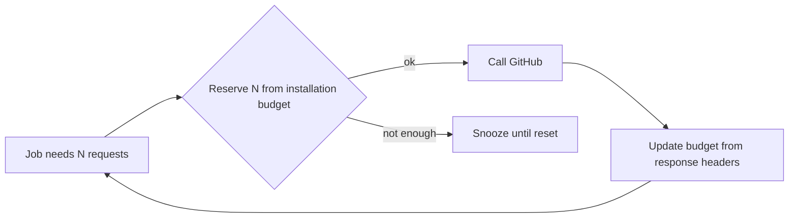

# Scalability

This document states how each part of Gitorgasm scales, what limits it, and the path from one node to several. Numbers come from [workload-model.md](./workload-model.md) and are estimates unless marked **Verified**.

## 1. Summary

| Part          | How it scales                                             | Limit                               | State                                                                                                                                                             |
| ------------- | --------------------------------------------------------- | ----------------------------------- | ----------------------------------------------------------------------------------------------------------------------------------------------------------------- |
| core api      | Horizontal replicas. Stateless.                           | Postgres connections, node memory   | Exists (stateless design). Replica count: Planned manifests.                                                                                                      |
| core worker   | Horizontal replicas plus `WORKER_CONCURRENCY` per replica | GitHub budget and secondary limits  | Exists                                                                                                                                                            |
| PostgreSQL    | Vertical. Partitioning for large tables.                  | One node's disk, memory, and I/O    | Exists (local dev). Cluster: Planned.                                                                                                                             |
| GitHub budget | Per installation. Fixed by GitHub.                        | 5,000–12,500 req/h per installation | **Verified**: [REST rate limits](https://docs.github.com/en/rest/using-the-rest-api/rate-limits-for-the-rest-api#primary-rate-limit-for-github-app-installations) |
| Web app       | Vercel                                                    | Vercel Hobby limits                 | Planned                                                                                                                                                           |

**Decision**: the GitHub rate budget is the true limit of the system. Compute, memory, and Postgres scale far beyond what the budget allows at every scale in workload-model.md §2–3.

## 2. API replicas

**Verified** stateless properties:

- Sessions are rows in Postgres (`sessions`), not process memory (`core/internal/httpapi/auth.go`).
- PKCE verifier and OAuth state are in short-lived cookies, not memory (D8).
- Jobs are enqueued in Postgres (`InsertTx`), not in process queues.
- The only process cache is the installation token cache in `internal/github/client.go`. A cache miss costs one App JWT request. Each replica has its own cache.

Consequences:

- Any replica can serve any request. No sticky sessions.
- Each replica opens up to `DB_MAX_CONNS` Postgres connections (code default 10, **Verified**: `core/internal/config/config.go`. Production ConfigMap sets 8 for the api, **Verified**: `deploy/kustomize/base/config.env`. The worker overrides it to 13, **Verified**: `deploy/kustomize/base/worker.yaml`). The worker needs at least 2 × `WORKER_CONCURRENCY` + 5 and refuses to start below it. **Rule**: replicas × `DB_MAX_CONNS` (api + worker, including surge pods during a rollout) must stay below Postgres `max_connections` minus a reserve for migrate and admin. The manifest sets `max_connections=60` (**Verified**: `deploy/kustomize/base/postgres.yaml`). With one replica each and one surge pod each: 2 × (8 + 13) + 2 (migrate) = 44.
- One api replica already rolls without downtime: `maxSurge: 1`, `maxUnavailable: 0`, readiness gate (**Verified**: `deploy/kustomize/base/api.yaml`). **Planned**: a second api replica only if load requires it. One replica is enough for load (**Estimate**). Recheck the connection rule above first.
- KEDA scale-to-zero is not used for the api (**Decision**): webhook acks must stay inside GitHub's 10 s limit, and a cold start adds latency.

## 3. Worker replicas and River

**Verified** (`core/internal/jobs/jobs.go`):

- River clients in several replicas coordinate through Postgres. Each job is claimed by one worker.
- Per replica, the `default` and `github` queues each run up to `WORKER_CONCURRENCY` jobs (default 4).
- One sync pass runs at a time per installation (session advisory lock). Duplicate triggers within one minute collapse into one job (`ByPeriod: time.Minute`).
- One periodic `reconcile_installations` job is scheduled by the River leader, not by every replica (**Assumption** from River's leader election for periodic jobs).

Scaling rules:

- Total GitHub concurrency = replicas × `WORKER_CONCURRENCY` for the `github` queue. **Decision**: keep it ≤ 20, well under GitHub's 100 concurrent requests (**Verified** limit, REST rate limits page).
- More replicas help only when many installations wait at the same time (for example a reconcile round over 1,000 installations). They do not speed up one installation, because its pass is sequential and locked.
- Rate-limited jobs snooze until reset (`river.JobSnooze`). They do not hold a worker slot while they wait.

## 4. PostgreSQL

| Lever                                      | When                                       | Notes                                                                                                                                      |
| ------------------------------------------ | ------------------------------------------ | ------------------------------------------------------------------------------------------------------------------------------------------ |
| Indexes for every list query               | Now                                        | Keyset index `repositories_listing_idx` exists (**Verified**: `00001_core.sql`).                                                   |
| Retention of `webhook_deliveries` payloads | Now                                        | Largest growth source before Stage 5 (workload-model.md §4). `purge_webhook_deliveries` runs daily (14 days processed, 30 days unprocessed). |
| River completed-job retention              | Now                                        | River cleaner removes completed jobs after 24 h by default (**Verified**: `rivershared@v0.49.0`).                                          |
| Vertical resources                         | When cache hit ratio or query p95 degrades | Limit 1000m / 512Mi (D15). Raise within node headroom.                                                                                     |
| Range partitioning of `signals` by month   | Stage 5                                    | Drop old partitions instead of `DELETE`. Create partitions from a scheduled job, not on the request path (legacy defect, legacy-audit §7). |
| Rollup tables for analytics                | Stage 5+                                   | Precompute per day per repo per user. Read rollups, not raw signals.                                                                       |
| Connection pooler (PgBouncer)              | Only if connection count is the limit      | Not needed at ≤ 4 processes × 10 connections.                                                                                              |
| Read replica                               | Only with a second node                    | No value on one node.                                                                                                                      |

## 5. GitHub budget and fairness

**Verified** facts:

- Budgets are per installation. One org cannot consume another org's primary budget.
- Secondary limits (100 concurrent, 900 REST points/min, content creation ~80/min and 500/h) apply in addition. The docs page does not state whether they are per installation or per app. **Assumption**: treat them as shared across the whole app to be safe.

**Current fairness** (Exists): FIFO-ish River scheduling on the `github` queue, plus one pass at a time per installation. A large org with a long pass holds one worker slot. With 4 slots, three other installations still progress.

**Gaps**:

- A large bulk operation or ingest for one installation could fill all `github` slots (Stage 4–5 risk).
- `gitorgasm_github_rate_limit_remaining{credential}` is a gauge per credential label, not a budget controller (**Verified**: `core/internal/github/client.go`).

**Planned** per-installation budget (Stage 4, before bulk operations):

1. Record `x-ratelimit-remaining`, `x-ratelimit-limit`, and `x-ratelimit-reset` per installation in Postgres or memory.
2. Before a request, reserve from the installation's budget. Keep a floor (for example 10%) for interactive work and webhooks.
3. If the reservation fails, snooze the job until reset.
4. Cap concurrent jobs per installation (River unique keys or an advisory-lock semaphore).
5. Pace content-creating mutations below 80/min per app.
6. Export budget used, reserved, and snoozed jobs as metrics.

## 6. Limits of a single node

| Limit                      | Effect                                                                | Mitigation now                                                                                                                  |
| -------------------------- | --------------------------------------------------------------------- | ------------------------------------------------------------------------------------------------------------------------------- |
| Memory requests ~80% used  | New pods may not schedule. KEDA wake-ups can trigger OOM or eviction. | Small requests (512Mi total), `GOMEMLIMIT`, no extra stateful services (technology-selection.md §3).                            |
| One disk                   | Disk loss loses the database.                                         | restic class-A `pg_dump` every 30 min, offsite to R2 hourly. RPO ≤ ~1 h (D4).                                                   |
| Node reboot or failure     | Full outage.                                                          | Restart-based recovery. Webhooks redeliver from GitHub on request; reconcile repairs missed events (`reconcile_installations`). |
| No HA Postgres             | Upgrades need downtime.                                               | Short maintenance windows. Migrations run before new pods start.                                                                |
| Shared CPU with other apps | Noisy neighbors raise tail latency.                                   | CPU limits 500m per pod. CPU is not the bottleneck (workload-model.md §5).                                                      |

## 7. Path to multi-node

Each step needs a measured trigger. None is planned for a date.

1. **Second node for stateless pods**. Trigger: memory requests prevent scheduling. Action: move api and worker off `vps` affinity. Postgres stays pinned to its PV.
2. **Postgres HA**. Trigger: downtime from the single instance is no longer acceptable. Action: install CloudNativePG, create a `Cluster` with one replica on the second node, move backups to CNPG barman to R2. Re-evaluate the CNPG rejection in technology-selection.md §2.1.
3. **Network storage**. Trigger: PV pinning blocks rescheduling. Action: `hcloud-volumes` StorageClass (present, unused today; cluster-audit.md §6).
4. **Queue split**. Trigger: one queue starves others. Action: separate worker Deployments per queue (service-boundaries.md §5).
5. **External event bus**. Trigger: several services must consume the same events. Action: re-evaluate NATS JetStream.

**Decision**: the GitHub budget model does not change with more nodes. More nodes add availability, not GitHub throughput.
