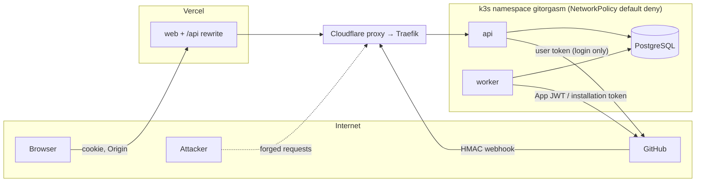

# Security threat model

Status: Stage 1 (Foundation). Scope: `core` (api, worker, migrate roles), PostgreSQL, the GitHub App, the Vercel frontend proxy, CI/CD, and the k3s deployment.

Labels: **Verified** (file path, command, or official URL), **Assumption**, **Decision**, **Planned**. "Now" in the tables means the control exists in code today. Every "Now" cell cites the code.

## 1. Assets

| Asset                  | Where                       | Impact if lost or stolen                                                   |
| ---------------------- | --------------------------- | -------------------------------------------------------------------------- |
| GitHub App private key | Secret `GITHUB_PRIVATE_KEY` | Attacker mints installation tokens for every installation. Highest impact. |
| Webhook secret         | `GITHUB_WEBHOOK_SECRET`     | Attacker forges webhooks (limited: handlers re-read GitHub).               |
| Client secret          | `GITHUB_CLIENT_SECRET`      | Attacker completes OAuth exchanges for stolen codes.                       |
| `TOKEN_ENCRYPTION_KEY` | Secret                      | With a DB copy, attacker opens user tokens.                                |
| User tokens (sealed)   | `sessions`                  | Act as the user on GitHub within App permissions.                          |
| Installation tokens    | worker memory only          | Act as the App on one installation for ≤ 1 h.                              |
| Session ids            | browser cookie; hash in DB  | Impersonate a user in Gitorgasm.                                           |
| Tenant data            | mirror tables               | Private repository names and metadata of other orgs.                       |

## 2. Trust boundaries

## 3. STRIDE threat table

S = Spoofing, T = Tampering, R = Repudiation, I = Information disclosure, D = Denial of service, E = Elevation of privilege.

| #   | Threat                                                             | STRIDE | Mitigation now (code)                                                                                                                                                                                                                                                                                                                                                                                            | Planned                                                                                                                                                                                                                   | Residual risk                                                                               |
| --- | ------------------------------------------------------------------ | ------ | ---------------------------------------------------------------------------------------------------------------------------------------------------------------------------------------------------------------------------------------------------------------------------------------------------------------------------------------------------------------------------------------------------------------- | ------------------------------------------------------------------------------------------------------------------------------------------------------------------------------------------------------------------------- | ------------------------------------------------------------------------------------------- |
| 1   | Cross-tenant access: user reads another org's data                 | I, E   | Grants only from `GET /user/installations` (`store.ReplaceUserInstallations`). Every org route uses `store.AccessibleInstallation` (join on `user_installations`). 404 for unknown and forbidden (`resolveOrg`). No response cache exists, so legacy SEC-1 cannot recur.                                                                                                                                         | Periodic grant re-verification. Optional PostgreSQL RLS (Stage 6). Tenant tests for every new route.                                                                                                                      | Medium-low. Removed members keep read access ≤ 168 h.                                       |
| 2   | Unauthorized GitHub mutation                                       | E      | No mutation endpoint exists. `POST …/sync` only reads GitHub.                                                                                                                                                                                                                                                                                                                                                    | Admin role check via `GET /user/memberships/orgs/{org}` at plan and execute (Stage 4). Dry run. Audit per item. Never invite non-members via `set-membership`.                                                            | Low now. Stage 4 risk depends on the role check.                                            |
| 3   | Privilege escalation inside an org (member acts as admin)          | E      | Not reachable: no admin action exists.                                                                                                                                                                                                                                                                                                                                                                           | Same as #2. Do not trust a cached role for mutations (legacy SEC-3).                                                                                                                                                      | Low now.                                                                                    |
| 4   | Stolen installation token                                          | I, T   | Tokens live only in worker memory (`client.go` `tokens` map), never in DB, logs, or job args. Expire after 1 h. Link-host guard prevents sending tokens to other hosts (`newRequest`).                                                                                                                                                                                                                           | Request tokens scoped to needed permissions and repositories (`apps/create-installation-access-token` accepts `permissions`/`repositories`).                                                                              | Low. 1 h window if a worker is compromised.                                                 |
| 5   | Stolen App private key                                             | S, E   | Stored only as the SOPS-encrypted Kubernetes Secret `gitorgasm-core` in `deploy/argocd/secrets.sops.yaml`. Only the Argo CD repo-server decrypts it. api and worker both load it through `envFrom` (`base/api.yaml`, `base/worker.yaml`).                                                                                                                                                                        | Separate secrets: api does not need the private key if it stops calling App endpoints. Key rotation runbook. Consider GitHub's key revocation.                                                                            | High impact. Mitigated by secret handling only.                                             |
| 6   | Compromised or spoofed webhook endpoint                            | S, T   | HMAC-SHA256 constant-time check, no fail-open (`VerifySignature`; config requires the secret when the App is configured). 25 MB cap. Handlers treat events as hints and re-read GitHub. Only `github_app_authorization` acts on payload data (`store.RevokeGitHubUser` deletes sessions and grants = safe direction).                                                                                            | Alert on rising `invalid_signature` rate.                                                                                                                                                                                 | Low. A forged event can only trigger a sync or a logout.                                    |
| 7   | Session hijacking                                                  | S      | 256-bit ids, HttpOnly, Secure, `__Host-` prefix, SameSite=Lax. Only hashes in DB (`secure.Hash`). No bearer header, no id in JSON (legacy SEC-7). CSP `default-src 'none'` and `no-store` on API responses (`securityHeaders`).                                                                                                                                                                                  | Idle timeout. "Sign out everywhere". Bind session to coarse user-agent hash (optional).                                                                                                                                   | Low. XSS in `web` is the main path; HttpOnly prevents reading the cookie but not riding it. |
| 8   | CSRF                                                               | T      | SameSite=Lax + mandatory `Origin == APP_ORIGIN` on unsafe methods (`checkOrigin`). OAuth `state` + PKCE, constant-time compare.                                                                                                                                                                                                                                                                                  | None.                                                                                                                                                                                                                     | Low.                                                                                        |
| 9   | SSRF                                                               | I      | No user-supplied URL is fetched. API base URLs come from config. `Link` pagination URLs must start with `APIBaseURL + "/"` (`newRequest`). Egress NetworkPolicy `core-egress` allows only PostgreSQL and TCP 443 to public addresses (private, CGNAT, and link-local ranges excluded), plus DNS (`base/networkpolicies.yaml`; deploy Planned).                                                                   | Keep the rule: no endpoint accepts a URL.                                                                                                                                                                                 | Low.                                                                                        |
| 10  | SQL injection                                                      | T, I   | All SQL in `store`, bind parameters only. No string-built SQL.                                                                                                                                                                                                                                                                                                                                                   | Lint rule or review check: no `fmt.Sprintf` into SQL.                                                                                                                                                                     | Low.                                                                                        |
| 11  | Webhook replay                                                     | S, T   | Delivery GUID primary key dedupe (`InsertWebhookDelivery ON CONFLICT DO NOTHING`). Signature required. Idempotent handlers. GitHub sends no signed timestamp.                                                                                                                                                                                                                                                    | Keep processed GUIDs ≥ 14 days (purge job).                                                                                                                                                                               | Low. Replay after purge = one extra sync.                                                   |
| 12  | Queue poisoning (malicious or malformed job)                       | T, D   | Jobs are inserted only by code paths with authenticated causes. Args hold ids only. Invalid webhook payload → `JobCancel` with error stored. Max attempts 8 / 10. Unique jobs bound duplicates.                                                                                                                                                                                                                  | River job metrics and alert on discarded jobs. Admin view of failed jobs.                                                                                                                                                 | Low. Needs DB write access to inject jobs.                                                  |
| 13  | Confused deputy (App acts on a tenant for a user who lacks rights) | E      | User requests resolve an installation only through the user's grant. Workers act only on installation ids from jobs whose cause was authorized.                                                                                                                                                                                                                                                                  | Mutations: check user's org role with the user token, then act with the installation token. Record actor in audit. Legacy fell back to user tokens and mixed cache entries by token type; Gitorgasm has no such fallback. | Medium in Stage 4 if the role check is skipped.                                             |
| 14  | Malicious dependency                                               | T, E   | Small dependency set (`go.mod`). Distroless non-root image. CI runs `govulncheck` (pinned v1.9.0, `core.yml`), `cargo deny` (`scoring.yml`), `pnpm audit --prod` for `web` (`web.yml`), and `pnpm audit` for the root git tooling (`ci.yml` job `tooling`). Third-party GitHub Actions are pinned to commit SHAs. Dependabot config exists (`.github/dependabot.yml`). Image build attaches SBOM and provenance. | Fail-closed license policy for npm dependencies (Rust has `cargo deny`).                                                                                                                                                  | Medium (industry baseline).                                                                 |
| 15  | Compromised CI/CD                                                  | T, E   | `.github/workflows/ci.yml` calls reusable workflows. Workflow default `permissions: contents: read`. The `image` job alone gets `packages: write` and pushes to GHCR only on a qualifying push to `main`. No cluster credentials in this repository's CI. CODEOWNERS exists. Actions are pinned to commit SHAs. PR SHAs reach commitlint through `env`, not inline expressions. actionlint checks the workflows. | Protected `main` with the required `CI` check. Image Updater uses write-back method `argocd` and makes no git commit (ADR 0012).                                                                                          | Medium.                                                                                     |
| 16  | Workload compromise (RCE in api/worker)                            | E, I   | Production manifests use namespace PSA `restricted` enforce, read-only root FS, drop ALL caps, seccomp RuntimeDefault, no service account token, default-deny NetworkPolicies (`deploy/kustomize/base`).                                                                                                                                                                                                         | Split secrets so api lacks the App private key.                                                                                                                                                                           | Medium. Worker holds the App key by necessity.                                              |
| 17  | Insider misuse (operator reads tokens or data)                     | I, R   | Tokens sealed at rest. Session ids hashed. `audit_events` for login, sync request, revocation.                                                                                                                                                                                                                                                                                                                   | Audit of admin DB access. Restic backups encrypted (restic default). Restrict SOPS age keys to the owner.                                                                                                                 | Medium. A cluster admin with both DB and key can open tokens.                               |
| 18  | Repudiation of actions                                             | R      | `audit_events` with actor, action, target, request id, inside the same transaction as the action (`requestSync`, `callback`).                                                                                                                                                                                                                                                                                    | Audit every mutation and every per-item result (Stage 4). Retention 400 days.                                                                                                                                             | Low.                                                                                        |
| 19  | DoS / rate-limit exhaustion                                        | D      | Webhook body cap. At most `maxWebhookReads` (2) unsigned webhook bodies are buffered at once, so raw pre-auth buffers stay at or below 2 × 25 MB. Sync dedupe. Worker concurrency cap (`WORKER_CONCURRENCY`). Snooze on GitHub rate limits. Cloudflare edge in front.                                                                                                                                            | In-app rate limiter per session and per IP (decisions item 19). Proactive GitHub budget floor.                                                                                                                            | Medium. Single node.                                                                        |
| 20  | Open redirect | S | Post-login redirect is the fixed `APP_ORIGIN/organizations` (`callback`); installation returns and redirect query values cannot change it. | Keep caller-supplied redirects disabled. | Low. |
| 21  | Secrets in logs                                                    | I      | Logs carry route, status, request id. GitHub errors log operation, status, kind only (`githubError`). Upstream bodies are not echoed to clients.                                                                                                                                                                                                                                                                 | Log field allow-list test.                                                                                                                                                                                                | Low.                                                                                        |

## 4. Legacy defects that the new design fixes

Source: `legacy-audit.md` §10 and §13. Each row cites the Gitorgasm code that removes the defect.

| Legacy ID | Defect                                                                    | Gitorgasm control                                                                                  | Status                                                                           |
| --------- | ------------------------------------------------------------------------- | -------------------------------------------------------------------------------------------------- | -------------------------------------------------------------------------------- |
| SEC-1     | Cross-org leaderboard leak through response cache before membership check | No response cache. Authorization runs before every read (`resolveOrg`).                            | Fixed by design. Leaderboards are Stage 5: authz must run before any cache read. |
| SEC-2     | Installation-linking IDOR                                                 | No endpoint accepts an installation id. Grants come only from GitHub (`ReplaceUserInstallations`). | Fixed                                                                            |
| SEC-3     | Stale memberships and admin flag                                          | Grants replaced at each login, revoked on uninstall.                                               | Partly fixed. Re-verification and role checks Planned (Stage 2).                 |
| SEC-4     | RLS off with public key in browser                                        | No database key in the browser. Only the server connects. No Supabase.                             | Fixed. RLS is Planned as defense in depth.                                       |
| SEC-5 | Open redirect | Fixed redirect to `APP_ORIGIN/organizations`. | Fixed |
| SEC-6     | Webhook fails open without secret                                         | Signature always required when the App is configured.                                              | Fixed                                                                            |
| SEC-7     | Session id in plain text, as bearer, in JSON                              | Hash stored, cookie only, never in a body.                                                         | Fixed                                                                            |
| SEC-8     | Unauthenticated debug routes                                              | No debug routes.                                                                                   | Fixed                                                                            |
| SEC-9     | Bulk-role invites outsiders as owners                                     | No bulk role yet. Design forbids `set-membership` for non-members (`github-integration.md` §8).    | Planned control                                                                  |
| SEC-10    | Weak secret fallbacks                                                     | `TOKEN_ENCRYPTION_KEY` required, exactly 32 bytes (`config.go`, `secure.NewSealer`).               | Fixed                                                                            |
| SEC-11    | No PKCE, non-constant CSRF compare, insecure cookie outside production    | PKCE S256, `subtle.ConstantTimeCompare`, `COOKIE_SECURE` default true.                             | Fixed                                                                            |
| SEC-12    | Vulnerable `xlsx` in browser                                              | Not carried over. Frontend dependency choice in Stage 4.                                           | Planned control                                                                  |
| SEC-13    | `ilike` wildcard injection on logins                                      | Logins compared with `lower(a.login) = lower($2)`, no `LIKE`.                                      | Fixed for current routes                                                         |
| §6.3      | Owner-less Redis locks, locks succeed without Redis                       | No Redis. River unique jobs and PostgreSQL transactions.                                           | Fixed                                                                            |
| §5.4      | Ingest errors dropped silently, no retry                                  | Errors recorded in `sync_state.last_error`. Classified retry. No tombstone on failure.             | Fixed for repository sync                                                        |

## 5. Review triggers

Re-run this threat model when any of these happen:

- A new GitHub permission is requested.
- A mutation endpoint is added.
- A new service or network path is added (for example the Rust scoring service).
- A cache layer is added in front of tenant data.
