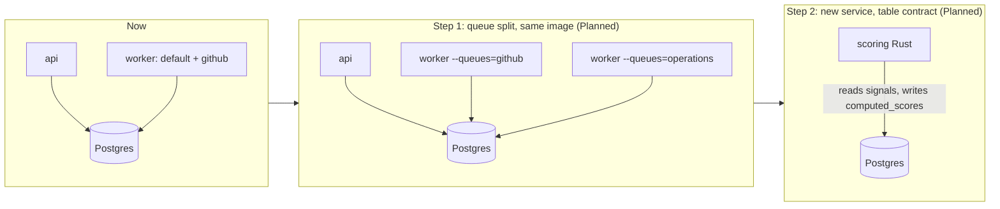

# Service boundaries

This document maps the logical domains of Gitorgasm to Go packages that exist now. It defines data ownership, the signals that justify extracting a domain into its own service, and the extraction strategy.

## 1. Decision: modular monolith first

**Decision** (D1): one Go module `services/core` with one image and three roles (`api`, `worker`, `migrate`). Domains are separated by package and by table ownership, not by process.

### 1.1 Why not seven microservices now

| Reason | Evidence |
|---|---|
| Memory is the binding cluster constraint. Each service adds at least one pod request (~128Mi in this design). Seven services would need ~900Mi before Postgres. | cluster-audit.md §2 (~1,508Mi headroom, ~870Mi worst case) |
| No domain has a different scaling profile today. All are I/O-bound on Postgres or GitHub. | [workload-model.md](./workload-model.md) §5 |
| Transactional enqueue needs the data change and the job row in one Postgres transaction. Splitting services across databases would need sagas or an outbox relay. | `InsertTx` in `services/core/internal/httpapi/orgs.go`, `InsertManyTx` in `httpapi/auth.go` |
| One operator. Each service adds CI, image, manifests, alerts, and upgrades. | Integrator constraint |
| The legacy problems were correctness and security, not deployment coupling. | legacy-audit.md §13 |
| Domain boundaries are not yet proven. Early splits freeze wrong boundaries into network contracts. | **Assumption** based on Stage 3–5 being unbuilt |

**Alternative considered**: one service per domain from the start. Rejected for the reasons above.

## 2. Domains and current packages

| Domain | Responsibility | Go packages now | Tables owned (write) | State |
|---|---|---|---|---|
| identity | GitHub login, sessions, user records, token sealing | `internal/httpapi` (`auth.go`), `internal/secure`, `internal/store` (user and session functions) | `users`, `sessions` | Exists |
| tenancy | Installations, accounts, user→installation grants, access checks | `internal/store` (`UpsertInstallation`, `ReplaceUserInstallations`, `AccessibleInstallation`, `ListOrganizations`) | `accounts`, `installations`, `user_installations` | Exists. Grant re-verification Planned (Stage 2). |
| github-integration | App JWT, tokens, REST calls, pagination, rate-limit classification | `internal/github` | none (in-memory token cache) | Exists |
| sync | Mirror GitHub state, webhook processing, reconcile | `internal/jobs`, `internal/store` (repository and sync functions) | `repositories`, `sync_state`, `webhook_deliveries` | Exists. Members, teams, invitations Planned (Stage 3). |
| operations | Bulk invites, role changes, team adds as jobs with per-item results | none | Planned: operation and item tables | Planned (Stage 4) |
| scoring | Presets, rulesets, score computation | none | Planned: presets, `computed_scores` | Planned (Stage 5) |
| analytics | Signals ingest, rollups, contributor profiles | none | Planned: `signals`, rollup tables | Planned (Stage 5+) |
| audit | Append-only record of security actions | `internal/store` (`Audit`) | `audit_events` | Exists |

Shared infrastructure packages: `internal/config`, `internal/db`, `internal/obs`, `internal/testdb`, `cmd/gitorgasm`.

**Verified**: all SQL lives in `services/core/internal/store/store.go`. **Planned**: when Stage 3 adds tables, split `store` into per-domain files or packages (`store/identity`, `store/sync`, …) so table ownership is visible in the import graph.

## 3. Data ownership rules

- One domain writes each table. Other domains read it through store functions, never by ad hoc SQL in handlers.
- GitHub is the source of truth for mirrored data (`accounts`, `installations`, `repositories`, and Planned members/teams). Gitorgasm rows are a cache with `synced_at` and tombstones (comment in `00001_core.sql`).
- Application-owned data (sessions, audit, Planned presets and operations) has no other source. It must be in backups.
- Every org-scoped read joins `user_installations` (D9).
- Cross-domain writes in one transaction are allowed inside the monolith only for the outbox pattern (data change + job row).

## 4. Extraction criteria

A domain becomes its own service only when at least one signal is measured, and the cost is accepted in a decision record.

| Signal | Threshold (Decision) | How measured |
|---|---|---|
| Different resource profile | CPU or memory of one job kind exceeds the worker limit (500m / 256Mi) or causes GC pauses that hurt other jobs | Planned River job metrics, container metrics |
| Different scaling need | One queue's age stays above its target while others are idle, and adding worker replicas does not fix it | Queue depth and age (workload-model.md §6) |
| Different language need | Benchmark rule in [rust-vs-go.md](./rust-vs-go.md) §5 is met | Benchmark on node `vps` |
| Different failure isolation need | A crash or leak in one domain takes down unrelated features more than once | Incident records |
| Different release cadence | One domain changes weekly while others are stable, and deploys conflict | Git history |
| Security isolation | A domain needs credentials others must not hold (for example `members: write` mutations) | Permission manifest (Planned Stage 2) |

## 5. Extraction strategy per domain

| Domain | Likely first? | Strategy | Contract |
|---|---|---|---|
| scoring | Yes (Stage 5, hypothesis) | New Rust service. Reads `signals` and presets. Writes `computed_scores` in one transaction. Claims work from a jobs table with `FOR UPDATE SKIP LOCKED`. Same database, separate role with grants on its tables only. | Postgres tables + job rows. No RPC. No FFI. |
| operations | Maybe | First as a separate River queue `operations` in the same worker with its own `MaxWorkers`. Then a separate worker Deployment with only that queue enabled. Same image, different flag. | River job args (JSON, versioned) |
| sync | Maybe | Separate worker Deployment running only the `github` queue. Same image. | River job args |
| analytics | Late | Rollups stay in Postgres. A separate store (ClickHouse) only if rollup queries miss targets on real data. | Change data from Postgres |
| webhook ingest | Unlikely | Already minimal: verify, insert, enqueue. Split only if ingress bursts starve api readiness. | `webhook_deliveries` + `process_webhook` job |
| identity, tenancy, audit | No | Stay in core. They are on every request path. | — |

**Decision**: the first extraction step for any Go domain is a **separate Deployment of the same image with a narrower queue set**, not a new codebase. This keeps one contract (River tables) and one build.

**Planned**: a worker flag or env var to select queues. Today `jobs.NewWorkerClient` enables both `default` and `github` queues with the same concurrency (**Verified**).
