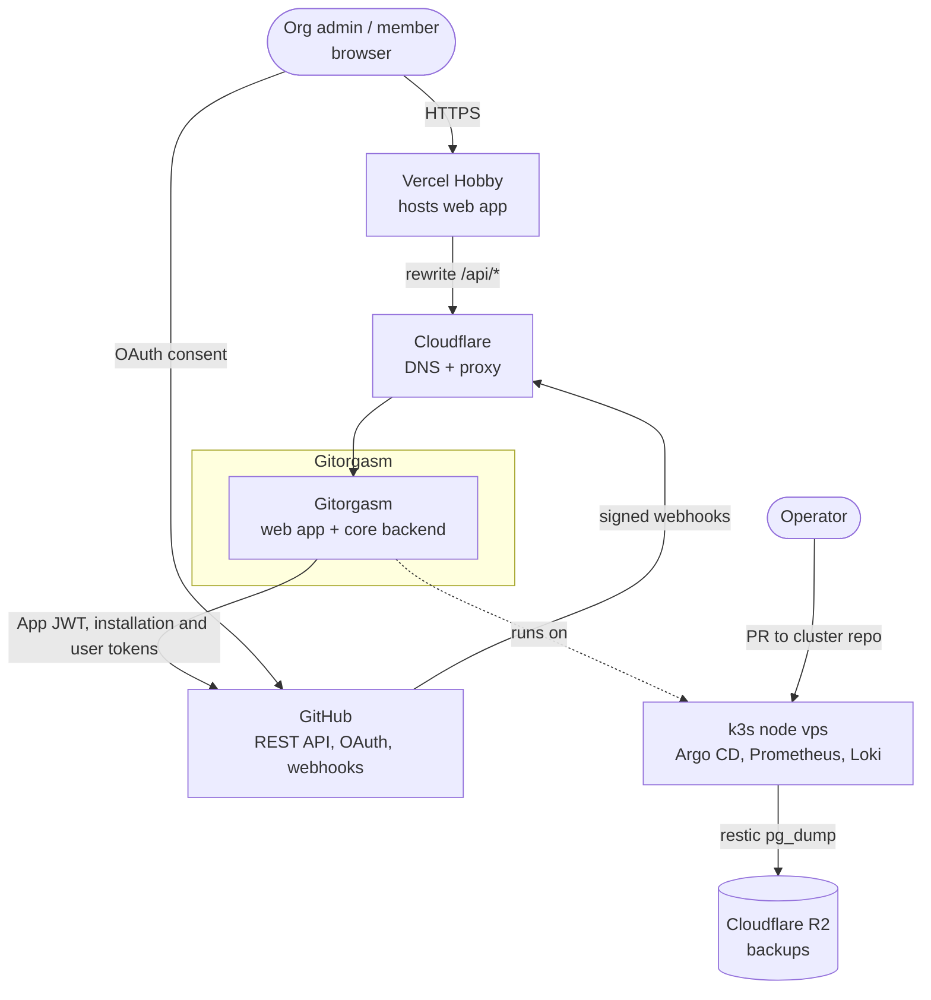
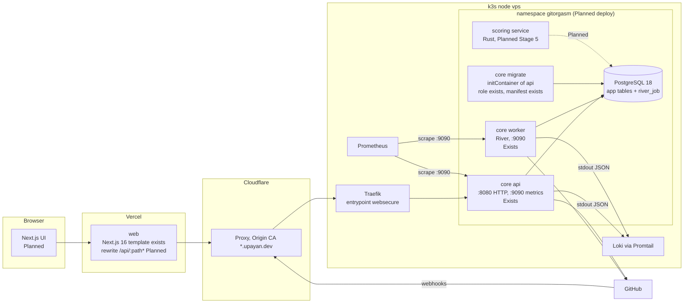
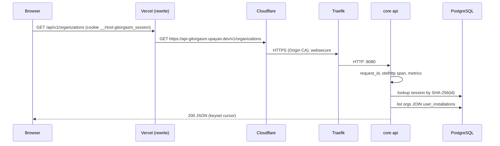
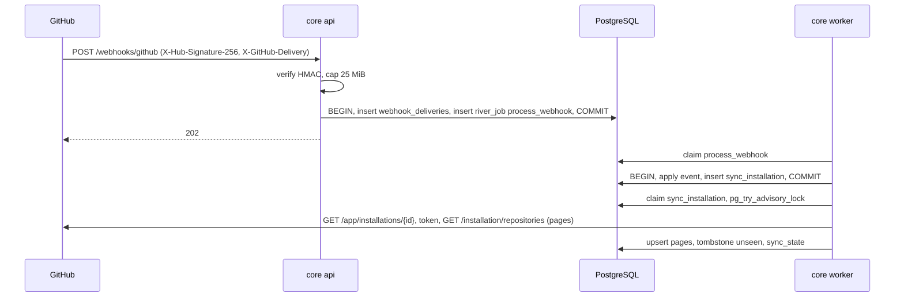

# System architecture

This document shows the system context, the containers, the request path, and the job path. Each element is marked **Exists** (code in this repository) or **Planned**.

## 1. System context

## 2. Containers

## 3. Components

| Component           | Responsibility                                                                                                                                    | State                                                                                                    | Evidence                                                                            |
| ------------------- | ------------------------------------------------------------------------------------------------------------------------------------------------- | -------------------------------------------------------------------------------------------------------- | ----------------------------------------------------------------------------------- |
| `gitorgasm api`     | Auth (login, callback, install redirect, logout), `/v1/me`, org and repository lists, sync request, webhook intake, health                        | Exists                                                                                                   | `core/internal/httpapi/server.go` routes                                            |
| `gitorgasm worker`  | Runs River jobs: `sync_installation`, `process_webhook`, `reconcile_installations`                                                                | Exists                                                                                                   | `core/internal/jobs/jobs.go`                                                        |
| `gitorgasm migrate` | Applies goose and River migrations                                                                                                                | Exists                                                                                                   | `core/cmd/gitorgasm/main.go` (`runMigrate`), `core/internal/db/db.go`               |
| GitHub client       | App JWT, installation token cache, narrow REST calls, rate-limit classification, metrics                                                          | Exists                                                                                                   | `core/internal/github/client.go`                                                    |
| Store               | All SQL                                                                                                                                           | Exists                                                                                                   | `core/internal/store/store.go`                                                      |
| Secure              | Random tokens, AES-256-GCM sealing                                                                                                                | Exists                                                                                                   | `core/internal/secure/secure.go`                                                    |
| Obs                 | slog JSON, Prometheus, OTel                                                                                                                       | Exists                                                                                                   | `core/internal/obs/obs.go`                                                          |
| PostgreSQL          | Only stateful service. App tables and River tables.                                                                                               | Local Compose and production StatefulSet (`postgres:18.6-alpine`, cluster PR #77).                     | `core/internal/db/migrations/`, `deploy/kustomize/base/postgres.yaml`               |
| Web app             | UI, same-origin rewrite                                                                                                                           | Deployed on Vercel; rewrite exists in `web/next.config.ts`. UI/API integration is planned for Stage 2.  | `web/package.json`, `web/next.config.ts`, roadmap Stage 1.5                         |
| Kustomize manifests | Namespace, ConfigMap, Deployments (api with `migrate` initContainer, worker), postgres StatefulSet, Services, NetworkPolicies, Ingress, static PV | Production copy deployed through `upayanmazumder/cluster#77`; future changes require a cluster PR.      | `deploy/kustomize`, `implementation-roadmap.md` Stage 1.5                          |
| Scoring service     | Rust scoring engine                                                                                                                               | Planned, hypothesis                                                                                      | [rust-vs-go.md](./rust-vs-go.md) §5                                                 |

**Decision**: one image serves all three roles so versions cannot drift (comment in `core/cmd/gitorgasm/main.go`).

## 4. Request path

| Hop                                                                                | State                                    | Evidence                                                            |
| ---------------------------------------------------------------------------------- | ---------------------------------------- | ------------------------------------------------------------------- |
| Browser → Vercel rewrite `/api/:path*` → `https://api-gitorgasm.upayan.dev/:path*` | Planned config                           | D7                                                                  |
| Cloudflare proxy, Origin CA wildcard, Traefik `websecure`                          | **Verified** cluster pattern             | cluster-audit.md                                                    |
| Ingress host `api-gitorgasm.upayan.dev`                                            | Planned. DNS record needs user approval. | D15                                                                 |
| api handler, session lookup, tenant join                                           | Exists                                   | `httpapi/auth.go`, `store.LookupSession`, `store.ListOrganizations` |
| Origin check on unsafe methods                                                     | Exists (D10)                             | `httpapi/server.go`                                                 |

**Assumption**: the session cookie reaches the api because the browser sees only the Vercel origin and Vercel forwards the `Cookie` header on rewrites. Verify at Stage 1.5.

## 5. Job path

Other job sources, all **Exists**:

- Login callback enqueues one sync per installation in the session transaction (`httpapi/auth.go`).
- `POST /v1/organizations/{login}/sync` enqueues a sync with an audit row (`httpapi/orgs.go`).
- Periodic `reconcile_installations` enqueues a sync per active installation (`jobs.ReconcileWorker`).

Job semantics (**Verified** in `jobs.go`): sync dedupes per installation per 1-minute window and runs one pass at a time per installation (advisory lock). Rate limits snooze. 401, 403, and other 4xx cancel. Tombstones only after every page succeeds.

## 6. Exists vs Planned

| Area             | Exists now                                                                                                                             | Planned                                                                                                            |
| ---------------- | -------------------------------------------------------------------------------------------------------------------------------------- | ------------------------------------------------------------------------------------------------------------------ |
| Backend roles    | api, worker, migrate                                                                                                                   | scoring service (Rust, Stage 5)                                                                                    |
| Data             | users, sessions, accounts, installations, user_installations, repositories, sync_state, webhook_deliveries, audit_events, River tables | members, teams, invitations (Stage 3); operations and items (Stage 4); signals, presets, computed_scores (Stage 5) |
| Jobs             | sync_installation, process_webhook, reconcile_installations, purge_sessions, purge_webhook_deliveries                                  | membership/team sync, bulk operations, ingest, scoring, audit and tombstone purge                                  |
| Webhooks handled | installation, installation_repositories, repository, github_app_authorization                                                          | organization, member, membership, team, push, pull_request, issues                                                 |
| Observability    | HTTP and GitHub metrics, JSON logs, OTel instrumentation                                                                               | River job metrics, trace backend, alerts                                                                           |
| Delivery         | Local compose, Makefile, CI (`.github/workflows/`), kustomize manifests, image build (push to GHCR on `main` only)                     | Cluster PR, GHCR access decision, DNS, Vercel project and rewrite                                                  |
